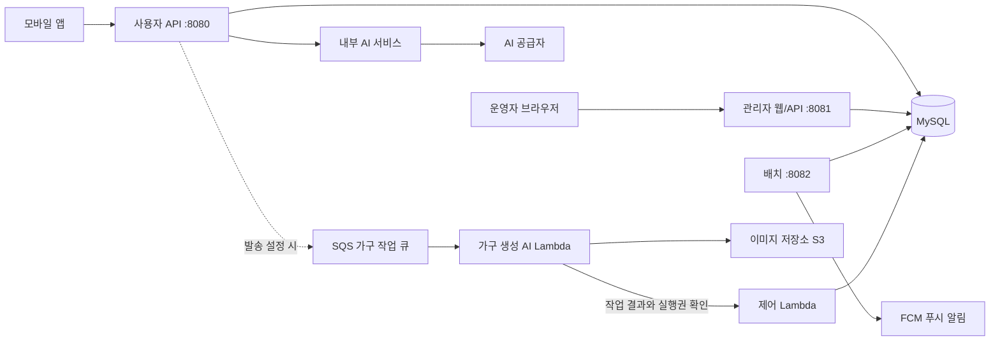
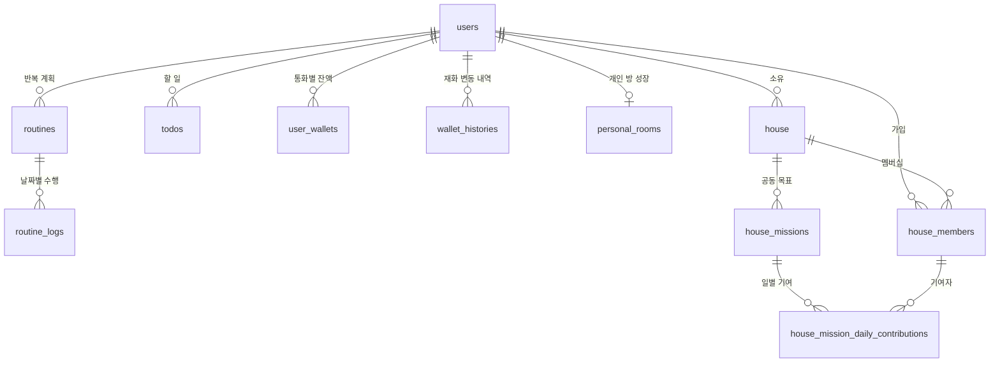
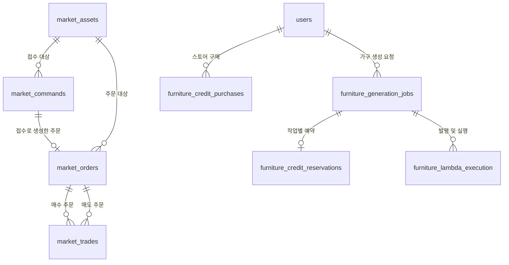
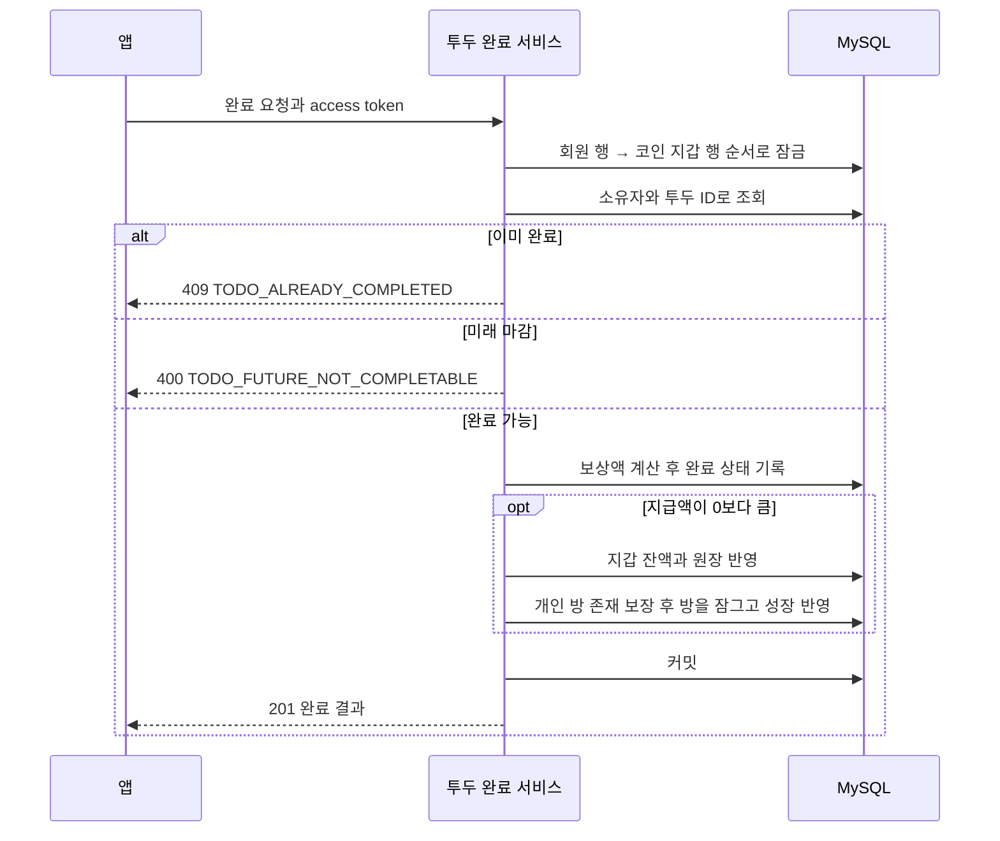
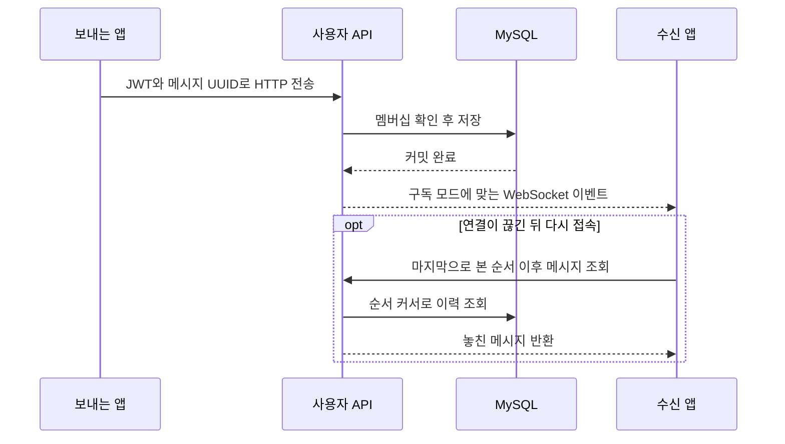
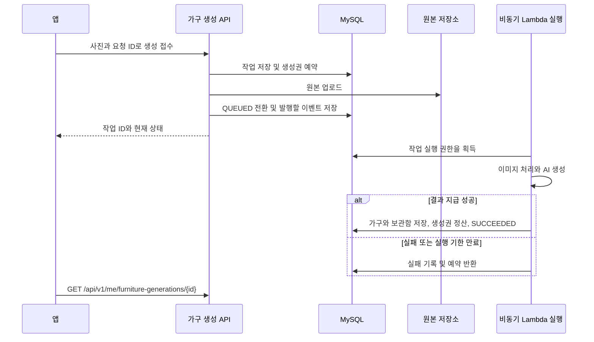
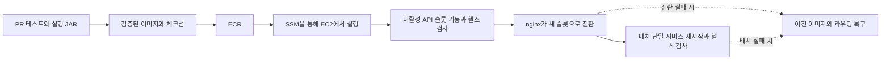
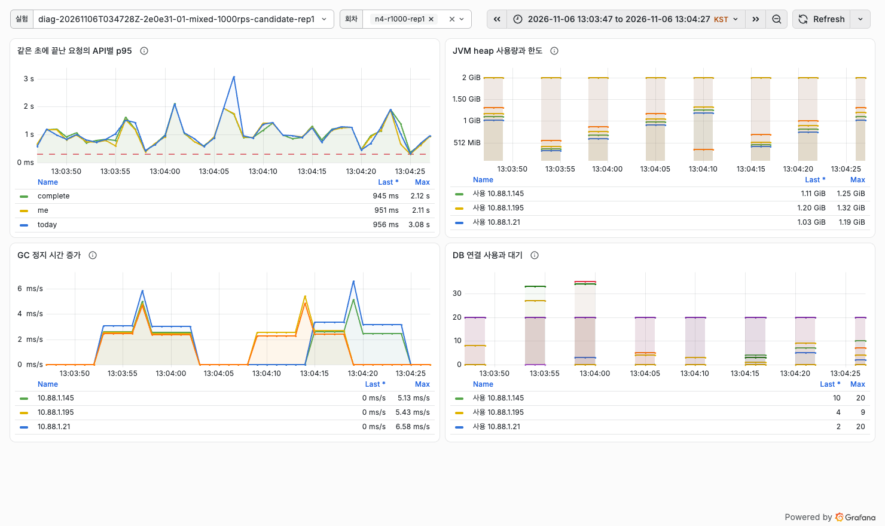

# 루게더 (Rougether) | 소셜 루틴 앱 백엔드

매일 정한 루틴을 수행하고, 같은 집에 사는 사람들과는 공동 미션을 진행할 수 있다. 예를 들어 오늘 마감인 운동을 완료하면 할 일의 상태가 바뀌고, 지급 한도가 남아 있으면 코인과 방 성장 포인트가 반영된다. 같은 집 구성원은 자란 방에 방문하고 방명록을 남길 수 있다. 또한 SNS 피드와 가구를 AI로 생성할 수 있다.

이 저장소에는 모바일 앱이 호출하는 **사용자 API**, 콘텐츠와 회원을 관리하는 **관리자 웹/API**, 알림과 미션 만료를 처리하는 **배치**, 사진을 가구로 변환하는 **Lambda**, 내부 **AI 서비스와 워커**가 있다. React Native 앱의 실행·빌드 안내는 [모바일 저장소](https://github.com/TripleS-soma/rougether-mobile)에 있다.  기능과 데이터 계약의 정본은 [서비스 명세](https://github.com/TripleS-soma/rougether-spec)다.

**찾아보기:** [서비스 구성](#서비스-구성) · [기능과 API](#주요-기능과-api) · [전체 HTTP 목록](#사용자-api-전체-목록) · [도메인별 처리 흐름](#도메인별-처리-흐름) · [데이터 모델](#데이터-모델) · [투두 완료 흐름](#투두-완료와-보상은-어떻게-같이-반영되나) · [로컬 실행](#로컬에서-실행하기) · [테스트와 CI](#테스트와-ci) · [성능과 장애 복구](#성능과-장애-복구) · [트러블슈팅](#트러블슈팅과-변경-이력)

| 프로젝트 정보 | 범위 |
|---|---|
| 이 저장소의 산출물 | Java 백엔드 앱과 라이브러리, Python AI 서비스와 워커, 배포 자동화 및 QA 도구 |
| 개발 배포 경로 | EC2에 사용자·관리자 API와 배치를 배포하는 경로. 외부 요청 경로와 비밀값 주입 방식은 [개발 환경 구성](deploy/terraform/ec2/README.md)에 기록한다. |
| 성능 검증 경로 | ALB와 ECS Fargate, 별도 RDS를 사용한 격리 실험. 개발 배포를 Fargate로 전환했다는 뜻이 아니다. |

## 서비스 구성



그림은 주요 호출을 보여준다. 배치는 모바일 앱이 접속하지 않아도 예정된 작업을 처리하고, 관리자 앱은 사용자 앱과 다른 인증 경로를 쓴다. 개발 배포와 성능 실험에서 트래픽이 들어오는 경로는 [배포와 모니터링](#배포와-모니터링)에 구분했다.

### 프로젝트 구조

백엔드 코드는 한 저장소에 두고, JVM 코드는 [Gradle 멀티모듈](settings.gradle)로 빌드한다. 실행 앱과 공용 라이브러리를 구분했다. Python 서비스는 Gradle 모듈이 아니다.

| 경로 | 책임 |
|---|---|
| `user-api/`, `admin-api/`, `batch/` | 각각 시작할 수 있는 Spring Boot 앱. 사용자 요청, 관리자 작업, 예약 작업의 진입점이 다르다. |
| `domain/`, `common/` | 도메인별 엔티티와 저장소, DB 마이그레이션 / 공통 오류, 값과 프로토콜. 실행 앱이 이 모듈들을 참조한다. |
| `infra/fcm/`, `infra/llm/`, `infra/assets/` | 알림 발송, AI 호출, 에셋 저장소 연동을 담당한다. |
| `furniture-application/`, `furniture-preprocessing/`, `furniture-lambda-*/` | 가구 생성 작업의 상태와 결과를 관리하는 코드, 이미지 전처리, 제어·AI·전처리를 실행하는 Lambda 핸들러다. |
| `ai-service/`, `ai-user-worker/` | 내부 FastAPI 서비스와 AI 계정의 작업을 수행하는 별도 Python 워커다. 가구 생성 Lambda와는 역할이 다르다. |
| `deploy/`, `qa/`, `tools/` | 인프라와 배포 스크립트, 재현 가능한 테스트 시나리오, 에셋 검증·등록 등 운영 도구다. |

각 앱 안에서는 먼저 기능으로 나눈다. 예를 들어 사용자 API의 `todo/web`에서 요청을 받고, `todo/service`에서 완료 규칙을 적용하고, `domain`의 저장소를 통해 기록한다. 같은 데이터를 쓰더라도 사용자 요청과 관리자 조작의 권한은 각 진입점에서 검사한다.

### 어느 패키지를 먼저 열어야 하나?

새 기능을 찾을 때는 앱 → 도메인 → 역할 순서로 내려간다. 아래는 투두 완료와 가구 생성 요청을 따라갈 때 실제로 거치는 경로다.

```text
user-api/src/main/java/com/triples/rougether/userapi/
  todo/web/             HTTP 메서드, 경로, 인증된 회원
  todo/service/         완료 여부와 기한 판정, 보상·방 성장 호출
  todo/dto/             앱이 받는 완료 결과
  furniture/service/    사진 접수, 작업 조회, SQS 전달
domain/src/main/
  java/com/triples/rougether/domain/    엔티티, 소유권 조회, 잠금 쿼리
  resources/db/migration/              테이블·인덱스·제약 변경 순서
furniture-application/                 가구 실행권, 단계 결과와 정산
admin-api/                             관리자 전용 화면과 API
batch/                                 일정에 맞춰 실행하는 작업
```

예를 들어 완료 응답의 JSON만 달라진다면 DTO와 컨트롤러 계약을 먼저 확인한다. 반대로 ‘완료는 됐는데 코인이 지급되지 않았다’면 응답 포맷보다 완료 서비스, 지급 규칙, 지갑 원장, 롤백 테스트를 먼저 확인해야 한다. 테이블 변경은 엔티티 수정만으로 배포하지 않고 Flyway 이력을 함께 남긴다.

### 기술과 쓰임새

| 구분 | 적용 기술 | 이 프로젝트에서 쓰는 곳 |
|---|---|---|
| 서버 | Java 25, Spring Boot 4.1.0, Gradle 9.5.1 | 앱을 모듈 단위로 빌드한다. Spring MVC는 HTTP 요청을, Spring Batch는 정기 작업을 처리한다. |
| 데이터 | MySQL 8.4, Spring Data JPA, Flyway | 사용자 활동, 소유권과 보상 원장을 영속화한다. [마이그레이션](domain/src/main/resources/db/migration)에 스키마 변경 순서를 남긴다. |
| 인증과 API 계약 | Spring Security, JWT, springdoc OpenAPI | 모바일 소셜 로그인과 관리자 세션을 분리하고, 사용자 API의 실제 요청 모델을 Swagger UI로 확인한다. |
| AI와 이미지 | Python, FastAPI, AWS Lambda, S3 | 모델 호출과 이미지 처리를 분리한다. 가구와 방 에셋에는 객체 키와 메타데이터를 저장한다. |
| 품질과 운영 | JUnit, Testcontainers, k6, Grafana, CloudWatch | 실제 MySQL 동작을 테스트하고, 부하 중에는 HTTP 지연을 JVM 힙, GC, 커넥션 풀, DB 지표와 같은 시간축에서 읽는다. |

## 주요 기능과 API

아래는 모바일 앱이 호출하는 대표 경로다. 표에서 공통 접두사 `/api/v1`을 생략했다.

| 사용자가 하는 일 | 대표 요청 | 구현 |
| --- | --- | --- |
| 소셜 로그인 후 내 정보, 목표와 대표 캐릭터 설정 | `POST /auth/kakao`, `GET /me`, `PUT /onboarding/goals` | [인증](user-api/src/main/java/com/triples/rougether/userapi/auth/web/AuthController.java), [온보딩](user-api/src/main/java/com/triples/rougether/userapi/onboarding/web/OnboardingController.java) |
| 반복 루틴과 투두를 만들고 오늘 일정과 월별 달력 확인 | `POST /routines`, `POST /todos`, `GET /today`, `GET /calendar/month` | [루틴](user-api/src/main/java/com/triples/rougether/userapi/routine/web/RoutineController.java), [투두](user-api/src/main/java/com/triples/rougether/userapi/todo/web/TodoController.java), [캘린더](user-api/src/main/java/com/triples/rougether/userapi/calendar/web/CalendarController.java) |
| 완료로 성장한 내 방을 꾸미고, 공동 집에 가입해 단체 미션에 기여 | `GET /rooms/me`, `PUT /rooms/me/layout`, `POST /houses/join-by-code`, `POST /houses/{houseId}/missions/{missionId}/contribute` | [방](user-api/src/main/java/com/triples/rougether/userapi/room/web/RoomController.java), [집](user-api/src/main/java/com/triples/rougether/userapi/house/web/HouseController.java), [단체 미션](user-api/src/main/java/com/triples/rougether/userapi/house/web/HouseMissionController.java) |
| 코인으로 상점에서 아이템을 사고, 뽑기와 시장 주문 이용 | `GET /me/wallets`, `POST /items/{itemId}/purchase`, `POST /gacha/{id}/draw`, `POST /market/orders` | [상점](user-api/src/main/java/com/triples/rougether/userapi/shop/web/ShopController.java), [뽑기](user-api/src/main/java/com/triples/rougether/userapi/gacha/web/GachaController.java), [시장 주문](https://github.com/TripleS-soma/rougether-server/blob/main/user-api/src/main/java/com/triples/rougether/userapi/market/web/MarketOrderController.java) |
| 가구 생성에 쓸 이용권을 구매하고 AI 가구 생성 결과 확인 | `POST /me/furniture-credits/purchases`, `POST /me/furniture-generations`, `GET /me/furniture-generations/{id}` | [결제](https://github.com/TripleS-soma/rougether-server/blob/main/user-api/src/main/java/com/triples/rougether/userapi/billing/web/FurnitureBillingController.java), [가구 생성](https://github.com/TripleS-soma/rougether-server/blob/main/user-api/src/main/java/com/triples/rougether/userapi/furniture/web/FurnitureGenerationController.java) |
| 집 채팅방에 메시지를 보내고 실시간 변경을 구독하거나 피드에 글 작성 | `POST /chat/rooms/{roomId}/messages`, `/chat/ws` (WebSocket), `POST /feed/posts` | [채팅 구독](https://github.com/TripleS-soma/rougether-server/blob/main/user-api/src/main/java/com/triples/rougether/userapi/chat/realtime/ChatSocketHandler.java), [피드](https://github.com/TripleS-soma/rougether-server/blob/main/user-api/src/main/java/com/triples/rougether/userapi/feed/web/FeedController.java) |
| 푸시를 받을 기기 등록, 알림 확인, 알림 설정 변경 | `POST /users/me/device-tokens`, `GET /notifications`, `PATCH /users/me/notification-settings` | [푸시와 알림](user-api/src/main/java/com/triples/rougether/userapi/notification/web) |
| 출석 체크, 미니게임, 주간 리포트와 루틴 추천 확인 | `POST /events/attendance/check-ins`, `GET /minigames`, `GET /reports/weekly`, `GET /recommendations` | [출석](https://github.com/TripleS-soma/rougether-server/blob/main/user-api/src/main/java/com/triples/rougether/userapi/attendance/web/AttendanceEventController.java), [미니게임](https://github.com/TripleS-soma/rougether-server/blob/main/user-api/src/main/java/com/triples/rougether/userapi/minigame/web/MinigameController.java), [리포트](https://github.com/TripleS-soma/rougether-server/blob/main/user-api/src/main/java/com/triples/rougether/userapi/report/web/WeeklyReportController.java), [추천](https://github.com/TripleS-soma/rougether-server/blob/main/user-api/src/main/java/com/triples/rougether/userapi/recommendation/web/RecommendationController.java) |

방 방문과 방명록, 초대 링크, 사용자 차단과 콘텐츠 신고, 버그 제보, 앱 아이콘 설정도 사용자 API에 포함된다. [방명록](user-api/src/main/java/com/triples/rougether/userapi/guestbook/web) · [초대 링크](https://github.com/TripleS-soma/rougether-server/tree/main/user-api/src/main/java/com/triples/rougether/userapi/invitelink/web) · [신고와 차단](https://github.com/TripleS-soma/rougether-server/tree/main/user-api/src/main/java/com/triples/rougether/userapi/moderation/web) · [버그 제보](user-api/src/main/java/com/triples/rougether/userapi/bugreport/web) · [앱 아이콘](https://github.com/TripleS-soma/rougether-server/tree/main/user-api/src/main/java/com/triples/rougether/userapi/appicon/web)

### 사용자 API 전체 목록

아래는 2026-11-07 기본 브랜치(`a990f97e`)의 사용자 앱을 기본 `local` 프로필로 부팅해 `/v3/api-docs`에서 읽은 **139개 경로, 177개 HTTP 작업**이다. 한 경로의 GET과 POST는 별개 작업이다. 경로에는 공통 접두사 `/api/v1`을 생략했다. 관리자 포트, 별도로 인증하는 내부 API, WebSocket 이벤트는 이 목록 밖이다. 문서에 보이는 경로가 모든 환경에서 허용된다는 뜻은 아니다. 요청 본문과 응답 스키마는 [로컬 Swagger UI](http://localhost:8080/swagger-ui/index.html)에서 확인한다.

<details>
<summary>로그인, 회원, 온보딩과 초대 (29개 작업)</summary>

| 기능 | 메서드와 경로 |
|---|---|
| 애플 로그인 | `POST /auth/apple` |
| 개발용 로그인 | `POST /auth/dev-login` |
| 구글 로그인 | `POST /auth/google` |
| 카카오 로그인 | `POST /auth/kakao` |
| 로그아웃 | `POST /auth/logout` |
| 토큰 재발급 | `POST /auth/refresh` |
| 내 정보 조회 | `GET /me` |
| 회원정보 수정 | `PUT /me` |
| 언어·개인 리마인드 시간대 수정 | `PATCH /me` |
| 회원탈퇴 | `DELETE /me` |
| 프로필 사진 등록·교체 | `PUT /me/profile-image` |
| 프로필 사진 삭제 | `DELETE /me/profile-image` |
| 캐릭터 마스터 목록 조회 | `GET /characters` |
| 목표 마스터 목록 조회 | `GET /goals` |
| 온보딩 상태 조회 | `GET /onboarding` |
| 대표 캐릭터 선택 (온보딩) | `PUT /onboarding/character` |
| 온보딩 목표 선택 저장 | `PUT /onboarding/goals` |
| 온보딩 집 선택 결과 조회 | `GET /onboarding/house` |
| 온보딩 집 선택 | `PUT /onboarding/house` |
| 초대코드 미리보기 | `GET /invites/by-code/{code}` |
| 내 초대코드 조회 | `GET /invites/me` |
| 초대코드 사용 | `POST /invites/redeem` |
| 내 보유 캐릭터 목록 조회 | `GET /me/characters` |
| 착용 캐릭터 교체 | `PUT /me/characters/select` |
| 캐릭터 악세사리 적용 | `PUT /me/characters/{userCharacterId}/accessories` |
| 캐릭터 악세사리 해제 | `DELETE /me/characters/{userCharacterId}/accessories/{characterSlotType}` |
| 실제 앱 foreground 활동 기록 | `POST /me/app-activity` |
| 내 앱 아이콘 상태 조회 | `GET /me/app-icon` |
| 사용자 API 상태 확인 | `GET /health` |

</details>

<details>
<summary>루틴, 투두, 일정과 회고 (32개 작업)</summary>

| 기능 | 메서드와 경로 |
|---|---|
| 내 카테고리 목록 조회 | `GET /categories` |
| 카테고리 생성 | `POST /categories` |
| 카테고리 수정 | `PUT /categories/{id}` |
| 카테고리 삭제 | `DELETE /categories/{id}` |
| 카테고리 집 연동 해제 | `DELETE /categories/{id}/house-link` |
| 내 루틴 목록 조회 | `GET /routines` |
| 루틴 등록 | `POST /routines` |
| 유사 루틴·투두 비교(캘린더 임포트 힌트) | `POST /routines/similarity` |
| 루틴 단건 조회 | `GET /routines/{id}` |
| 루틴 수정 | `PUT /routines/{id}` |
| 루틴 삭제 | `DELETE /routines/{id}` |
| 루틴 단체미션 연동 해제 | `DELETE /routines/{id}/house-mission-link` |
| 루틴 완료 체크 | `POST /routines/{id}/logs` |
| 루틴 완료 취소 | `DELETE /routines/{id}/logs` |
| 내 투두 목록 조회 | `GET /todos` |
| 투두 등록 | `POST /todos` |
| 투두 단건 조회 | `GET /todos/{id}` |
| 투두 수정 | `PUT /todos/{id}` |
| 투두 삭제 | `DELETE /todos/{id}` |
| 투두 완료 체크 | `POST /todos/{id}/complete` |
| 투두 완료 취소 | `DELETE /todos/{id}/complete` |
| 오늘 현황 조회 | `GET /today` |
| 캘린더 날짜별 루틴·투두 조회 | `GET /calendar` |
| 캘린더 월별 루틴·투두 전체·완료 개수 조회 | `GET /calendar/month` |
| 조정 추천 목록 조회 | `GET /recommendations` |
| 조정 추천 수락 | `POST /recommendations/{recommendationId}/accept` |
| 조정 추천 무시 | `POST /recommendations/{recommendationId}/dismiss` |
| 피드 댓글 신고 | `POST /feed/posts/{postId}/comments/{commentId}/reports` |
| 피드 게시물 신고 | `POST /feed/posts/{postId}/reports` |
| 거래소 종목(가구) 신고 | `POST /market/assets/{assetId}/reports` |
| 주간 회고 목록 조회 | `GET /reports/weekly` |
| 주간 회고 상세 조회 | `GET /reports/weekly/{reportId}` |

</details>

<details>
<summary>개인 방, 공동집, 집 미션과 구성원 (41개 작업)</summary>

| 기능 | 메서드와 경로 |
|---|---|
| 내 방 조회 | `GET /rooms/me` |
| 내 방 거미줄 청소 | `POST /rooms/me/cobweb/clean` |
| 내 방 자유배치 저장 | `PUT /rooms/me/layout` |
| 내 방 슬롯 배치 저장 | `PUT /rooms/me/slots` |
| 방명록 목록 조회 | `GET /rooms/{roomOwnerId}/guestbooks` |
| 방명록 작성 | `POST /rooms/{roomOwnerId}/guestbooks` |
| 집 탐색 목록 조회 | `GET /houses` |
| 공동집 생성 | `POST /houses` |
| 초대코드로 집 미리보기 | `GET /houses/by-code/{inviteCode}` |
| 집 커버 이미지 목록 조회 | `GET /houses/cover-images` |
| 초대코드로 집 참여 | `POST /houses/join-by-code` |
| 집 상세 조회 | `GET /houses/{houseId}` |
| 집 설정 수정 | `PUT /houses/{houseId}` |
| 온보딩 자동 입주 설정 조회 | `GET /houses/{houseId}/auto-join` |
| 온보딩 자동 입주 설정 변경 | `PUT /houses/{houseId}/auto-join` |
| 초대코드 재발급 | `POST /houses/{houseId}/invite-code` |
| 입주 신청 (구버전 호환 경로) | `POST /houses/{houseId}/join` |
| 대기 중인 입주 신청 목록 | `GET /houses/{houseId}/join-requests` |
| 입주 신청 | `POST /houses/{houseId}/join-requests` |
| 입주 신청 수락 | `POST /houses/{houseId}/join-requests/{requestId}/accept` |
| 입주 신청 거절 | `POST /houses/{houseId}/join-requests/{requestId}/reject` |
| 구성원 목록 조회 | `GET /houses/{houseId}/members` |
| 집 탈퇴 | `DELETE /houses/{houseId}/members/me` |
| 구성원 강퇴 | `DELETE /houses/{houseId}/members/{membershipId}` |
| 집 미리보기 (비구성원 가능) | `GET /houses/{houseId}/preview` |
| 소유권 양도 | `POST /houses/{houseId}/transfer-ownership` |
| 내 집 목록 조회 | `GET /me/houses` |
| 내 집 순서 변경 | `PUT /me/houses/order` |
| 내가 보낸 입주 신청 목록 조회 | `GET /me/join-requests` |
| 입주 신청 철회 | `DELETE /me/join-requests/{requestId}` |
| 단체 미션 목록 조회 | `GET /houses/{houseId}/missions` |
| 단체 미션 등록 | `POST /houses/{houseId}/missions` |
| 단체 미션 상세 조회 | `GET /houses/{houseId}/missions/{missionId}` |
| 단체 미션 삭제 | `DELETE /houses/{houseId}/missions/{missionId}` |
| 단체 미션 보상 받기 | `POST /houses/{houseId}/missions/{missionId}/claim` |
| 단체 미션 수행 체크 (기여) | `POST /houses/{houseId}/missions/{missionId}/contribute` |
| 집 멤버에게 응원 보내기 | `POST /houses/{houseId}/members/{membershipId}/cheer` |
| 집 멤버 그날 현황 조회 (루틴 + 투두, 완료 여부 포함) | `GET /houses/{houseId}/members/{membershipId}/day` |
| 집 멤버 방 조회 | `GET /houses/{houseId}/members/{membershipId}/room` |
| 집 멤버 방 거미줄 청소 | `POST /houses/{houseId}/members/{membershipId}/room/cobweb/clean` |
| 집 멤버 루틴 완료 내역 조회 | `GET /houses/{houseId}/members/{membershipId}/routine-completions` |

</details>

<details>
<summary>상점, 거래소, 재화와 가구 생성 (33개 작업)</summary>

| 기능 | 메서드와 경로 |
|---|---|
| 상점 아이템 목록 조회 | `GET /items` |
| 아이템 구매 | `POST /items/{itemId}/purchase` |
| 인벤토리 조회 | `GET /me/items` |
| 뽑기 머신 목록 조회 | `GET /gacha` |
| 뽑기 머신 상세 조회 | `GET /gacha/{id}` |
| 뽑기 실행 | `POST /gacha/{id}/draw` |
| 뽑기 보상 목록 조회 | `GET /gacha/{id}/rewards` |
| 내 재화 잔액 조회 | `GET /me/wallets` |
| 내 재화 증감 이력 조회 | `GET /me/wallets/histories` |
| 거래소 종목 목록 조회 | `GET /market/assets` |
| AI 가구 발행 | `POST /market/assets` |
| 거래소 종목 상세 조회 | `GET /market/assets/{assetId}` |
| 거래소 최근 체결 조회 | `GET /market/assets/{assetId}/trades` |
| 주문 접수 결과 조회 | `GET /market/commands/{commandId}` |
| 주문 접수 | `POST /market/orders` |
| 발행 재고 판매 주문 수량 수정 접수 | `POST /market/orders/{orderId}/amend` |
| 주문 취소 접수 | `POST /market/orders/{orderId}/cancel` |
| 내 판매 관리 가구 | `GET /me/market/assets` |
| 내 거래소 주문 목록 조회 | `GET /me/market/orders` |
| 고정가 상품 목록 | `GET /market/shop` |
| 내가 만든 가구 판매 등록 | `POST /market/shop` |
| 고정가 상품 상세 | `GET /market/shop/{id}` |
| 내 고정가 상품 수정 | `PUT /market/shop/{id}` |
| 표시 가격으로 즉시 구매 | `POST /market/shop/{id}/purchase` |
| 내 최근 가구 생성 작업 20개 | `GET /me/furniture-generations` |
| 가구 생성 작업 접수 | `POST /me/furniture-generations` |
| 가구 생성 상태 조회 | `GET /me/furniture-generations/{id}` |
| 완성 가구 재검토 | `POST /me/furniture-generations/{id}/feedback` |
| 가구 생성 이용권 잔액 | `GET /me/furniture-credits` |
| 가구 이용권 상품 목록 | `GET /me/furniture-credits/products` |
| 스토어 구매 검증 및 가구 이용권 지급 | `POST /me/furniture-credits/purchases` |
| Apple 결제 알림 수신 | `POST /billing/notifications/apple` |
| Google 결제 알림 수신 | `POST /billing/notifications/google` |

</details>

<details>
<summary>피드, 채팅, 차단과 알림 (33개 작업)</summary>

| 기능 | 메서드와 경로 |
|---|---|
| 피드 사진 한 장 업로드 | `POST /feed/images` |
| 피드 사진 조회 | `GET /feed/images/{imageId}` |
| 미사용 업로드 취소 | `DELETE /feed/images/{imageId}` |
| 전체 또는 작성자별 최신 피드 | `GET /feed/posts` |
| 게시물 등록 | `POST /feed/posts` |
| 게시물 상세 | `GET /feed/posts/{postId}` |
| 내 게시물 수정 | `PATCH /feed/posts/{postId}` |
| 내 게시물 삭제 | `DELETE /feed/posts/{postId}` |
| 댓글 목록 | `GET /feed/posts/{postId}/comments` |
| 댓글·대댓글 등록 | `POST /feed/posts/{postId}/comments` |
| 내 댓글 삭제 | `DELETE /feed/posts/{postId}/comments/{commentId}` |
| 대댓글 목록 | `GET /feed/posts/{postId}/comments/{commentId}/replies` |
| 좋아요 | `PUT /feed/posts/{postId}/like` |
| 좋아요 취소 | `DELETE /feed/posts/{postId}/like` |
| 채팅방 상세 조회 | `GET /chat/rooms/{roomId}` |
| 메시지 이력 조회 | `GET /chat/rooms/{roomId}/messages` |
| 메시지 보내기 | `POST /chat/rooms/{roomId}/messages` |
| 채팅 알림 설정 조회 | `GET /chat/rooms/{roomId}/notification` |
| 채팅 알림 설정 변경 | `PUT /chat/rooms/{roomId}/notification` |
| 읽음 위치 갱신 | `PUT /chat/rooms/{roomId}/read` |
| 집 채팅방 열기 | `POST /houses/{houseId}/chat-room` |
| 내가 차단한 사용자 목록 | `GET /me/blocks` |
| 사용자 차단 | `PUT /users/{userId}/block` |
| 사용자 차단 해제 | `DELETE /users/{userId}/block` |
| 알림 목록 조회 | `GET /notifications` |
| 알림 전체 삭제 | `DELETE /notifications` |
| 알림 전체 읽음 처리 | `PATCH /notifications/read-all` |
| 알림 개별 삭제 | `DELETE /notifications/{notificationId}` |
| 알림 읽음 처리 | `PATCH /notifications/{notificationId}/read` |
| 디바이스 토큰 등록 | `POST /users/me/device-tokens` |
| 디바이스 토큰 삭제 | `DELETE /users/me/device-tokens` |
| 알림 설정 조회 | `GET /users/me/notification-settings` |
| 알림 설정 변경 | `PATCH /users/me/notification-settings` |

</details>

<details>
<summary>출석, 미니게임과 버그 제보 (9개 작업)</summary>

| 기능 | 메서드와 경로 |
|---|---|
| 현재 연속 출석 이벤트 상태 조회 | `GET /events/attendance` |
| 오늘 출석 체크 | `POST /events/attendance/check-ins` |
| 이용 가능한 미니게임 목록 | `GET /minigames` |
| 게임별 전체 사용자 랭킹 | `GET /minigames/{gameCode}/leaderboard` |
| 게임 시작 | `POST /minigames/{gameCode}/runs` |
| 플레이 기록 제출 | `POST /minigames/{gameCode}/runs/{runId}/finish` |
| 버그 제보 제출 | `POST /bug-reports` |
| 내 버그 제보 목록 | `GET /me/bug-reports` |
| 내 버그 제보 스크린샷 조회 | `GET /me/bug-reports/screenshots` |

</details>

### 관리자와 연동 문서

관리자 웹은 회원 목록과 가입 퍼널을 조회하고, 신고와 금칙어, 캐릭터·에셋, 지급 작업을 운영하는 별도 앱이다. 모바일 회원의 access token으로 관리자 화면에 들어가는 구조가 아니다. [관리자 기능 소스](admin-api/src/main/java/com/triples/rougether/adminapi) · [제품 지표의 정의와 집계 범위](https://github.com/TripleS-soma/rougether-server/blob/main/docs/operations/product-metrics.md)

전체 계약은 [도메인 API 명세](https://github.com/TripleS-soma/rougether-spec/blob/main/api.md)와 [데이터 모델 명세](https://github.com/TripleS-soma/rougether-spec/blob/main/erd.md)에서 확인할 수 있다. 실행 중인 사용자 API가 받는 요청과 필드는 로컬 Swagger UI와 [OpenAPI JSON](http://localhost:8080/v3/api-docs)에서 확인한다.

## 인증과 권한

| 경로 | 인증 및 접근 기준 |
| --- | --- |
| 모바일 앱 | 카카오, 구글, 애플 로그인 후 받은 access token을 `Authorization: Bearer …`로 보낸다. 사용자 API는 JWT에서 회원을 식별한다. 토큰 갱신과 로그아웃은 각각 `POST /api/v1/auth/refresh`, `POST /api/v1/auth/logout`이다. 투두는 요청자의 `userId`와 `todoId`를 함께 조회하며, 집 가입 승인에는 집 소유자 검사가 추가된다. [인증 설정](user-api/src/main/java/com/triples/rougether/userapi/global/config/SecurityConfig.java), [집 가입 처리](user-api/src/main/java/com/triples/rougether/userapi/house/service/HouseJoinService.java) |
| 채팅, 스토어 콜백, AI 내부 연동 | 채팅은 WebSocket의 첫 프레임에서 JWT와 대화방 접근 권한을 확인한다. Apple과 Google의 결제 알림은 각각 서명과 OIDC를 검증한다. `/internal/ai-users/**`는 별도 서비스 토큰으로 보호한다. [채팅](https://github.com/TripleS-soma/rougether-server/blob/main/user-api/src/main/java/com/triples/rougether/userapi/chat/realtime/ChatSocketHandler.java), [결제 알림](https://github.com/TripleS-soma/rougether-server/blob/main/user-api/src/main/java/com/triples/rougether/userapi/billing/web/BillingNotificationController.java), [AI 내부 API](https://github.com/TripleS-soma/rougether-server/blob/main/user-api/src/main/java/com/triples/rougether/userapi/aiuser/web/AiUserController.java) |
| 관리자 화면 | 별도 애플리케이션에서 관리자 계정과 암호를 검증하고 폼 로그인 세션을 사용한다. 사용자 활동, 추천 관리 등 지정된 화면은 `ADMIN` 또는 `SUPER_ADMIN` 역할을 요구한다. [관리자 보안 설정](admin-api/src/main/java/com/triples/rougether/adminapi/global/config/AdminSecurityConfig.java) |

### 동시에 들어온 토큰 갱신

모바일에서는 서버가 새 토큰을 보냈어도 앱이 응답을 받기 전에 백그라운드로 전환될 수 있다. 재시도를 전부 탈취로 보면 정상 사용자가 로그아웃되고, 반대로 무조건 재발급하면 이미 폐기된 토큰을 계속 쓸 수 있다.

| 갱신 시 제시된 토큰 | 서버의 처리 |
|---|---|
| 유효한 기기 계열 토큰이며 만료까지 여유가 있음 | access token만 새로 발급하고 기존 refresh token을 반환한다. |
| 만료 임박 또는 계열 정보가 없는 기존 형식 | 회전한다. 같은 토큰으로 동시에 들어온 요청은 토큰 행 잠금으로 순서대로 판정한다. |
| 회전 직후 응답 유실로 볼 수 있는 유예 내 재시도 | 계정과 만료 여부 등을 확인한 후 같은 계열에서 재발급하고 이전 후속 토큰을 대체한다. |
| 유예 밖 재사용 또는 회전 외 폐기 사유 | 그 기기의 토큰 계열을 폐기하고 거절한다. 계열을 식별할 수 없는 기존 형식은 회원의 활성 토큰을 폐기한다. |

거절을 곧바로 트랜잭션 안에서 예외로 던지면 방금 기록한 폐기까지 롤백될 수 있다. 여기서는 폐기를 커밋하고 바깥 서비스에서 인증 오류로 변환한다. 서버는 refresh token 원문 대신 해시로 행을 찾는다. [회전 코드](https://github.com/TripleS-soma/rougether-server/blob/main/user-api/src/main/java/com/triples/rougether/userapi/auth/service/RefreshTokenRotator.java) · [재시도·폐기 검증](user-api/src/test/java/com/triples/rougether/userapi/auth/service/AuthServiceRefreshTest.java)

API 오류는 HTTP 상태와 업무 코드를 함께 읽는다. 예를 들어 성공한 투두 완료를 재시도하면 `409 TODO_ALREADY_COMPLETED`다. 사용자 입력 오류는 필드별 이유를, 같은 이메일에 다른 로그인 공급자가 연결된 경우처럼 앱이 처리 방법을 골라야 하는 오류는 추가 세부 정보를 담을 수 있다. [공통 오류 응답 형식](common/src/main/java/com/triples/rougether/common/error/ErrorResponse.java)

## 데이터 모델

루틴은 반복 계획과 날짜별 수행 로그를 분리한다. 투두는 자기 행에 마감일, 완료 상태와 실제 지급액을 보관한다. 회원과 집은 멤버십으로 연결되며, 집 미션의 기여는 해당 집에서의 멤버십을 기준으로 기록한다. 아래는 완료, 성장, 집 참여에 쓰이는 테이블이다. [도메인 모델](domain/src/main/java/com/triples/rougether/domain), [Flyway 스키마 이력](domain/src/main/resources/db/migration)



### 거래소와 가구 생성의 데이터 관계

거래소에서는 접수 명령, 주문, 체결을 따로 보관한다. 한 체결은 매수 주문과 매도 주문을 각각 참조한다. 가구 생성에서는 스토어 구매 내역과 작업별 생성권 예약을 분리한다. 다음 그림은 주요 외래 키만 표시한다. [거래소 스키마](https://github.com/TripleS-soma/rougether-server/blob/main/domain/src/main/resources/db/migration/V80__add_market.sql), [생성권 스키마](https://github.com/TripleS-soma/rougether-server/blob/main/domain/src/main/resources/db/migration/V67__add_furniture_credit_billing.sql), [실행 이벤트 스키마](https://github.com/TripleS-soma/rougether-server/blob/main/domain/src/main/resources/db/migration/V73__add_furniture_lambda_outbox.sql)



## 투두 완료와 보상은 어떻게 같이 반영되나

`POST /api/v1/todos/{id}/complete`는 완료 상태, 코인과 원장, 개인 방 성장 포인트를 하나의 트랜잭션에서 처리한다. 같은 회원이 루틴과 투두를 동시에 완료해도 일일 한도를 넘지 않도록, 일반 조회에 앞서 회원 행과 코인 지갑 행을 항상 같은 순서로 잠근다. [완료 서비스](user-api/src/main/java/com/triples/rougether/userapi/todo/service/TodoService.java), [코인 지급](https://github.com/TripleS-soma/rougether-server/blob/main/user-api/src/main/java/com/triples/rougether/userapi/routine/reward/service/CompletionRewardService.java), [방 성장](https://github.com/TripleS-soma/rougether-server/blob/main/user-api/src/main/java/com/triples/rougether/userapi/room/service/RoomGrowthService.java)



당일 마감은 최대 10코인을 지급하며 루틴과 투두의 일일 합산 기본 보상 상한은 100코인이다. 크리스마스 가구 보너스는 이 원금 한도에 별도로 추가하며 성장 포인트에는 포함하지 않는다. 남은 한도가 10보다 작으면 그만큼만 지급한다. 과거 마감 또는 마감일이 없는 투두는 보상 없이 완료할 수 있다. 성공한 요청을 다시 보내면 409가 반환되므로 코인과 성장 포인트가 중복 지급되지 않는다. 지급 도중 실패하면 완료 상태 변경도 롤백된다. [완료 통합 테스트](user-api/src/test/java/com/triples/rougether/userapi/todo/service/TodoCompletionServiceIntegrationTest.java)

예를 들어 오늘 마감인 내 투두(예시 ID 42)를 처음 완료하고 일일 지급 한도가 충분할 때의 응답은 다음과 같다. 실제 호출에는 유효한 사용자 토큰이 필요하다.

```http
POST /api/v1/todos/42/complete
Authorization: Bearer <access_token>
```

```json
{"id":42,"status":"COMPLETED","completedAt":"2026-11-07T05:30:00Z","rewardCurrencyType":"COIN","rewardAmount":10}
```

[완료 응답 DTO](user-api/src/main/java/com/triples/rougether/userapi/todo/dto/TodoCompleteResponse.java)

## 도메인별 처리 흐름

### 오늘 화면과 캘린더: 무엇을 공유하나?

오늘 화면과 캘린더의 날짜 상세는 같은 날의 루틴과 투두를 보여준다. 하루 항목과 요약은 `DailyAgendaAssembler`가 작성하고 두 화면이 `agenda.dto`를 사용한다. 오늘 화면에만 필요한 스트릭은 `TodayResponse`에 남겨 두었다. 예전에는 캘린더가 자기 응답을 만들기 위해 `today.dto`를 가져와야 했다. 자바 클래스의 위치를 옮기되 앱에 보내는 JSON과 기존 OpenAPI 스키마 이름은 유지했다. 캘린더의 **월별 개수 조회**는 날짜별 상세와 별도 API다. [이전·이후 호출 구조와 응답 계약](https://github.com/TripleS-soma/rougether-server/blob/main/docs/work/agenda-read-model.md)

### 집 미션: ‘두 명 참여’와 ‘절반 참여’의 차이

집 구성원 4명 중 2명이 기여했다면 참여율은 50%다. 구성원 수가 6명으로 바뀌면 같은 두 명의 기여도 50%에 못 미친다. 반면 `DAILY_MEMBER_COUNT`에서 목표를 2명으로 정했다면 여전히 달성이다. 앱이 표시하는 진행률과 보상을 받을 수 있는지 판정하는 기준을 구분한다.

| 행동 | 검사 또는 변경하는 것 |
|---|---|
| 집 밖에서 미리보기 | 공개 여부를 검사하고 공개용 정보를 읽는다. 방문자의 개인 기여 내역을 읽지 않는다. |
| 집 안에서 목록·상세 조회 | 집이 유효한지, 요청자가 활성 구성원인지 검사한다. 다른 집의 미션 ID를 넘겨도 해당 집의 미션처럼 읽을 수 없다. |
| 루틴으로 자동 기여 | 루틴 완료 트랜잭션에 참여한다. 같은 회원의 같은 날 기여를 중복 집계하지 않는다. |
| 보상 수령 | 집과 미션 순서로 잠근 뒤 수령 기록과 보상 반영을 함께 처리한다. 조회 API가 진행률을 보여주는 것만으로 재화가 지급되지는 않는다. |

[집 미션 조회와 쓰기 분리](https://github.com/TripleS-soma/rougether-server/blob/main/docs/work/house-mission-query.md) · [달성 인원 기준을 추가한 변경 #497](https://github.com/TripleS-soma/rougether-server/pull/497)

### 집 채팅: 메시지 전송, 재접속, 여러 서버

쓰기와 실시간 알림은 서로 다른 경로다. 앱은 HTTP로 메시지를 저장하고, WebSocket은 커밋된 변경을 알려 준다. 수신자가 잠시 오프라인이거나 다른 API 서버에 붙어도 메시지 순서와 읽음 상태의 기준은 MySQL이다.



- 같은 UUID로 전송을 재시도하면 같은 메시지를 반환하고, 이전 읽음 위치를 보내도 읽음 커서가 뒤로 가지 않는다.
- 단일 서버는 Redis 없이 실행한다. 여러 서버에서 즉시 전파하려면 공용 Redis를 설정한다. Redis를 끈 다중 서버는 주기적으로 DB 상태를 동기화한다. Redis를 메시지 원본으로 쓰지 않는다.
- 모바일 Origin을 WebSocket 핸들러에서만 허용했을 때는 앞단 보안 필터가 여전히 403을 반환했다. 두 곳에서 같은 허용 목록을 쓰도록 맞추고 실제 소켓으로 허용·거절, 강퇴 후 연결 종료를 검증했다.

[채팅 계약과 실행 조건](https://github.com/TripleS-soma/rougether-server/blob/main/docs/work/house-chat.md) · [Origin 오류 재현과 수정](https://github.com/TripleS-soma/rougether-server/blob/main/docs/work/market-chat-fixes-20261028.md)

### AI 계정은 사용자 토큰을 쓰지 않는다

AI 계정은 일반 회원처럼 OAuth 로그인을 하거나 모바일 access token을 발급받지 않는다. 예약 워커가 내부 API에서 작업을 받고, FastAPI가 판단한 행동을 Spring에 제출하면 서비스가 **실행 시점의 소유권과 접근 권한을 다시 검사**한다. 집을 나간 뒤에는 이전 멤버십을 근거로 집 채팅을 읽게 해서는 안 된다.

장기 기억은 계정별 그래프 그룹에 넣는다. 호출자가 다른 계정의 그룹 ID를 지정하지 못하도록 서버가 계정 ID에서 그룹을 정하고, 원문 접근권도 별도로 확인한다. 워커는 실행 예산 안에서 작업을 처리한 뒤 종료한다. **워커 종료가 FastAPI·Neo4j 종료를 뜻하지 않는다.** 실제 사람의 사용량을 볼 때는 AI 계정을 별도로 분류한다. [AI 계정의 실행 흐름](https://github.com/TripleS-soma/rougether-server/blob/main/docs/work/ai-user-runtime.md) · [기억 격리와 재처리](https://github.com/TripleS-soma/rougether-server/blob/main/docs/work/ai-user-graphiti.md)

### 관리자 화면에서 ‘오늘 활동’을 읽는 법

`GET /admin/user-activities`는 관리자 세션과 역할을 확인하고, KST 기준으로 선택한 날의 업무 기록을 읽는다. 인증한 날짜, 할 일을 생성한 시각, 실제 완료한 시각은 서로 다른 지표다. 예를 들어 어제 만든 할 일을 오늘 완료했다면 생성은 어제, 완료는 오늘에 해당한다. 완료를 취소하면 현재 완료 기록 기준 집계에서는 빠질 수 있다. 이 화면으로 클릭 수나 사라진 과거 행동을 복원할 수는 없다.

날짜별 활동의 중복은 DB의 `(user_id, activity_date)` 유일 제약으로 막는다. 메모리나 선택적 Redis 캐시는 반복 조회 비용을 줄이는 장치다. 관측 기록이 실패했다고 회원의 원래 요청까지 실패시키지는 않으며, 커밋 성공 전에는 ‘오늘 기록 완료’ 표식을 남기지 않는다. [관리자 활동 화면의 집계 기준](https://github.com/TripleS-soma/rougether-server/blob/main/docs/operations/admin-user-activity.md) · [활동 기록 배치와 캐시 장애 처리](https://github.com/TripleS-soma/rougether-server/blob/main/docs/work/activity-batch-rollout.md)

### 가구 거래소에서 주문을 내고 판매가 끝날 때까지

거래소에는 두 구매 경로가 있다. **지정가 주문**은 사고팔 가격을 정해 상대 주문과 체결될 때까지 기다린다. **정가 상점**은 제작자가 정한 표시 가격으로 즉시 구매한다.

| 사용자 행동 | API | 서버가 보장하는 동작 |
| --- | --- | --- |
| 지정가 주문 제출 | `POST /api/v1/market/orders` | 매수는 가격×수량만큼 코인을 맡긴다. 보유 가구 매도는 인벤토리와 방에서 가구를 빼고, 제작자의 발행 재고 매도는 재고를 먼저 차감한다. 같은 사용자와 `requestId`로 같은 주문을 재전송하면 기존 접수를 돌려준다. |
| 주문 진행 확인 | `GET /api/v1/market/commands/{commandId}` | 주문 접수 응답은 HTTP 202다. 앱은 `commandId`로 처리 결과를 조회한다. 엔진은 먼저 호가창에 있던 주문의 가격으로 체결하고, 매수자가 맡긴 금액이 체결가보다 많으면 차액을 돌려준다. |
| 미체결 주문 취소 | `POST /api/v1/market/orders/{orderId}/cancel` | 자신의 `OPEN` 주문에 대해 취소 명령을 접수한다. 엔진이 처리하면 남은 코인, 보유 가구 또는 발행 재고를 돌려준다. 반환된 가구는 인벤토리로 돌아간다. |
| 정가 상점에서 즉시 구매 | `POST /api/v1/market/shop/{id}/purchase` | 구매자가 본 가격과 현재 가격이 다르면 결제하지 않는다. 같은 구매 요청은 같은 영수증을 받는다. [정가 상점](https://github.com/TripleS-soma/rougether-server/blob/main/user-api/src/main/java/com/triples/rougether/userapi/market/web/MarketShopController.java) |

주문을 받는 API는 명령을 DB에 남긴 뒤 응답한다. 여러 API 인스턴스가 떠도 **DB 리스**를 가진 체결 엔진이 처리하고, 리스가 바뀌면 이전 실행자의 토큰으로 쓰는 작업을 차단한다. 마지막 매도 주문이 체결되거나 취소·만료되면 그 가구의 남은 매수 주문과 아직 처리 전인 매수 접수까지 찾아 코인을 돌려준다. 환불 중 실패하면 판매 취소도 롤백되어 다음 처리에서 다시 시도한다. [주문 접수](https://github.com/TripleS-soma/rougether-server/blob/main/user-api/src/main/java/com/triples/rougether/userapi/market/service/MarketOrderCommandService.java), [체결 엔진](https://github.com/TripleS-soma/rougether-server/blob/main/user-api/src/main/java/com/triples/rougether/userapi/market/engine/MatchingEngine.java), [마지막 판매 동시성·환불 테스트](https://github.com/TripleS-soma/rougether-server/blob/main/user-api/src/test/java/com/triples/rougether/userapi/market/engine/MarketSaleVisibilityIntegrationTest.java)

### 가구 생성과 결제는 중복 요청을 어떻게 처리하나

앱에서 생성권 구매를 확인하는 `POST /api/v1/me/furniture-credits/purchases`와 Apple·Google이 보내는 `POST /api/v1/billing/notifications/{apple|google}`은 같은 구매를 알려올 수 있다. 서버는 스토어에서 거래를 다시 검증하고 **스토어, 환경, 거래 참조 해시**의 고유 조합으로 구매를 식별한다. 동시에 두 경로로 성공 통보가 와도 생성권은 한 번만 지급한다. 환불 후 늦은 구매 알림, Google 소비 확인 실패와 재시도도 통합 테스트에 포함된다. [구매 확인과 재조정](https://github.com/TripleS-soma/rougether-server/blob/main/user-api/src/main/java/com/triples/rougether/userapi/billing/service/FurnitureBillingService.java), [결제 통합 테스트](https://github.com/TripleS-soma/rougether-server/blob/main/user-api/src/test/java/com/triples/rougether/userapi/billing/FurnitureBillingIntegrationTest.java)



그림은 사진을 `POST /api/v1/me/furniture-generations`에 보내는 경로다. 접수 단계에서 생성권을 예약하고 성공할 때 차감한다. 같은 사용자와 요청 ID, 같은 입력이면 기존 작업을 돌려주고 입력이 달라지면 충돌로 처리한다. 원본 업로드 후 작업 상태와 **발행할 이벤트를 같은 DB 트랜잭션**에 저장해 메시지 전송 실패 시 다시 발행할 수 있다. 중복 메시지나 결과 저장 응답이 유실된 경우에는 실행 권한과 순번을 확인한다. 실행 기한이 지나면 미완료 작업을 정리하고 예약을 한 번만 반환한다. [생성 접수](https://github.com/TripleS-soma/rougether-server/blob/main/user-api/src/main/java/com/triples/rougether/userapi/furniture/service/FurnitureGenerationService.java), [작업 상태 및 정산](https://github.com/TripleS-soma/rougether-server/blob/main/furniture-application/src/main/java/com/triples/rougether/furniture/service/FurnitureGenerationTransactions.java), [메시지 중복·커밋 응답 유실 테스트](https://github.com/TripleS-soma/rougether-server/blob/main/user-api/src/test/java/com/triples/rougether/userapi/furniture/FurnitureLambdaIntegrationTest.java)

## 로컬에서 실행하기

JDK 25와 Docker Compose를 준비한다. Gradle은 저장소에 포함된 Wrapper를 쓴다. 명령은 저장소 루트에서 실행한다.

```bash
git clone https://github.com/TripleS-soma/rougether-server.git
cd rougether-server
docker compose up -d mysql
docker compose logs --tail=30 mysql
```

Compose는 MySQL 8.4만 시작한다. 컨테이너 로그에서 MySQL이 연결을 받을 준비가 되면 사용자 API를 실행한다. 기본 `local` 프로필은 `localhost:3306/rougether`에 접속하고 Flyway가 스키마를 적용한다. 루트 Compose의 로컬 DB 기본값과 맞아 새 클론에는 별도 환경변수가 필요 없다. [Compose 설정](compose.yml) · [사용자 API 로컬 설정](user-api/src/main/resources/application-local.yml)

```bash
./gradlew :user-api:bootRun
```

다른 터미널에서 상태를 확인한다. 정상 응답에는 `"service": "rougether-user-api"`와 `"status": "ok"`가 들어간다. 브라우저에서는 Swagger UI로 요청과 응답 스키마를 볼 수 있다.

```bash
curl --fail http://localhost:8080/api/v1/health
```

| 실행 대상 | 별도 터미널에서 실행 | 로컬 주소와 데이터 |
|---|---|---|
| 사용자 API | `./gradlew :user-api:bootRun` | [Swagger UI](http://localhost:8080/swagger-ui/index.html), 기본 프로필은 MySQL |
| 관리자 웹/API | `./gradlew :admin-api:bootRun` | [관리자 헬스](http://localhost:8081/admin/health), 기본 설정은 별도 H2 메모리 DB |
| 배치 | `./gradlew :batch:bootRun` | [배치 헬스](http://localhost:8082/actuator/health), 로컬 MySQL에 연결해 예약 작업 수행 |

다른 MySQL을 쓰려면 `DB_URL`, `DB_USERNAME`, `DB_PASSWORD`를 현재 셸에 설정한 뒤 `./gradlew :user-api:bootRun --args='--spring.profiles.active=mysql'`로 실행한다. JDBC URL에 `&`가 들어가면 셸에서 값 전체를 따옴표로 감싼다. 관리자도 같은 DB를 써야 하면 사용자 API로 먼저 마이그레이션을 적용한다. 관리자 `mysql` 프로필은 위 세 변수와 `ADMIN_ORIGIN_SECRET`을 요구하며 Flyway와 로컬 시드 계정을 끈다. Firebase 발송을 쓰는 환경은 `FIREBASE_CREDENTIALS_PATH`에 자격 증명 **파일 경로**를 제공한다. [환경변수 예시](.env.example) · [관리자 설정](admin-api/src/main/resources/application.yml) · [배치 설정](batch/src/main/resources/application.yml)

앱은 실행한 터미널에서 `Ctrl+C`로 종료한다. `docker compose stop mysql`은 DB 컨테이너를 정지하고 로컬 데이터 볼륨을 보존한다.

### 처음 실행할 때의 데이터

사용자 API를 빈 MySQL에 연결하면 Flyway가 테이블과 버전별 기준 데이터를 만든다. 예를 들어 V66은 장식 뽑기 카테고리와 보상 풀을 구성한다. 아이템 슬롯 배정, 캐릭터 액세서리, 금칙어를 다시 적재할 때는 각각의 관리자 시드 스크립트와 JSON을 함께 사용한다. 이 스크립트는 로그인한 **관리자 API가 연결한 DB**를 수정한다. 기본 H2 관리자에 넣은 데이터는 사용자 API의 MySQL에서 보이지 않는다. [Flyway 마이그레이션](domain/src/main/resources/db/migration) · [시드 데이터](deploy/seed) · [아이템 슬롯 적재 스크립트](deploy/scripts/seed-item-slots.sh)

헬스체크에 성공하면 실제 업무 흐름도 검증할 수 있다. `./qa/k6/run-local.sh smoke`는 임시 MySQL과 사용자 API를 띄우고 개발용 사용자를 만든 다음 루틴과 투두의 생성, 완료, 오늘 목록 반영, 취소, 삭제까지 1회 실행한다. 사용자가 많은 부하실험은 별도의 합성 사용자·투두와 테스트용 토큰을 격리된 DB에 준비한다. [로컬 smoke 실행 조건](qa/k6/README.md) · [부하실험 데이터 생성 및 DB 감사](https://github.com/TripleS-soma/rougether-server/blob/main/qa/scale/seed/README.md)

### 사용자 API까지 Docker에서 실행하기

앞의 Compose MySQL을 실행한 상태에서 아래 명령을 저장소 루트에서 실행한다. 호스트에서 실행한 사용자 API가 있다면 먼저 종료해 8080 포트를 비운다. CI와 같은 `Dockerfile.runtime`으로 JAR을 담고, API 컨테이너를 MySQL 컨테이너와 같은 Compose 네트워크에 연결한다. 이 네트워크에서는 DB 호스트 이름이 Compose 서비스명인 `mysql`이다. [런타임 Dockerfile](https://github.com/TripleS-soma/rougether-server/blob/main/Dockerfile.runtime)

```bash
./gradlew :user-api:bootJar
mkdir -p build/readme-image/jars/user-api
cp user-api/build/libs/user-api-0.0.1-SNAPSHOT.jar build/readme-image/jars/user-api/app.jar
docker build -f Dockerfile.runtime --build-arg APP_MODULE=user-api \
  -t rougether-user-api:local build/readme-image
db_network=$(docker inspect --format '{{range $name, $_ := .NetworkSettings.Networks}}{{$name}}{{end}}' "$(docker compose ps -q mysql)")
docker run --rm --name rougether-local-api --network "$db_network" \
  -p 127.0.0.1:8080:8080 \
  -e 'DB_URL=jdbc:mysql://mysql:3306/rougether?serverTimezone=Asia/Seoul&characterEncoding=UTF-8' \
  rougether-user-api:local
```

위 명령은 Compose와 로컬 프로필의 기본 DB 계정을 사용한다. DB 계정을 직접 설정했다면 `docker run`에도 `-e DB_USERNAME -e DB_PASSWORD`로 셸의 값을 전달한다. 별도 터미널에서 `curl --fail http://localhost:8080/api/v1/health`로 응답을 확인한다. `docker stop rougether-local-api`로 API를 종료할 수 있다.

| 처음 실행할 때 보이는 증상 | 확인할 지점 |
|---|---|
| 3306 또는 8080 포트가 이미 사용 중 | `docker compose ps`와 호스트의 MySQL·API 프로세스를 확인한다. 같은 API를 호스트와 컨테이너에서 동시에 실행하려면 호스트 쪽 포트를 변경한다. |
| `Communications link failure` 또는 DB 연결 거부 | `docker compose logs --tail=30 mysql`로 DB 기동 완료를 확인한다. 호스트 JVM은 `localhost`, 같은 Compose 네트워크의 앱 컨테이너는 `mysql`을 사용한다. |
| 사용자 API와 관리자에서 데이터가 다르게 보임 | 각 앱의 프로필과 JDBC URL을 대조한다. 공유 MySQL에서는 사용자 API가 먼저 스키마를 만들고 관리자 `mysql` 프로필이 검증한다. |
| Testcontainers가 Docker 환경을 찾지 못함 | `docker info`와 현재 Docker context를 확인한 뒤 실패한 테스트를 다시 실행한다. |

## 테스트와 CI

```bash
./gradlew test                                  # 전체 Gradle 모듈 테스트
./gradlew :user-api:test                        # 사용자 API만 검증
./gradlew :user-api:bootJar :admin-api:bootJar :batch:bootJar
git diff --check
```

전체 테스트에는 Docker를 켜 두어야 한다. 가령 뽑기 카테고리 SQL 테스트는 Testcontainers로 MySQL 8.4를 직접 띄우고 데이터 변경 결과를 검사한다. 도메인 마이그레이션 검증에는 H2를 쓰는 테스트도 있다. [MySQL 테스트 예시](https://github.com/TripleS-soma/rougether-server/blob/main/user-api/src/test/java/com/triples/rougether/userapi/gacha/GachaCategoryActivationSqlTest.java) · [H2 마이그레이션 테스트 예시](https://github.com/TripleS-soma/rougether-server/blob/main/domain/src/test/java/com/triples/rougether/domain/minigame/MinigameMigrationTest.java)

`main` 대상 PR의 GitHub Actions는 사용자 API 테스트를 두 그룹으로 나누고, 다른 모듈과 배포 스크립트를 별도로 검사한다. 성공한 작업에서 받은 세 앱의 JAR로 컨테이너 이미지를 만들고 테스트 결과를 보관한다. 성능 기준과 k6 시나리오는 전용 문서에서 확인할 수 있다. [PR 검사](.github/workflows/pr-gate.yml) · [빌드 및 이미지 검증](https://github.com/TripleS-soma/rougether-server/blob/main/.github/workflows/backend-verify.yml) · [서비스 품질 기준](docs/quality/service-quality-baseline.md) · [k6 실행 가이드](qa/k6/README.md)

**어떤 실패를 테스트하는가?** 서비스 테스트는 보상 계산과 권한을, 통합 테스트는 여러 테이블의 변경과 롤백을 확인한다. [투두 완료 롤백](user-api/src/test/java/com/triples/rougether/userapi/todo/service/TodoCompletionRollbackTest.java)과 [집 가입 경합](https://github.com/TripleS-soma/rougether-server/blob/main/user-api/src/test/java/com/triples/rougether/userapi/house/HouseJoinRequestConcurrencyTest.java)이 예다. AI 서비스는 JVM과 FastAPI 사이의 실제 HTTP 계약도 [별도 CI](https://github.com/TripleS-soma/rougether-server/blob/main/.github/workflows/ai-service.yml)에서 검증한다.

### 테스트가 지켜야 하는 동작

| 수준 | 실패를 만드는 조건 | 검증 결과 |
|---|---|---|
| 계산 규칙 | 미션 참여 인원이 0명이거나 목표에 못 미침 | 달성으로 처리하지 않는다. 인원수 목표와 비율 목표는 각 규칙대로 계산한다. [진행률 단위 테스트](https://github.com/TripleS-soma/rougether-server/blob/main/user-api/src/test/java/com/triples/rougether/userapi/house/service/HouseMissionProgressCalculatorTest.java) |
| HTTP 계약 | 제목 없는 투두 등록, 이미 끝낸 투두의 재완료 | 잘못된 입력은 400, 재완료는 409와 `TODO_ALREADY_COMPLETED`를 반환한다. [투두 컨트롤러 테스트](user-api/src/test/java/com/triples/rougether/userapi/todo/web/TodoControllerTest.java) |
| 트랜잭션 | 투두 상태 변경 후 지갑 처리에서 예외 발생 | 완료·취소 전의 투두 상태와 코인 잔액을 유지한다. [롤백 통합 테스트](user-api/src/test/java/com/triples/rougether/userapi/todo/service/TodoCompletionRollbackTest.java) |
| 동시성 | 같은 날 기여와 보상 수령을 동시에 요청 | 일별 기여와 보상은 각 1회, 다른 미션의 보상은 누락 없이 반영한다. [집 미션 동시성 테스트](user-api/src/test/java/com/triples/rougether/userapi/house/HouseMissionDailyConcurrencyTest.java) |
| 실제 MySQL | 뽑기 활성 조건과 보상 풀이 다르거나 갱신 중 DB 오류 발생 | 부분 활성화되지 않고 변경된 행과 시각이 롤백된다. [MySQL 8.4 SQL 검증](https://github.com/TripleS-soma/rougether-server/blob/main/user-api/src/test/java/com/triples/rougether/userapi/gacha/GachaCategoryActivationSqlTest.java) |
| 스케줄러 | 만료일이 서로 다른 집 미션에 만료 작업 실행 | 기한이 지난 `ACTIVE` 미션만 `EXPIRED`가 된다. [배치 통합 테스트](batch/src/test/java/com/triples/rougether/batch/housemission/HouseMissionExpireTriggerTest.java) |

```bash
./gradlew :user-api:test --tests '*TodoCompletionRollbackTest'
./gradlew :user-api:test --tests '*HouseMissionDailyConcurrencyTest'
./gradlew :batch:test --tests '*HouseMissionExpireTriggerTest'
```

**커버리지 측정 이력.** 2026년 9월 8일 main `5e5c6470`에서 JaCoCo 0.8.14로 Java 모듈 7개를 측정했다. 실행 가능한 11,635줄 중 10,873줄(**93.45%**), 분기 4,372개 중 3,472개(**79.41%**)가 실행됐다. 테스트 1,918개 성공, 1개 건너뜀, 실패 0개였다. 당시 범위에는 SQL, 설정 파일과 외부 시스템이 포함되지 않는다. 이는 [당시 모듈별 집계](docs/performance/assets/coverage-20260908.json)다. 11월 코드에서 같은 커버리지가 유지된다는 뜻은 아니다. 11월 main의 CI는 테스트와 이미지 검증을 필수로 두며, 새 변경에 대한 line/branch 커버리지 기준은 품질 목표로 관리한다. [측정 시점의 소스](https://github.com/TripleS-soma/rougether-server/tree/5e5c6470da0be2db4e249568dad41b7506d70e9d) · [품질 기준선](docs/quality/service-quality-baseline.md)

## 배포와 모니터링

| 환경 | 구성 | 확인할 수 있는 것 |
|---|---|---|
| 개발 환경 배포 | GitHub Actions → ECR → SSM → EC2 컨테이너 | API 헬스, 트래픽 전환, 실패 시 이전 버전 복구 |
| 성능 테스트 환경 | AWS 내부 k6 → ALB → ECS Fargate 사용자 API → RDS MySQL | API 1·2·4대에서 요청 분배, 지연, DB CPU, 커넥션 대기 |

`main` 배포 워크플로는 소스 트리가 일치하는 PR 검증 산출물을 재사용하고, 일치하는 산출물이 없으면 전체 검증을 다시 실행한다. `ROUGETHER_DEPLOY_MODE`의 기본값은 `hold`다. `blue-green` 모드에서는 사용자·관리자 API를 비활성 슬롯에 기동하고 헬스를 확인한 뒤 라우터를 전환한다. 배치는 단일 서비스를 재시작하고 헬스를 검사한다. 전환 실패 시 스크립트가 이전 이미지와 라우팅 복구를 시도한다. [배포 워크플로](.github/workflows/docker-publish.yml) · [전환 및 복구 스크립트](.github/scripts/deploy-ec2-with-rollback.sh)

개발 EC2는 CloudWatch에 호스트와 서비스별 컨테이너 메모리 사용량을 수집하고 경보를 Webex로 전달하도록 구성했다. 성능 테스트에서는 Grafana로 JVM 힙, GC 정지, 커넥션 풀 대기를 HTTP 지연과 같은 시간축에서 확인했다. 배치 단독 중단 때 놓치는 알림은 QA 보드에서 별도로 추적한다. [개발 환경 모니터링](https://github.com/TripleS-soma/rougether-server/blob/main/deploy/terraform/monitoring/README.md) · [성능 실험과 QA 보드](docs/performance/mentor-review.md)

### 개발 배포에서 실패를 발견하면



1. `main`에 병합되면 GitHub Actions가 소스 트리가 동일한 PR 산출물을 찾는다. 일치하면 JAR로 만들어 둔 이미지를 검증해 재사용한다. 없으면 전체 테스트와 이미지 생성을 다시 수행한다.
2. 소스와 체크섬을 확인한 이미지를 ECR에 올린다. 개발 환경의 배포 모드가 `blue-green`이면 SSM으로 EC2에 명령을 전달한다. `hold`는 앱 전환을 보류하는 기본 모드다.
3. 사용자 API와 관리자 API 각각에 대해 비활성 슬롯을 띄워 헬스를 확인하고 nginx의 대상 포트를 전환한다. 안정 포트 헬스를 다시 검사한 뒤 배치를 재시작한다. 배치는 한 인스턴스로 예약 작업을 수행한다.
4. 전환 과정에 오류가 발생하면 스크립트가 이전 슬롯, 이미지, 배치 상태를 복구하고 헬스를 재검사한다. 복구가 실패한 경우 SSM 작업 출력과 systemd 서비스 로그에서 실패 단계를 확인한다. 이후 워크플로는 외부 헬스 경로도 검사한다. [배포 워크플로](.github/workflows/docker-publish.yml) · [전환과 롤백 구현](.github/scripts/deploy-ec2-with-rollback.sh) · [롤백 테스트](.github/scripts/test-deploy-ec2-with-rollback.sh)

개발 EC2에서는 1분마다 컨테이너 working set을 수집한다. 서비스 상한의 90% 이상이 5분 연속이면 메모리 경보가 발생한다. CloudWatch 경보의 장애·복구 전환은 SNS와 전달 Lambda를 거쳐 Webex로 간다. 메모리 경보는 누락된 표본을 정상으로 취급한다. 격리 훈련에서 배치 헬스를 30초마다 측정한 뒤 Webex 장애 알림까지 걸린 시간이 8분 8초에서 1분 37초로 줄었다. 복구 알림은 첫 정상 헬스 확인 후에 왔다. [배치 경보 전후 비교](docs/performance/batch-health-comparison.md) [경보와 알림 경로](https://github.com/TripleS-soma/rougether-server/blob/main/deploy/terraform/monitoring/README.md) · [배치 장애 경보 #496](https://github.com/TripleS-soma/rougether-server/issues/496)

## 성능과 장애 복구

**1,500 RPS를 보냈을 때 사용자 API 1대는 어디까지 처리했나?** AWS의 격리 환경에서 `k6 → ALB → ECS Fargate 사용자 API → RDS MySQL` 경로로 측정했다. API는 4 vCPU / 8 GiB(힙 2 GiB), DB는 2 vCPU / 8 GiB인 `db.m6g.large`였다. 내 정보 조회 40%, 오늘 할 일 조회 40%, 투두 완료 20%를 섞었다.

| 질문 | 확인한 결과 |
|---|---|
| ALB가 여러 API에 분산했나? | 1,000 RPS에서 API 1·2·4대 모두 미발행 없이 처리했다. 4대에서는 각 서버가 75,001 / 75,000 / 75,000 / 75,000건을 받았다. |
| API를 늘리면 더 빨라졌나? | 발생기와 예열 조건을 맞추고 총 DB 풀을 40으로 고정한 1,500 RPS 비교에서 p99는 1대 215.5ms, 4대 273.5ms였다. 고정 부하 5분 측정이지 대수별 최대 처리량은 아니다. |
| 내 정보 조회를 줄인 효과는? | 별도 후보 이미지에서 반복 요청의 SELECT를 3회에서 2회로 줄였다. 같은 1대 조건에서 p99는 215.5 → 168.5ms였지만 DB CPU 평균은 88.18 → 88.84%, 커넥션 획득 평균은 5.74 → 5.81ms였다. 다른 API의 p99도 낮아져 차이 전체를 변경 효과로 돌리지는 않는다. |
| HTTP 요청과 업무 처리량은 같은가? | 후보 이미지에서 5분간 발행한 450,001건이 모두 응답 검사를 통과했다. 성공 요청은 1,499.30건/초이며, 이 중 DB에서 확인한 **투두 완료는 299.86건/초**다. |
| 배치만 꺼지면? | 격리 환경에서 배치만 강제 종료해도 내 정보·오늘 조회(200)와 투두 완료(201)는 성공했다. 대신 집 미션 만료가 밀렸고, 재기동 후 지난 미션만 한 번 만료됐다. |

[측정 조건, Grafana 화면, QA 이슈 모음](docs/performance/mentor-review.md) · [p95가 300ms를 넘은 2초의 DB와 풀 분석](docs/performance/connection-spike.md) · [GitHub QA 보드](https://github.com/orgs/TripleS-soma/projects/3/views/1)

### 1,000 RPS: 네 서버로 요청이 나뉘었나?

4대가 받은 요청 수는 가장 많은 서버와 가장 적은 서버 사이에 한 건 차이였다. 아래는 같은 회차의 Grafana 화면이다. 요청이 고르게 나뉘었는지와 각 API가 빨리 응답했는지는 별개이므로, 분배 건수와 응답 시간을 따로 확인했다.



### 1,500 RPS: 응답이 밀린 두 초에 요청은 어디서 기다렸나?

이번에는 API **1대**, DB 풀 **40개**로 측정했다. 첫 30초를 제외한 평균으로 보면, 조회를 줄인 후보에서 커넥션을 빌린 뒤 반납하기까지 걸린 시간이 짧아졌다. 하지만 느렸던 두 초만 떼면 세 API가 함께 밀렸다.

| 시각 (KST) | HTTP p95 | 사용 중인 커넥션 / 대기 스레드 | DB CPU |
|---|---:|---:|---:|
| 14:33:19 | 156ms | 6 / 0 | 86.9% |
| **14:33:20** | **461ms** | **40 / 160** | **96.6%** |
| **14:33:21** | **349ms** | **40 / 160** | **99.5%** |
| 14:33:22 | 41ms | 4 / 0 | 95.4% |

14:33:22에는 DB CPU가 여전히 95%를 넘었지만 풀 앞의 줄은 사라졌다. 그래서 **요청들이 커넥션을 기다렸다는 것**까지는 말할 수 있고, **특정 SQL이 먼저 지연을 일으켰는지**는 이 기록으로 알 수 없다. HTTP p95는 그 초에 끝난 요청들의 값이고 풀은 순간 표본이어서, 한 요청이 461ms 전부를 풀에서 기다렸다는 뜻도 아니다. [초별 기록과 해석](docs/performance/connection-spike.md)

### 그래프를 볼 때 무엇부터 비교하나

| 현상 | 함께 볼 기록 | 이번 프로젝트에서 확인한 예 |
|---|---|---|
| 같은 부하인데 서버를 늘린 회차가 더 느리다 | 목표 요청 수, 실제 발행·응답 수, 발생기 CPU, 노드별 요청 수 | 발생기 CPU가 먼저 포화된 회차에서는 ALB가 분배할 요청 자체가 부족했다. 부하 스크립트의 진단 비용을 고친 후 분배를 다시 확인했다. |
| DB CPU는 높은데 SQL 한 번을 줄여도 CPU가 그대로다 | CPU의 user/system/I/O wait, 풀의 획득 시간과 점유 시간, 같은 조건의 요청 비율 | `/me` 후보에서 **빌린 후 반납까지**는 평균 8.49 → 6.29ms였고 **빌릴 때까지**는 5.74 → 5.81ms였다. SELECT 수와 커넥션 획득 수를 같은 지표로 세면 이 차이가 보이지 않는다. |
| 짧은 지연이 JVM 메모리 때문처럼 보인다 | 완료 초별 HTTP p95, GC 정지 증가분, 힙 사용량, 풀 active/pending, DB 호스트 지표 | 1,500 RPS에서 두 초 모두 40개 커넥션이 사용 중이었고 160개 스레드가 대기했다. 같은 초의 GC 정지 증가분은 0/11ms였다. HTTP p95에서 GC 시간을 빼 개별 요청의 DB 시간을 추산할 수는 없다. |
| 배치 메모리 경보가 정상으로 돌아왔다 | 컨테이너 working set, 프로세스 헬스, 마지막 성공 시각, 실제 작업 지연 | 메모리가 임계치 아래라는 것과 정각에 작업이 실행됐다는 것은 다르다. 사용자 API가 살아 있어도 집 미션 만료는 밀릴 수 있다. |

운영 EC2의 **컨테이너 working set**은 JVM 힙과 다른 값이다. 메모리 한도에 다가가는지 보려면 컨테이너 지표를, Java 객체 사용 추세와 GC를 보려면 JVM 지표를 읽는다. [메모리 수집 방식과 경보 기준](https://github.com/TripleS-soma/rougether-server/blob/main/deploy/terraform/monitoring/README.md)

## 트러블슈팅과 변경 이력

| 관찰한 문제 | 조치와 검증 |
|---|---|
| 서버를 4대로 늘리자 같은 목표 부하에서 보내지 못한 요청이 늘었다. | 부하 발생기 CPU가 평균 98.7%였다. 진단용 HTTP 클라이언트와 수집 스레드를 재사용한 뒤 다시 측정하자 1,000 RPS의 미발행이 60,027건에서 0건이 됐다. [발생기 수정 및 재측정 #498](https://github.com/TripleS-soma/rougether-server/issues/498) |
| 다른 사람의 방에서 이미 끊긴 연속 기록이 4일로 보였다. | DB의 마지막 성공 기록과 오늘 화면에 표시할 값을 분리했다. 과거 최고 기록은 유지하면서 조회일 기준으로 현재 연속 일수를 계산한다. [재현 조건과 회귀 검증](https://github.com/TripleS-soma/rougether-server/blob/main/docs/troubleshooting/stale-streak-display.md) |
| AI 응답이 늦어지면 일반 요청도 함께 밀렸다. | 로컬 지연 실험에서 동기 HTTP 호출은 FastAPI로 옮기는 것만으로 개선되지 않았다. 동시 요청 제한과 폴백이 어떤 요청을 보호하고 어떤 요청을 포기했는지 비교했다. [스레드 점유 실험](https://github.com/TripleS-soma/rougether-server/blob/main/docs/quality/ai-thread-isolation-20260922.md) |

### 증상에서 원인을 좁힌 사례

**테스트는 통과하는데 매번 약 50초가 더 걸렸다.** 집 커버 인증 테스트가 롤백용 트랜잭션에서 만든 회원을, 별도 트랜잭션의 활동 기록기가 읽으려 했다. 미커밋 데이터 때문에 INSERT가 잠금 시간 초과까지 기다렸지만, 활동 기록 실패가 사용자 요청을 실패시키지 않는 정책이라 테스트는 계속 초록색이었다. DB 잠금 제한을 낮추지 않고 해당 인증 테스트에서만 활동 기록기를 분리했다. JWT, 실제 사용자 조회와 커버 응답은 계속 검증하고 활동 트랜잭션은 전용 테스트에서 검증한다. [느린 테스트 로그와 CI 개선 기록](https://github.com/TripleS-soma/rougether-server/blob/main/docs/work/ci-backend-optimization-20261017.md)

**캐릭터 애니메이션 키를 바꾸면 왜 관리자 삭제 검사까지 바뀌었나?** 앱은 캐릭터 이미지를 내려줘야 하고 관리자는 활성화에 필요한 파일이 있는지, 사용 중인 파일을 지우는지 검사한다. 과거에는 다섯 곳에서 파일 경로를 만들거나 해석했다. 공통 규칙으로 옮겨 파일명 변경을 한 곳에서 검토할 수 있게 했고, 잘못된 삭제를 막는 정책과 사용자 응답은 유지했다. [호출처별 전후 기록](https://github.com/TripleS-soma/rougether-server/blob/main/docs/work/character-animation-keys.md)

**기기 세 대 중 한 대에만 푸시를 보내면 성공인가?** 사용자·관리자·배치에는 빈 토큰 처리, 전송 예외, 부분 성공을 판정하는 코드가 각각 있었다. 기기 한 대라도 성공하면 발송 성공으로 판정하는 규칙은 공유하되, 사용자 앱에서 비동기로 보내는 방식과 배치가 발송 상태를 저장하는 방식은 분리해 유지했다. 따라서 서버의 ‘발송 성공’은 모든 기기가 알림을 표시했다는 뜻이 아니다. [보존한 경계와 검증 결과](https://github.com/TripleS-soma/rougether-server/blob/main/docs/work/fcm-delivery-result.md)

### 주요 변경 이력과 설계 기록

| 시점 | 달라진 동작 | 기록 |
|---|---|---|
| 2026-10-17 | AI 계정 작업과 장기 기억 처리를 추가하고, 워커가 처리할 작업 범위를 제한했다. | [PR #448](https://github.com/TripleS-soma/rougether-server/pull/448) |
| 2026-10-18~20 | 방 응답 조립을 공통 조회기로 옮기고, 가구 생성은 Lambda 실행 경로로 정리했다. 소셜 로그인은 공급자별 검증과 공통 DB 처리를 분리했다. | [방 응답 #454](https://github.com/TripleS-soma/rougether-server/pull/454), [가구 실행 #461](https://github.com/TripleS-soma/rougether-server/pull/461), [소셜 로그인 #463](https://github.com/TripleS-soma/rougether-server/pull/463) |
| 2026-10-28 | 거래소 상품 판매가 종료되면 더 이상 노출하지 않고 대기 중이던 구매 대금을 환불하도록 했다. | [PR #468](https://github.com/TripleS-soma/rougether-server/pull/468) |
| 2026-11-06 | 공동집 미션에 하루에 필요한 참여 인원수를 기준으로 진행하는 유형을 추가했다. | [PR #497](https://github.com/TripleS-soma/rougether-server/pull/497) |
| 2026-11-07 | 총 DB 풀 40개에서 1,500 RPS를 비교하고 내 정보 조회 감소 후보를 별도 실험했다. | [실험 기록](docs/performance/mentor-review.md) |

설계 과정을 더 보려면 다음 기록에서 실제 호출 경로와 전후 검증을 볼 수 있다.

- [방 응답 조립](https://github.com/TripleS-soma/rougether-server/blob/main/docs/work/room-response-reader.md): 방을 읽는 여러 API가 같은 응답 규칙을 쓰도록 조립 책임을 옮겼다.
- [가구 생성 Lambda 전용화](https://github.com/TripleS-soma/rougether-server/blob/main/docs/work/furniture-lambda-only.md): AI 실행 경로는 하나로 합치고, 만료 정산과 임시 사진 삭제는 별도 서비스에 남겼다.
- [소셜 로그인 DB 처리](https://github.com/TripleS-soma/rougether-server/blob/main/docs/work/social-login-db.md): 카카오·구글·애플의 토큰 검증은 다르지만 회원을 찾고 계정을 연결하는 저장 규칙은 공유한다.
- [운영 지표와 리텐션 집계](https://github.com/TripleS-soma/rougether-server/blob/main/docs/operations/product-metrics.md): 사용자 활동 데이터가 어떤 기간과 사용자 집단을 뜻하는지 기록했다.

기능별 계약은 [제품 명세](https://github.com/TripleS-soma/rougether-spec), 작업·검토 방식은 [기여 규칙](CONTRIBUTING.md)과 [저장소 작업 안내](CLAUDE.md)를 따른다. QA 보드에서 [세 API의 동시 지연 #495](https://github.com/TripleS-soma/rougether-server/issues/495)과 [배치 경보의 개발 환경 적용 및 작업 지연 감지 #496](https://github.com/TripleS-soma/rougether-server/issues/496)을 추적한다.
