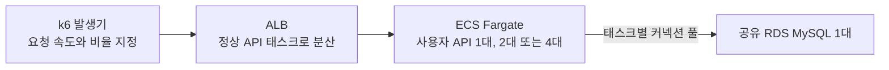
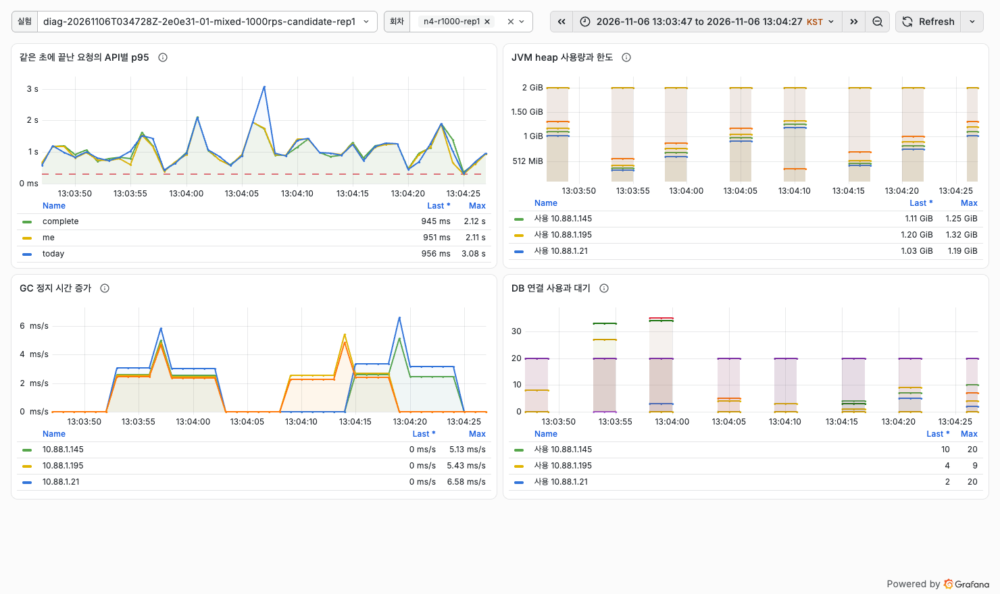

# 사용자 API는 1,500 RPS를 처리했나?

**사용자 API 1대가 5분간 450,001건을 처리했다.** 내 정보 조회를 줄인 뒤 진행한 회차에서 미발행과 예상 밖 오류는 0건이었고, 투두 완료 90,000건도 DB에서 확인했다. 전체 응답의 p99는 168.5ms였다. 다만 측정 중 두 차례의 1초 구간에서 p95가 300ms를 넘었다. [그 2초에 커넥션을 기다린 이유](./connection-spike.md)

## 부하는 어디로 보냈나

내 정보 조회 40%, 오늘 할 일 조회 40%, 투두 완료 20%를 섞었다. 완료 응답이 성공하면 DB에서도 투두 소유자, 완료 상태와 보상을 대조했다. API 한 대는 **4 vCPU, 메모리 8 GiB, JVM 최대 힙 2 GiB**다. DB는 **2 vCPU, 메모리 8 GiB**인 `db.m6g.large` 한 대를 사용했다. 실험자는 회차마다 ECS 서비스의 태스크 수를 지정했다.

## 서버 수를 늘리면 어떻게 달라지나

발생기가 1,000 RPS를 보내도록 설정한 첫 시도에서 서버 4대가 받은 요청은 초당 794건이었다. 발생기 CPU가 평균 98.7%에 달해 60,027건을 발행하지 못했다. 진단용 HTTP 클라이언트와 수집 스레드를 재사용하도록 수정한 뒤 같은 부하를 다시 보냈다. [발생기 수정과 재측정 #498](https://github.com/TripleS-soma/rougether-server/issues/498)

| 목표 RPS | API 대수 | 전체 DB 풀 | 실제 RPS | HTTP p95 | HTTP p99 | 미발행 |
|---:|---:|---:|---:|---:|---:|---:|
| 1,000 | 1 | 20 | 1,000.0 | 41.8ms | 142.0ms | 0 |
| 1,000 | 2 | 40 | 1,000.0 | 32.4ms | 181.8ms | 0 |
| 1,000 | 4 | 80 | 1,000.0 | 57.4ms | 174.1ms | 0 |
| 1,500 | 1 | 40 | 1,499.95 | 95.4ms | 215.5ms | 0 |
| 1,500 | 4 | 40 | 1,499.95 | 92.9ms | 273.5ms | 0 |

1,000 RPS에서 ALB가 4대에 보낸 요청은 각각 75,001건, 75,000건, 75,000건, 75,000건이었다. 이 실험은 API 한 대당 풀을 20개로 고정했기 때문에 서버를 늘리면 DB에 열 수 있는 연결도 함께 늘었다. [수평확장 QA #494](https://github.com/TripleS-soma/rougether-server/issues/494)

1,500 RPS에서는 이 변수를 제거했다. 전체 풀 40개를 1대에 40개 또는 4대에 10개씩 배분하고, 같은 이미지로 서버당 200 RPS를 180초 동안 예열했다. 발생기는 8 vCPU, 16 GiB, 가상 사용자 2,000명으로 맞췄다. 두 조건 모두 요청을 처리했지만 4대 회차의 p99는 58ms 높았다. 1대는 목표보다 2건 더 발행해 요청 수 자동 검사에서 ±1건 허용 범위를 벗어났다. 발행과 서버 처리는 모두 450,002건이었다. 대수별 최대 처리량은 이번 고정 부하 실험의 범위를 벗어난다.

## 내 정보 조회를 하나 줄이면 DB 부하도 줄어드나

`GET /api/v1/me`에서 온보딩 목표와 대표 캐릭터를 한 번에 읽도록 바꿨다. 반복 요청당 SELECT가 3회에서 2회로 줄었다. API 1대, 전체 풀 40개에서 1,500 RPS를 다시 보내고 변경 전 1대 회차와 비교했다.

| 지표 | 변경 전 | 변경 후 |
|---|---:|---:|
| HTTP p95 / p99 | 95.4 / 215.5ms | 93.6 / 168.5ms |
| DB CPU 평균 | 88.18% | 88.84% |
| 커넥션 하나를 얻기까지 걸린 평균 시간 | 5.74ms | 5.81ms |
| 동시에 커넥션을 기다린 최대 스레드 수 | 160 | 160 |

HTTP는 5분 전체를, DB와 풀은 첫 30초를 제외한 270초를 집계했다. p99는 요청 100개 중 99개가 응답을 마친 시간이다. 조건별 한 회차에서 전체 p99는 47ms 짧아졌지만 DB CPU와 평균 커넥션 대기는 비슷했다. 코드가 바뀌지 않은 다른 API에서도 p99가 짧아져, 차이 전체를 내 정보 조회 개선에 귀속하기는 어렵다. [1초별 HTTP, 풀, DB 기록](./connection-spike.md)

**변경 후 속도를 업무 단위로 보면** 초당 HTTP 요청과 응답 검사를 통과한 요청이 각각 1,499.30건이다. 이 중 실제 투두 완료는 초당 299.86건이었다. 나머지는 내 정보와 오늘 할 일 조회다. 멘토 메모의 ‘200 / 1,000’은 단위와 대상 API가 미확인이라, 여기서는 직접 센 HTTP 요청과 업무 성공 수를 각각 표시했다.

[두 회차의 요청 수, 업무 TPS, 지연, DB CPU 집계값(JSON)](./assets/me-load-comparison.json)

## Grafana로 무엇을 확인했나

위 화면은 1,000 RPS 실험의 지연 구간이다. JVM이 사용하는 힙과 GC 정지를 HTTP 지연, 풀 대기와 같은 시간축에서 읽었다. 최신 1,500 RPS 회차에서 p95가 461ms와 349ms였던 두 초에는 각각 커넥션 40개가 모두 사용 중이었고 160개 스레드가 기다렸다. [세 API의 동시 지연 추적 #495](https://github.com/TripleS-soma/rougether-server/issues/495)

## 배치만 종료하면 사용자는 어떤 영향을 받나

격리한 로컬 환경에서 사용자 API와 MySQL을 켜둔 채 배치 프로세스만 강제 종료했다. 중단 중에도 내 정보와 오늘 목록은 HTTP 200, 투두 완료는 201을 반환했고 완료 시각이 DB에 저장됐다. 반면 정각에 만료돼야 할 집 미션은 계속 `ACTIVE`였다.

배치를 다시 시작한 뒤 262.4초가 지나자 밀린 미션 한 건이 `EXPIRED`로 바뀌었다. 이 시간에는 로컬 컨테이너 기동도 포함된다. 두 시간 후 만료 예정이던 대조 미션은 그대로였고, 배치를 한 번 더 재기동해도 같은 미션의 만료 전이는 총 한 번이었다. [배치 중단 및 복구 QA #493](https://github.com/TripleS-soma/rougether-server/issues/493)

## 무엇이 남았나

2026년 11월 7일 기준으로 QA 보드에 다섯 건을 등록했고 세 건을 완료했다. [GitHub QA 보드](https://github.com/orgs/TripleS-soma/projects/3/views/1)

| 상태 | 항목 | 확인한 결과 또는 남은 일 |
|---|---|---|
| 완료 | [#493](https://github.com/TripleS-soma/rougether-server/issues/493), [#494](https://github.com/TripleS-soma/rougether-server/issues/494), [#498](https://github.com/TripleS-soma/rougether-server/issues/498) | 배치 중단 복구, 1,000 RPS 수평확장, 발생기 CPU 포화 수정 및 재측정 |
| 진행 중 | [#495 공통 응답 지연](https://github.com/TripleS-soma/rougether-server/issues/495) | 풀에서 대기한 구간은 확인했다. 같은 시각 부하가 달라진 DB 내부의 개별 작업을 특정하는 일은 남았다. |
| 예정 | [#496 배치 단독 중단 경보](https://github.com/TripleS-soma/rougether-server/issues/496) | 사용자 API가 정상이어도 배치만 멈춘 상황을 감지하고, 장애와 복구 알림이 Webex에 도착하는지 확인해야 한다. |

현재 결과는 **수동으로 지정한 API 대수에서의 5분 처리량**이다. 부하에 따라 태스크가 자동으로 늘어나는 시점, 증가에 걸리는 시간, 대수별 최대 처리량은 별도 검증 범위다. 테스트 환경은 ECS Fargate와 ALB를 선택했다. API Gateway 도입이나 Elastic Beanstalk 비교는 해당 기술을 별도 평가하기로 할 때 다룬다.
