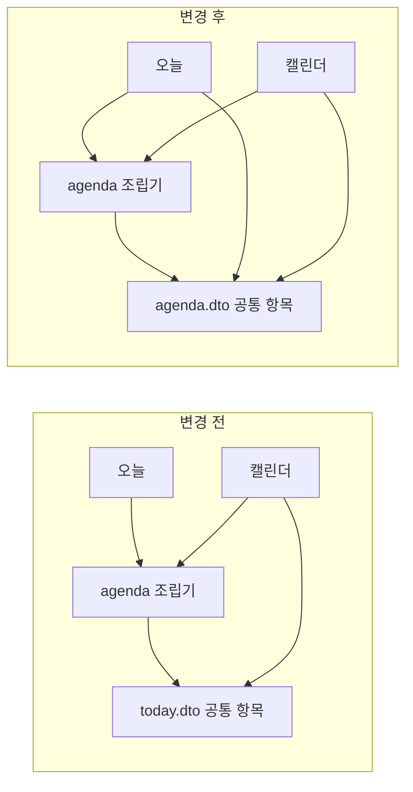

# 오늘·캘린더 공통 DTO 이동

2026-10-18 작업 시작 · 2026-10-19 최종 검증 | R4 | 기준 main `67a74547e44b90cdbd7a6ed249516cd362ef248b`

오늘과 캘린더가 함께 사용하는 일별 응답 DTO 4개를 `today.dto`에서 `agenda.dto`로 옮겼다. 공통 조립기와 캘린더가 오늘 화면의 패키지를 참조하던 구조를 정리했다. API의 JSON 응답과 기존 OpenAPI 스키마 이름은 유지한다.

## 무엇이 달라졌나

| 항목 | 변경 전 | 변경 후 |
| --- | --- | --- |
| 공통 데이터의 위치 | `today.dto`에 오늘 전용 DTO와 함께 있음 | `agenda.dto`에 일별 공통 항목과 요약을 모음 |
| 공통 조립기 | `DailyAgendaAssembler`가 `today.dto`를 참조 | 같은 기능 영역의 `agenda.dto`를 참조 |
| 캘린더 | 서비스와 응답 DTO가 `today.dto`를 참조 | `agenda.dto`를 참조 |
| 화면별 응답 | `TodayResponse`, `CalendarDayResponse` | 각 패키지에 유지. 오늘 응답만 `TodayStreak`를 포함 |
| 변환 단계 | 공통 조립기에서 항목과 요약 생성 | 동일. 중간 DTO나 추가 매퍼 없음 |
| 외부 계약 | JSON 필드와 `Today*` OpenAPI 스키마 이름 | 동일. Java 타입 이름만 `Agenda*`로 변경 |



화살표는 코드의 참조 방향이다. 기존 `today → agenda → today.dto`의 패키지 간 순환 참조를 없앴다. Spring 빈의 순환 의존성을 해결한 작업이라는 뜻은 아니다. 공통 DTO를 변경하면 여전히 두 API를 함께 검증해야 한다.

| 기존 Java 타입 (`today.dto`) | 변경한 Java 타입 (`agenda.dto`) | 담는 값 |
| --- | --- | --- |
| `TodayCategoryGroup` | `AgendaCategoryGroup` | 카테고리별 루틴과 투두 |
| `TodayRoutineItem` | `AgendaRoutineItem` | 루틴 표시 정보, 완료 여부, 연결 미션 ID |
| `TodayTodoItem` | `AgendaTodoItem` | 투두 표시 정보, 마감일과 시각, 완료 상태 |
| `TodaySummary` | `AgendaSummary` | 완료 수, 남은 수, 진행률 |

각 record에 `@Schema(name = "기존 Today 타입명")`을 지정했다. Java 패키지 정리만으로 문서의 component 이름과 `$ref`가 바뀌지 않게 했다. record 필드, 필드별 스키마 설명, 루틴 항목의 보조 생성자는 그대로 유지했다.

## 유지한 동작

| 범위 | 유지 조건 |
| --- | --- |
| 오늘 조회 | `GET /api/v1/today`, KST 오늘 고정, `date/categories/summary/streak` |
| 캘린더 일간 조회 | `GET /api/v1/calendar?date=…`, `date/categories/summary`, streak 없음 |
| 캘린더 월간 조회 | `GET /api/v1/calendar/month?yearMonth=…`, 일간 조회와 대상·완료 수 일치 |
| 투두 포함 조건 | `dueDate == 기준일`. 지난 마감, 미래 마감, 마감일 없는 항목 제외 |
| 루틴 소싱 | 오늘·미래는 현재 ACTIVE 버전, 어제는 유효 버전과 완료 로그 병합, 그제 이전은 당시 로그 기준 |
| 정렬 | 카테고리 ID 오름차순과 미분류 마지막. 루틴은 예정 시각 → ID, 투두는 마감 시각 → ID. null 시각 마지막 |
| 진행률 | 완료 수 / 전체 수. 대상이 없으면 0.0 |
| 직렬화 | null, 빈 배열, 날짜·시간·완료 시각, enum, 집 미션 ID 유지 |
| 조회 경계 | 소유권 필터, SKIPPED 제외, 읽기 트랜잭션, 저장소 호출, 월 조회 최대 6회 쿼리 유지 |

기준 커밋과 비교해 import, 패키지, 타입명과 추가한 스키마 이름 지정만 제외하면 조립기, 두 서비스, 두 외부 응답, 옮긴 네 record의 코드가 동일하다. 날짜별 조회 방식을 합치거나 DB 쿼리를 바꾸지 않았다. 집 멤버 활동과 루틴 유사도에서 사용하는 `isRoutineTargetOn`도 그대로다. 성능 개선을 측정한 작업은 아니다.

## 검증 결과

먼저 변경 전 코드로 기존 관련 테스트 111개를 실행했다. 이어 컨트롤러 테스트의 JSON 검증을 강화하고 스키마 테스트 2개를 추가한 뒤, DTO를 옮기기 전에도 계약 테스트 12개가 통과하는지 확인했다. 이후 DTO를 이동하고 같은 기준으로 다시 검증했다.

| 검증 범위 | 변경 전 | 변경 후 |
| --- | --- | --- |
| 오늘, 캘린더, 집 멤버 활동, 루틴 유사도 | 8개 클래스, 111개 통과 | 스키마 테스트를 포함한 9개 클래스, 113개 통과 |
| 강화한 JSON 검증과 새 스키마 검증 | 3개 클래스, 12개 통과 | 집중 테스트에 포함, 12개 통과 |
| 전체 모듈 컴파일 | 이번 작업에서 변경 전 전체 실행은 하지 않음 | 통과. 입력이 바뀌지 않은 태스크는 `UP-TO-DATE` 결과 재사용 |
| 전체 테스트 | 이번 작업에서 변경 전 전체 실행은 하지 않음 | 통과 2,726개, 조건부 생략 10개, 실패·오류 0개 |
| 코드 형식 검사 | `git diff --check` 통과 | `git diff --check` 통과 |

2026-10-19 Docker Desktop 재시작 후 `./gradlew compileJava test --console=plain`이 종료 코드 0, `BUILD SUCCESSFUL`로 완료됐다. 소요 시간은 3분 48초다. 변경한 `user-api`의 테스트 전체를 다시 실행했고, 나머지 모듈은 입력이 같아 Gradle의 `UP-TO-DATE` 결과를 재사용했다.

| 최종 결과 범위 | 전체 | 통과 | 생략 | 실패·오류 |
| --- | ---: | ---: | ---: | ---: |
| `user-api` — 이번에 전체 재실행 | 2,111 | 2,104 | 7 | 0 |
| 나머지 모듈 — 기존 결과 재사용 | 625 | 622 | 3 | 0 |
| 합계 | **2,736** | **2,726** | **10** | **0** |

모듈별 `build/test-results/test/TEST-*.xml` 390개를 집계했다. 관련 9개 클래스의 113개 테스트도 최종 전체 실행에서 모두 통과했다. `contextLoads`, H2 캐시 트랜잭션 3개, 봇 거주 동시성 테스트도 통과했다. 앞선 집중 실행이나 중단한 실행을 합계에 더하지 않았다.

생략 10개는 기존 환경 변수 조건이 충족되지 않은 테스트다. 네이티브 libvips 2개, 실제 FastAPI 1개, 실제 AI 모델 평가 2개, 실제 가구 생성·개발 Lambda 5개이며, 이번 변경으로 생략을 추가하지 않았다. 따라서 이 결과는 해당 외부 환경의 검증을 포함하지 않는다.

집중 테스트의 실패, 오류, 생략은 모두 0개다. 테스트 건수는 검증 범위 기록이며 커버리지 비율이 아니다. 이번 작업의 테스트 순증은 스키마 검증 2개이고, 기존 컨트롤러 테스트 6개의 JSON 검증을 강화했다.

| 근거 | 확인한 내용 |
| --- | --- |
| `TodayServiceIntegrationTest` | 반복 규칙, 기준일과 소유권 필터, SKIPPED 제외, 정렬, 진행률, 스트릭, 기존 조회 예산 |
| `CalendarServiceIntegrationTest` | 오늘·미래·어제·그제 이전 소싱, 버전 분기, 삭제 기록, 완료 상태와 진행률 |
| `CalendarMonthIntegrationTest` | 일간·월간 집계 일치, KST 자정 경계, 월 조회 최대 6회 쿼리 |
| 두 컨트롤러 테스트 | 고정 JSON 전체를 엄격 비교. null, 빈 배열, CHECK/PHOTO, PENDING/COMPLETED, 연결 미션, 시간, 오늘의 streak와 캘린더의 streak 부재 |
| `AgendaOpenApiContractTest` | 서버와 같은 Springdoc 기본 설정으로 두 응답의 OpenAPI 3.1 모델 생성. 변경 전 스냅샷과 필드, 설명, component 이름, `$ref` 전체 비교 |
| 집 멤버 활동·루틴 유사도 테스트 | 공통 조립기의 반복 판정 기능을 이용하는 나머지 호출 경로 |

스키마 기준 파일은 기준 커밋의 원본 DTO로 생성한 `user-api/src/test/resources/contracts/agenda/TodayResponse.json`과 `CalendarDayResponse.json`이다. 아래 초기화 보완 후 원본 DTO 6개를 별도 경로에 컴파일해 기준을 다시 확보했고, 최종 스키마 테스트 2개가 원본과 변경본에서 모두 통과함을 확인했다. 변경본의 결과로 기대값을 덮어쓰지 않았다. JSON 검증의 기대값은 고정 text block으로 작성했다.

OpenAPI 검증 범위는 DTO 모델과 참조이며, 실행 중인 서버의 `/v3/api-docs` 전체 결과를 비교한 것은 아니다. HTTP 응답 검증은 MockMvc에서 수행했고 데이터 조회 동작은 DB 통합 테스트로 확인했다. 운영 배포나 실제 앱 E2E 결과를 뜻하지 않는다.

별도 코드 리뷰는 PASS였으며 차단할 결함을 발견하지 못했다. Java 25와 Docker의 MySQL 8.4 Testcontainers를 사용했고 CI 분할 속성은 지정하지 않았다.

전체 실행에서 발견한 검증 환경 문제도 함께 보완했다.

| 문제 | 보완 |
| --- | --- |
| 스키마 테스트가 Springdoc 초기화 여부에 따라 `LocalTime`을 객체 또는 문자열로 해석 | `initExtraSchemas()`를 명시해 단독 실행도 서버의 기본 설정을 사용. 원본 DTO로 스냅샷과 테스트를 다시 검증 |
| Hikari의 `minimum-idle=0`이 초기 확인 연결을 닫으면 Testcontainers가 DB를 중지하고 다시 기동. 두 번째 기동에 1분 52초가 걸려 연결 대기 초과 | 테스트용 JDBC URL에 `TC_DAEMON=true`를 지정해 같은 JVM이 끝날 때까지 DB 유지 |
| 기존 `DailyActivityCacheTransactionTest`의 H2 풀 상한 2개로 Flyway 초기화 연결 부족 | 해당 테스트의 풀 상한만 3개로 조정. 트랜잭션 비활성, 활성 연결 0개, 커밋 행 확인 검증을 그대로 유지 |

마지막 두 변경은 `src/test` 안의 DB 설정에만 적용한다. 연결 대기시간을 늘리는 임시 재시도는 최종 검증 명령에 사용하지 않는다.

설정 보완 중 Docker 없이 실행하는 계약·캐시 테스트 15개는 먼저 통과했다. 이어 MySQL을 포함한 117개 재검증이 새 Ryuk 컨테이너 생성 단계에서 멈춰 해당 실행을 종료했다. 사용자 승인 후 Docker Desktop을 재시작했고, 최종 전체 실행에서 `TC_DAEMON` 적용 후의 MySQL 회귀 검증까지 완료했다. 임시 연결 대기시간 설정은 사용하지 않았다.

검증 후 테스트 컨테이너는 정리됐고, 기존 로컬 MySQL(3306)은 `healthy` 상태로 복구됐음을 확인했다.

2026-10-19 커밋·병합 준비 시 원격을 갱신해 `origin/main`이 위 기준 커밋과 동일함을 확인했다. 최신 migration은 V93이며, 이번 변경에는 migration 추가나 수정이 없다. 최종 CI와 병합 상태는 이 변경의 PR 이력으로 확인한다.

```bash
# 변경 전 기존 범위
./gradlew :user-api:test \
  --tests '*Today*' \
  --tests '*Calendar*' \
  --tests '*HouseMemberActivity*' \
  --tests '*RoutineSimilarity*' --console=plain

# DTO 이동 전 강화한 계약 검증
./gradlew :user-api:test \
  --tests '*TodayControllerTest' \
  --tests '*CalendarControllerTest' \
  --tests '*AgendaOpenApiContractTest' --console=plain

# 변경 후 집중 검증
./gradlew :user-api:test \
  --tests '*Today*' \
  --tests '*Calendar*' \
  --tests '*HouseMemberActivity*' \
  --tests '*RoutineSimilarity*' \
  --tests '*AgendaOpenApiContractTest' --console=plain

# 변경 후 전체 검증
./gradlew compileJava test --console=plain
git diff --check

```

## 계약 확인과 후속 사항

스펙 저장소의 `origin/main`인 `a0d7545b2d83403ccbe770f8320a856c4611a1dc`와 현재 구현을 대조했다. 오래된 로컬 체크아웃을 갱신하지 않고 원격 추적 main의 파일을 읽었다.

기존 스키마 설명의 “지난 마감 포함” 문구는 실제 동작 및 최신 계약과 다르다. 이번에는 기존 문구까지 보존하고, 투두의 기준일 정확 일치 동작을 테스트했다. 스펙에도 같은 시각의 루틴 정렬을 `id`와 `originRoutineId`로 각각 설명하는 부분이 있어, 이번에는 기존 `id` 정렬을 유지했다. 이러한 문구·정책 정리는 별도 변경에서 처리한다.
