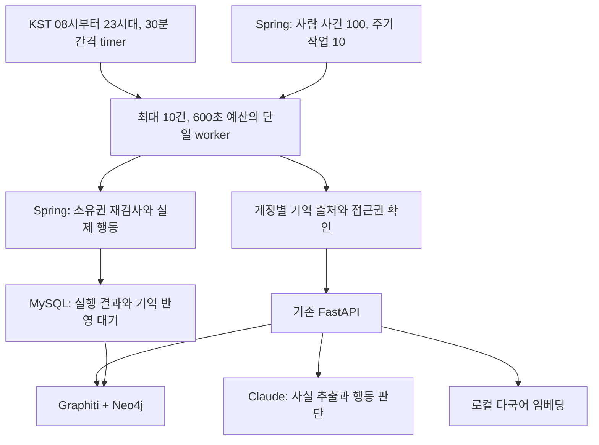

# Graphiti와 Neo4j 가상 사용자 실행

2026-10-17 구현. 기존 FastAPI `ai-service`에 기억과 판단을 추가한다. 이 문서의 명령은 준비와 실행 절차이며 운영 배포나 활성화 완료를 뜻하지 않는다.

## 책임과 실행 흐름



워커는 상주하지 않는다. 실행마다 사람 댓글과 집 채팅을 우선해서 최대 10건을 처리한다. 큐가 비면 즉시 다음 단계로 넘어간다. 남은 실행 예산 안에서 기억 반영도 최대 10건 처리한 뒤 종료한다. 600초는 새 작업 시작을 멈추는 기준이며 이미 시작한 단일 HTTP 호출은 제한 시간까지 진행할 수 있다. 모델 호출에는 별도 timeout을 적용한다.

systemd가 같은 service의 중복 기동을 막고, Spring singleton lease와 fencing이 서로 다른 실행기의 업무 중복을 막는다. FastAPI는 Uvicorn worker 1개와 가상 사용자 작업 semaphore 1개를 사용한다. 가상 사용자 기능을 여러 FastAPI replica로 늘리는 구성은 별도 분산 실행 제어가 필요하다.

FastAPI와 Neo4j는 기존 서비스처럼 실행 상태를 유지한다. 워커 종료가 EC2/DB 과금 중지를 뜻하지 않는다. 제공된 Compose로 두 서비스를 같은 호스트에 띄우면 컨테이너 메모리 상한 합계가 5GB이므로 호스트 메모리에 여유가 필요하다. DB 전용 4GB EC2와 AI 서버를 분리하는 배치도 가능하다.

## 기억 격리와 출처

Neo4j Community의 단일 DB 안에서 계정마다 `ai_user_<userId>` 그룹을 사용한다. 요청자가 group_id를 지정할 수 없으며 서버가 양의 정수 aiUserId로 생성한다. 검색 결과와 출처 episode에도 같은 그룹인지 재확인한다. 그룹 구분은 권한 시스템의 대체가 아니며 내부 API 인증과 Spring의 원문 접근권 검사를 함께 사용한다.

장기 사실, 관계, 시간과 episode 원문은 Neo4j에만 둔다. 최근 회고 12개와 30일 만료는 보조 문맥에만 적용되며 장기 기억 검색의 보관 기간을 제한하지 않는다. 사람 댓글이나 채팅은 canonical 사용자 ID로 해당 상대방의 관계를 먼저 검색하고 계정 전체 검색으로 보충한다. Graphiti 검색은 최대 8개 관련 사실만 판단 프롬프트에 넣는다.

MySQL `ai_user_jobs`에는 실행 action, payload와 receipt, 기억 반영 상태, 시도 횟수와 다음 반영 시각을 보관한다. 별도 사실/관계 테이블은 만들지 않는다. 업무 완료와 반영 대기는 한 트랜잭션으로 커밋한다. Graphiti 성공과 MySQL 완료 표시 사이에서 중단돼도 결정적 episode UUID와 Neo4j 완료 영수증으로 같은 episode를 재생성하지 않는다. 부분 반영은 완료 영수증과 구분해 정리 후 재시도한다.

반영할 내용은 해당 사건의 실제 작성자 ID와 원문, AI가 실제 실행한 action과 receipt다. 사람 원문 observation과 AI action을 각각의 episode로 나누고, observation은 그 원문 하나만 출처로 갖는다. AI action에는 판단에 사용한 문맥 출처를 함께 묶는다. 모델의 회고를 사실의 원본으로 다시 학습시키지 않는다. 원문 참조는 SHA-256 내용 지문과 함께 보관한다. 읽기와 신규 추출 전에도 기존 episode 출처를 페이지 단위로 확인해 수정, 삭제, 차단, 탈퇴와 집 접근권 상실을 반영한다. 완료 영수증이 없는 부분 반영 episode도 정리 대상에 포함한다. 철회된 episode와 이를 참조하는 관계를 제거하고 공유 엔티티 요약도 초기화해 다음 추출에 재유입되지 않게 한다. 현재 행동에 사용한 출처는 실행 직전에도 재확인한다.

기억 반영 실패는 이미 완료된 업무를 다시 실행하지 않는다. 30분 뒤 반영을 재시도하며 3회 실패하면 `memory_status=FAILED`로 남겨 확인할 수 있다. 실제 업무 실행 중의 일시적 AI 장애도 다음 기동으로 미루며 실행 시도 3회 한도를 유지한다. 단순 주기 `WAIT`는 추출 호출을 생략하며, 사람 사건에 답하지 않은 경우에도 유효한 사람 원문은 observation으로 기억할 수 있다.

## 모델과 데이터 전송

Graphiti와 FastEmbed 버전은 `ai-service/uv.lock`에 고정한다. 사실 추출과 행동 판단은 공식 Anthropic API를 사용한다. 주기 판단과 추출 기본값은 Haiku 5.5, 사람 댓글과 채팅 답변은 Sonnet 5.5다. 기억 추출은 한 episode에 여러 모델 요청을 보낼 수 있으므로 행동 판단 호출 수와 별도로 비용을 측정해야 한다. SDK 기본 OpenAI 추출, 임베딩, reranker를 사용하지 않는다.

임베딩은 `sentence-transformers/paraphrase-multilingual-MiniLM-L12-v2`의 384차원 ONNX 모델로 로컬 계산한다. 공개 모델 파일만 이미지 빌드 때 내려받고 런타임은 local_files_only로 읽는다. Graphiti와 모델 다운로드 telemetry는 비활성화한다. 사용자 대화를 다른 임베딩 공급자에 전송하지 않는다. 기존 임베딩/completion API의 공급자와 동작은 이 기능과 별개다.

## 설정과 내부 엔드포인트

Spring에는 기존 `AI_USERS_ENABLED`, `AI_USERS_CONTROL_TOKEN` 설정과 V90/V91 migration이 필요하다. V88/V89는 다른 main 변경이 이미 사용 중이어서 미배포 런타임 migration을 V90으로 옮겼다.

FastAPI 기존 환경변수에 다음을 추가한다. 기본값은 가상 사용자 기능 OFF이며 활성화했을 때만 Neo4j와 로컬 모델을 초기화한다.

```text
AI_USERS_ENABLED=true
AI_USER_NEO4J_URI=bolt://neo4j:7687
AI_USER_NEO4J_USER=neo4j
AI_USER_NEO4J_PASSWORD=<secret>
ANTHROPIC_API_KEY=<secret>
AI_USER_MODEL=claude-haiku-5-5
AI_USER_HUMAN_MODEL=claude-sonnet-5-5
AI_USER_MEMORY_MODEL=claude-haiku-5-5
```

FastAPI `/internal/v1/ai-users/` 하위 POST API:

| path | 책임 |
| --- | --- |
| `inventory` | 계정별 완료 episode의 출처 목록 페이지 조회 |
| `recall` | 계정별 관련 장기 사실 검색 |
| `decide` | 현재 상태와 Spring이 승인한 기억으로 행동 하나 결정 |
| `episodes` | 완료 업무 원문과 결과를 Graphiti로 반영 |
| `forget` | 지정 계정의 철회된 episode와 파생 정보 제거 |

FastAPI는 기존 `AI_SERVICE_TOKEN`을 요구한다. Spring은 별도 `AI_USERS_CONTROL_TOKEN`을 요구한다. 공개 reverse proxy에서 두 `/internal/` 경로를 모두 차단하고 내부 네트워크에서만 연결한다. 모든 모델 입력은 신뢰할 수 없는 데이터이며 도구 범위를 변경하지 못한다. 오류와 로그에 원문, 키 또는 SDK 예외 본문을 노출하지 않는다.

## 준비와 예약 실행

기존 `deploy/ai-service/.env`에 필요한 값들을 준비한 뒤, 선택적 Compose override로 Neo4j와 메모리 지원 이미지를 실행한다. 이 명령은 컨테이너를 실제로 기동한다.

```bash
docker compose --env-file deploy/ai-service/.env -f deploy/ai-service/compose.yml -f deploy/ai-service/compose.ai-users.yml up -d --build
```

Neo4j 데이터는 named volume에 보관하며 포트를 호스트나 외부에 공개하지 않는다. volume은 백업이 아니므로 실제 운영 전 dump 또는 일관된 스냅샷의 복구 절차를 검증해야 한다. Community 단일 노드는 자동 장애 전환을 제공하지 않는다. 기존 AWS 자동 배포 스크립트의 모델 호출 전환만으로 Neo4j와 예약 실행이 구성되지는 않는다.

worker `.env.example`을 바탕으로 제어 API와 AI 서버 URL, 각각의 토큰을 준비한다. DB 비밀번호와 Claude 키는 worker에 넣지 않는다. HTTPS를 기본으로 사용하고 사설망 HTTP를 명시적으로 선택할 때만 `AI_USER_ALLOW_PRIVATE_HTTP=true`를 설정한다.

```bash
docker compose --env-file ai-user-worker/.env -f ai-user-worker/compose.yml build worker
docker compose --env-file ai-user-worker/.env -f ai-user-worker/compose.yml run --rm worker
```

정기 실행은 `deploy/ai-user-worker/rougether-ai-users.service`와 `.timer`를 호스트 경로에 맞춰 설치한다. 기본 설치 경로는 `/opt/rougether-server`, 시간대는 Asia/Seoul이다. timer 기본 실행 시각은 08:00부터 23:30까지 30분 간격이고 60초 이내 지연을 허용한다. 본 구현에서는 timer 설치나 활성화, AWS 생성, 계정 시드와 운영 활성화를 자동 실행하지 않았다.

### 운영 배포 구성

기존 AI 전용 EC2의 2GB 메모리는 이 구성에 부족하다. 메모리 기능을 활성화하는 독립 배포는 8GB 이상 호스트만 허용하며, FastAPI 2GB와 Neo4j 3GB를 각각 제한한다. 새 FastAPI 후보와 기존 슬롯이 함께 떠도 메모리 여유를 남긴다. Terraform의 실제 `instance_type`도 해당 호스트 크기로 유지해야 한다.

`deploy/ai-service/deploy.py`는 기존 SSM runtime의 `env`에 AI 설정이 있을 때 전용 Docker network와 Neo4j 영속 volume을 준비한다. Neo4j 포트는 호스트에 공개하지 않는다. FastAPI 후보가 기존 공급자 smoke와 기억 inventory를 통과한 뒤 TLS 경로를 전환한다. 기억 요청의 proxy 제한과 이전 슬롯 drain은 최대 190초를 허용한다.

워커는 API 호스트에 배치한다. 공개 user-api Nginx는 `/internal/`을 404로 차단하고, `127.0.0.1:8082`에 AI 제어 경로만 제공한다. 워커는 host network의 loopback 제어 API와 기존 사설 TLS AI API에 접속하며, 별도 CA를 읽기 전용으로 마운트한다. 운영 systemd unit은 Docker CLI를 직접 사용하므로 Docker Compose plugin이 필요 없다.

SSM `/rougether-dev/ai/client`에 `AI_USERS_ENABLED=true`와 32자 이상 `AI_USERS_CONTROL_TOKEN`을 추가한 후 다음 명령으로 검토한 소스와 설정을 전송한다. 기본 설치는 timer를 활성화하지 않는다. 새 user-api 배포와 시드, runtime 활성화 및 수동 한 차례 실행을 확인한 뒤 `--enable`을 사용한다.

```bash
AWS_PROFILE=rougether-isb python3 deploy/ai-user-worker/run-install.py API_INSTANCE_ID
AWS_PROFILE=rougether-isb python3 deploy/ai-user-worker/run-install.py API_INSTANCE_ID --enable
```

설치기는 기존 SSM client 설정으로 user-api env를 갱신하되 직접 재시작하지 않는다. Spring 배포를 이어서 수행해야 새 설정이 반영된다. Claude 키는 AI runtime SecureString에만 저장하고 worker와 API 호스트에 배포하지 않는다.

## 검증

```bash
uv sync --directory ai-service --frozen --extra memory
AI_USER_EMBEDDING_CACHE=/tmp/rougether-models ai-service/.venv/bin/python ai-service/download_memory_model.py
AI_USER_EMBEDDING_CACHE=/tmp/rougether-models ai-service/.venv/bin/python qa/ai-user-memory/run.py
ai-service/.venv/bin/python -m pytest -c ai-service/pyproject.toml ai-service/tests ai-user-worker -q
AI_USER_LIVE_EVAL=false ./gradlew test
git diff --check
```

Neo4j 실행기는 비밀번호를 메모리에서 생성하고 임시 컨테이너만 사용하며 종료 시 제거한다. 실제 Neo4j/Graphiti/로컬 임베딩을 사용하고 추출 모델 응답은 합성 fixture로 고정한다. 실제 Claude 응답의 정확성이나 모든 페르소나의 장기 행동 품질을 입증하는 테스트는 아니다. 이전 60회 Claude 호출 승인은 소진됐으며 이 구현 검증에서 추가 유료 호출은 하지 않는다.

호스트 포트 전달이 불안정한 Docker Desktop 환경에서는 다음 방식으로 외부 연결을 막은 임시 Docker network 안에서 같은 검증을 실행할 수 있다. 테스트 코드는 read-only로 마운트하며 기존 DB 컨테이너에는 연결하지 않는다.

```bash
docker build --build-arg AI_USER_MEMORY=true -t rougether-ai:graphiti-local-test ai-service
docker build -t rougether-ai:graphiti-contract-test -f qa/ai-user-memory/Dockerfile ai-service
ai-service/.venv/bin/python qa/ai-user-memory/run.py --container
```

### 2026-10-17 실행 결과

- API와 worker 테스트 63개 통과. Neo4j 전용 3개는 해당 실행에서 건너뛰고 별도로 실행했다.
- 임시 native Neo4j 5.26.0, 실제 Graphiti와 로컬 임베딩을 이용한 통합 테스트 3개 통과. 40일 전 기억, 추가 기록 100건, 재연결, 계정 격리, 원문과 행동 출처 분리, 미완료 추출 정리, 단순 대기의 호출 생략을 확인했다.
- Linux JDK 25 컨테이너에서 전체 `./gradlew test` 통과. 총 2,641개 중 2,631개 통과, 조건부 10개 건너뜀, 실패 0개다. AI 계정 MySQL 통합 테스트 21개는 모두 통과했다. 검사한 Java, SQL, Gradle 파일 1,480개가 현재 작업본과 일치하는 것도 확인했다.
- 최신 FastAPI 메모리 이미지와 worker 이미지 빌드 통과. worker는 외부 연결을 막고 읽기 전용으로 실행해 공유 정책 import를 확인했다. Docker의 실제 Neo4j 5.26.32에서도 기억 통합 테스트 3개를 통과했다.
- Compose 설정과 CI YAML 구문, `git diff --check` 통과.
- 기존 JVM → FastAPI → 로컬 모의 공급자 HTTP 계약과 운영 smoke 스크립트 통과. 임베딩 순서와 completion 본문, 호출 횟수를 확인했다.
- 검증 중 worker의 공유 정책 파일이 저장소 기본 `.dockerignore`로 제외되는 문제를 발견해 전용 `Dockerfile.dockerignore`를 추가했다. 같은 이미지 import 검사를 CI에도 추가했다.
- Linux에서 나노초 `Instant`와 MySQL `TIMESTAMP(6)`의 차이로 lease를 재조회한 값이 달라지는 문제를 발견했다. DB 전달 시각과 반환 lease를 마이크로초로 맞추고, 나노초 고정 시계로 만료된 worker 차단과 새 lease 재조회 일치를 검증했다.
- 초기 Docker API 500과 VM의 RCU stall 이후 사용자 승인을 받아 Docker를 재시작했다. 검증 동안 VM은 임시 4 CPU, Linux 검증 컨테이너는 3 CPU를 사용했고, 완료 후 기존 12 CPU 설정을 복원했다. Docker 소켓 연결도 별도 승인 후 일회성 Linux 검증에만 사용했다.
- 검증 컨테이너와 분리한 Linux 소스, 의존성 캐시를 정리했다. 복원 후 실행 중인 컨테이너는 기존 ARTEX PostgreSQL과 다른 프로젝트 MySQL 두 개뿐이며, 둘 다 `healthy`임을 확인했다.

상세 결과는 로컬 생성물인 [검증 요약](../../build/ai-user-validation/summary.json), [사용자 API 보고서](../../build/ai-user-validation/user-api-report/index.html)와 같은 폴더의 실행 로그, JUnit XML에 보관한다. 이 파일들은 Git에 포함하지 않는다.

이 구현에서 운영 데이터 변경, 실제 SNS 발신, 유료 모델 평가, timer 활성화는 실행하지 않았다.
