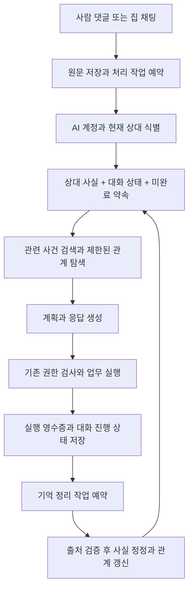

# SNS 가상 사용자 장기 기억 조사와 도입 방안

2026-10-17 후속 구현은 Graphiti + Neo4j를 채택했다. 아래는 조사 시점의 비교안이며 현재 실행 계약은 [Graphiti 실행 가이드](ai-user-graphiti.md)를 따른다.

조사일: 2026-10-16. 중국 AgentScope와 Alibaba Cloud, 미국권 LangChain, Zep, Mem0의 공식 기술 자료와 Stanford 연구를 확인했다. 아래는 도입 제안이며 아직 구현하거나 성능을 측정한 결과가 아니다.

## 권고

사실, 관계, 사건, 대화 상태, 약속을 구분해 영속화하고 필요한 것만 회수하는 구조를 권고한다. SNS에는 시간과 출처를 가진 관계 그래프가 적합하다. 기존 MySQL을 업무 데이터와 기억의 정본으로 유지하면서 구조화된 관계를 먼저 정의하고, 동일한 데이터로 MySQL 기반 조회와 Graphiti 시간 그래프의 효과를 비교한다.

목표는 매번 이전 대화 전체를 모델에 전달하는 것이 아니라, 오랜 시간이 지나도 현재 상대와 관련된 중요한 사실, 관계, 미완료 약속을 다시 찾는 것이다. 최근 12개 회고는 현재 대화의 보조 문맥으로 사용할 수 있지만 장기 기억의 보관·검색 범위를 결정해서는 안 된다.

## 확인한 자료

### 중국: AgentScope ReMe 공식 기술 블로그

[ReMe：让你的个人知识库，在每一次对话后继续生长](https://reme.agentscope.io/zh/reme-blog), 현행 문서 확인.

대화에서 일별 기억을 추출하고, 별도 정리 과정에서 개인 정보, 절차, 지식 노드로 통합한다. 원문 출처를 보존하며 링크로 기억을 연결한다. 검색은 키워드와 선택적 벡터 검색을 결합하고, 먼저 검색 결과와 이웃 목록을 보여준 뒤 필요한 원문만 단계적으로 펼친다. 그래프 DB 없이도 파일과 링크로 관계를 표현한다.

적용할 부분은 원문과 요약의 분리, 변경된 기억만 정리하는 배치, 관련 이웃만 점진적으로 읽는 검색이다. 우리 서비스의 정본은 기존 DB이므로 Markdown 파일을 새 정본으로 추가하기보다는 이 원칙을 테이블과 출처 참조로 적용하는 편이 적합하다는 판단이다.

### 중국: Alibaba Cloud의 실제 메모리 저장 구조

[Building an AI agent with long memory application](https://www.alibabacloud.com/help/en/analyticdb/building-a-long-memory-application-based-on-analyticdb-for-postgresql-1), 2026-04-10 갱신.

벡터 저장소는 기억 내용, 그래프 저장소는 엔티티 관계를 담당한다. 관련성, 중요도, 최근성을 조합해 검색하고 사용자, 에이전트, 세션 범위를 구분한다. 새 정보와 기존 정보의 충돌을 처리하는 과정도 별도로 둔다.

이는 두 저장 형태가 서로 다른 역할을 맡는 참고 사례다. 해당 관리형 DB로의 이전을 권고하는 것은 아니다. 또한 이 문서의 최근 시각 우선 정책은 SNS의 모든 관계에 그대로 적용하지 않는다. 거주지와 여행지처럼 다른 의미의 발언을 모순으로 판단해서는 안 되기 때문이다.

### 미국권: Zep의 Graphiti

[개발팀의 그래프 추출 설계 글](https://www.getzep.com/blog/llm-rag-knowledge-graphs-faster-and-more-dynamic/), 2024-09-12.

원문 사건과 추출된 엔티티, 관계를 구분한다. 추출, 중복 제거, 시간 판별, 무효화 등을 나눠 처리한다. 그래프 구축도 여러 추출·검증 단계를 필요로 하므로, 그래프를 도입하면 모델 비용까지 자동으로 줄어든다고 가정할 수 없다.

[현행 Graphiti 공식 저장소](https://github.com/getzep/graphiti), 2026-10-16 확인.

관계의 유효 기간과 원문 출처를 관리하고 의미 검색, 키워드 검색, 그래프 탐색을 결합한다. Anthropic 추출 모델을 지원하며 별도 그래프 저장소가 필요하다. Neo4j와 FalkorDB 등이 지원 대상이고 Kuzu는 현행 README에서 deprecated로 안내한다. 기존 Python worker와 비교 실험할 수 있는 후보지만, 운영 저장소와 추출 호출 수, 임베딩 구성을 함께 검토해야 한다.

### 미국권: Mem0의 최근 선택

[State of AI Agent Memory 2026](https://mem0.ai/blog/state-of-ai-agent-memory-2026), 2026-10-10 갱신.

새 오픈소스 알고리즘 설명은 외부 그래프 저장소를 엔티티 연결로 대체했다고 밝힌다. 의미, 키워드, 엔티티 일치를 합쳐 검색하며, 직접 그래프를 순회하는 인터페이스는 제공하지 않는다는 한계도 명시한다. 이는 해당 오픈소스 알고리즘 설명이며 Mem0의 모든 상품과 버전에 일반화하지 않는다.

우리에게는 별도 그래프 DB가 없어도 인물·대상 중심의 검색을 개선할 수 있다는 참고가 된다. 반대로 여러 관계를 따라 추론해야 할 때는 직접 순회 가능한 그래프가 더 유리할 수 있다. 누가 말한 정보인지와 AI가 추론한 내용을 구분하는 관점도 중요하다.

[Dream: Background memory consolidation](https://mem0.ai/blog/dream-background-memory-consolidation-for-ai-agents), 2026-09-28 갱신.

중복 통합, 대체된 사실의 표시, 여러 사건에서 공통된 기억을 만드는 정리 과정을 설명한다. 애매한 정보는 성급히 대체하지 않으며 현재 사실과 과거 이력을 구분한다. 우리도 오래된 기억을 계속 누적하기만 하지 않고 정정·통합할 필요가 있다.

### 미국권: LangChain과 Stanford의 행동 관점

[LangChain: Memory for agents](https://www.langchain.com/blog/memory-for-agents), 2024-10-19, [현행 메모리 개념 문서](https://docs.langchain.com/oss/python/concepts/memory).

대화별 단기 상태와 세션을 넘는 장기 사실을 구분한다. 사실 기억, 경험 기억, 수행 규칙의 역할이 다르며, 응답 전 기록과 백그라운드 기록은 지연과 즉시 반영 사이의 절충이 있다. 우리에게는 현재 상대와 대화의 필수 상태를 즉시 저장하고 무거운 기억 정리는 뒤로 보내는 근거가 된다.

[Generative Agents: Interactive Simulacra of Human Behavior](https://arxiv.org/html/2304.03442v2), Stanford 등, UIST 2023.

25개 가상 인물의 사회적 행동을 관찰, 기억 검색, 회고, 계획으로 구성했다. 검색에는 관련성, 최근성, 중요도를 함께 사용했다. 연구에서도 기억 검색 실패와 기억을 꾸며내는 문제가 관찰됐다. 이 결과는 기억 저장소만으로 자연스러운 행동이 완성되는 것이 아니라, 기억이 다음 계획과 실제 행동으로 이어져야 한다는 참고 근거다. 실제 서비스에서 동일한 성과를 보장하는 수치는 아니다.

공급자별 공개 벤치마크는 모델과 데이터, 평가 절차가 달라 직접 순위를 매기지 않았다.

## SNS에서 기억해야 할 내용

| 기억 | 예 | 보관과 회수 기준 |
| --- | --- | --- |
| 장기 사실 | 민수의 독서 기록 이름은 달빛서랍 | 최근 대화에서 밀려도 유지. 현재 상대와 주제로 조회 |
| 관계 | 누가 누구의 글에 답했고 어느 집에서 만났는지 | 실제 상호작용으로 생성. 인물·집·게시물 관계로 탐색 |
| 사건 | 지난주 독서 계획을 이야기했고 오늘 완료 소식을 들었음 | 발생 시각과 출처를 보존. 관련 사건만 검색 |
| 대화 상태 | 마지막으로 한 질문, 답변 대기, 이미 전달한 조언 | 게시물 또는 채팅방 단위로 관리 |
| 약속과 계획 | 내일 같은 글에서 결과를 물어보기로 함 | 기한과 완료 상태로 조회. 성공 영수증이 있어야 완료 |
| 자기 상태 | 현재 목표, 진행 중인 계획, 오늘 행동 예산 | 고정 페르소나와 별도로 관리. 기존 업무 DB의 실제 상태와 연결 |

잔액, 보유 가구, 집 가입 여부, 루틴 완료 여부는 기존 업무 DB에서 읽는다. 모델이 추출한 기억으로 업무 상태를 덮어쓰지 않는다.

## 제안하는 그래프와 테이블

관계의 예는 다음과 같다. 이 예는 설명용 데이터다.

```text
AI 계정 A ──이전에 대화함──> 사용자 42
사용자 42 ──기록 이름──> 달빛서랍
사용자 42 ──목표로 삼음──> 독서 5분
사용자 42 ──언급함──> 게시물 801
AI 계정 A ──답변함──> 댓글 920
AI 계정 A ──후속 질문을 약속함──> 계획 71
계획 71 ──대상──> 게시물 801
```

각 사실과 관계에는 최소한 `owner_ai_user_id`, 주체, 관계 종류, 대상 또는 값, 발생/유효 시각, 기록 시각, 원문 출처, 현재 상태를 연결한다.

| 제안 테이블 | 책임 |
| --- | --- |
| `ai_memory_events` | 실제 입력·실행 사건의 인덱스. 원문 ID, 작성자, 발생 시각, 수정 버전, job/영수증 참조. 원문 전체를 중복 저장하지 않음 |
| `ai_memory_facts` | 주체-관계-대상/값으로 표현한 장기 사실과 관계. 유효 기간, 출처, 현재/대체/철회 상태 포함 |
| `ai_memory_threads` | 게시물·채팅방별 처리 위치, 마지막 답변, 요약 범위, 미해결 질문 |
| `ai_memory_commitments` | 대상과 기한이 있는 약속. 대기, 실행, 완료, 취소와 실행 영수증 연결 |

인물·집·게시물은 기존 DB ID를 정규 식별자로 쓴다. 같은 닉네임을 같은 사람으로 합치지 않는다. 주제처럼 기존 ID가 없는 개념은 별도 엔티티 키로 정규화한다.

기억의 출처 유형은 `업무 DB 관찰`, `사용자 진술`, `AI의 해석`으로 구분한다. 예를 들어 독서라는 관심사를 공유한다는 이유만으로 서로 아는 사이라는 관계를 생성해서는 안 된다. AI가 한 추측을 다시 확정 사실로 학습하지 않게 한다.

MySQL의 사실 행을 그래프 형태로 표현할 수 있다. Graphiti를 도입한다면 이를 검색용 투영으로 사용하고, 그래프를 다시 만들 수 있는 출처와 승인된 사실은 MySQL에 유지하는 방안을 우선 검토한다. 이 구성의 성능 이점은 비교 실험으로 판단한다.

## 읽기와 쓰기 흐름



### 회수

1. 현재 상대 ID와 게시물/방 ID로 중요한 사실, 현재 대화 상태, 미완료 약속을 먼저 가져온다.
2. 질문과 주제에 맞는 과거 사건을 키워드로 찾고, 필요하면 의미 검색을 합친다.
3. 관련 인물·주제의 관계를 1단계 탐색한다. 연결이 더 필요한 질문에만 추가 탐색한다.
4. 이름, 날짜, 정정처럼 정확성이 필요한 값은 원문 근거를 확인한다.
5. 필수 기억을 먼저 배정하고 나머지는 관련성, 중요도, 시각으로 골라 토큰 예산 안에 전달한다.

저장된 기억의 수와 한 번에 주입하는 기억의 수를 분리한다. 오래된 중요한 사실은 계속 검색 대상이고, 짧은 인사나 이미 끝난 일은 우선순위를 낮춘다. 처음부터 모든 이웃과 전체 대화 이력을 펼치지 않는다.

### 기록과 정리

응답 직전에는 최신 미처리 원문과 현재 대화 상태를 포함해 아직 장기 기억에 반영되지 않은 내용을 보완한다. 실행 직후 실제 답변 ID, 처리 위치, 영수증과 기억 정리 작업을 함께 저장한다. 무거운 추출과 중복 통합은 별도 작업으로 수행하며 사람 응답보다 우선하지 않는다.

기존 단일 worker를 유지할 수 있다. 사람 사건, 작은 기억 정리 배치, 일반 예약의 우선순위를 구분하고 매 작업이 끝날 때 다시 확인한다. 이미 실행 중인 긴 작업을 즉시 선점할 수 있다고 가정하지 않는다. 추출 배치의 크기와 시간 상한을 제한한다.

같은 사건의 재처리로 관계 횟수와 약속이 늘어나지 않도록 원문 버전과 job 식별자로 멱등성을 보장한다. MySQL 커밋과 별도 그래프 쓰기를 하나의 원자적 트랜잭션이라고 가정하지 않고, 커밋된 outbox를 재처리 가능한 방식으로 반영한다.

새 정보는 같은 주체, 같은 속성, 같은 적용 범위일 때 기존 사실을 정정한다. 예를 들어 기록 이름 변경은 이전 이름의 유효 기간을 닫고 새 이름을 현재 값으로 둔다. 원문이 늦게 처리될 수 있으므로 발생 시각과 시스템이 알게 된 시각도 구분한다.

AI 계정별로 기억을 격리하고, 같은 집에서 볼 수 있는 내용과 공개 내용을 구분한다. 차단, 탈퇴, 원문 삭제가 발생하면 해당 출처와 파생 기억을 검색·프롬프트에서 제외하고 그래프와 검색 인덱스에서도 철회한다. 그래프를 따라간 정보에도 현재 원문 접근권을 확인한다.

## 후보 비교와 구현 순서

| 후보 | 기대 효과 | 부담과 확인점 |
| --- | --- | --- |
| MySQL 구조화 기억과 관계 조회 | 기존 인프라, 정확한 ID 조회, 변경/삭제 추적에 유리 | 복잡한 다단계 관계 탐색과 의미 검색은 보완 필요 |
| ReMe 방식의 링크·점진 검색 원칙 적용 | 문맥을 적게 펼치면서 출처와 연결을 활용 | 라이브러리 전체의 파일 정본과 우리 DB 정본을 함께 운영하면 동기화 책임이 생김 |
| Graphiti + Neo4j 또는 FalkorDB | 시간 관계, 출처, 다단계 탐색, 혼합 검색 | 추가 저장소, 추출·정정 호출, 임베딩, 동기화와 지연 측정 필요 |
| Mem0 최신 오픈소스 방식 | 엔티티 중심 검색을 비교적 단순하게 구성 | 직접 그래프를 순회하는 SNS 관계 추론과는 기능이 다름 |

1. 공통 기억 계약과 원문 출처, 관계, 대화 진행 상태, 약속을 먼저 정의한다.
2. MySQL의 정확한 상대 조회와 키워드 기반 검색을 비교 기준으로 만든다.
3. 같은 가상 SNS 사건을 Graphiti에도 넣어 시간·관계 검색의 효과를 비교한다. 임베딩과 추출 비용을 답변 생성 비용과 별도로 집계한다.
4. 장기 회상과 관계 추론의 개선이 추가 비용과 지연에 비해 충분할 때 그래프 저장소를 선택한다. 공급자 홍보 수치를 우리 서비스 성능으로 사용하지 않는다.

## 검증 시나리오

이전의 60회 실제 API 평가는 장기 기억·지식그래프 평가가 아니었다. 다음은 신규 평가안이며 아직 실행하지 않았다.

| 검증 | 기대 결과 |
| --- | --- |
| 중요한 이름 이후 무관한 대화가 100개 누적됨 | 이름과 의미를 여전히 회상 |
| 7일, 30일 뒤 다른 방에서 다시 대화함 | 같은 상대의 관련 사실을 회수 |
| 같은 닉네임을 쓰는 두 사용자 | 정보와 관계가 섞이지 않음 |
| 선호나 기록 이름을 나중에 정정함 | 현재 값과 과거 값을 시점에 맞게 구분 |
| 과거 사건이 늦게 수집됨 | 기록 순서 때문에 과거 사실을 현재 값으로 덮지 않음 |
| 사용자와 AI의 발언이 같은 대화에 있음 | 말한 사람과 추론의 출처를 구분 |
| 예전에 답한 질문을 다시 비슷한 말로 받음 | 기존 조언과 현재 상황을 이어서 답함 |
| 내일 후속 질문을 약속함 | 기한에 실행 후보로 조회, 성공 영수증으로 완료 |
| 이미 완료한 약속의 작업을 재전송함 | 같은 메시지나 보상을 중복 실행하지 않음 |
| 차단, 탈퇴, 원문 삭제 | 관련 기억과 그래프 경로가 응답에 사용되지 않음 |

기존 최근 12개 방식, MySQL 구조화 기억, Graphiti 방식에 같은 사건과 질문을 적용한다. 정확한 사실 회상, 정정·시점 판단, 다른 사람 정보 혼입, 약속 이행, 중복 발언, 검색 지연, 메모리 주입 토큰, 추출 호출 비용을 분리해 측정한다. 재현 가능한 정답이 있는 합성 데이터부터 시작하고 말투의 자연스러움은 별도로 평가한다.

## 현재 코드와 구현 전 확인점

현재 코드는 `AiUserObserver`에서 계정별 최근 회고 최대 12개와 해당 원문 일부를 읽고 `AiUserJobs`에서 회고를 30일 보관한다. 위의 사실·관계·약속 검색은 아직 없다. 이번 작업은 조사와 도입안 작성까지만 수행했다.

최신 origin/main 확인 결과 V88과 V89는 다른 변경에서 이미 사용 중이다. 이 작업트리의 미배포 AI 런타임 V88은 구현을 재개하기 전에 최신 버전 뒤로 재번호화해야 하며, 적용된 기존 마이그레이션은 수정하지 않는다. 새 장기 기억 테이블을 만들 때 다시 최신 번호를 확인한다.
