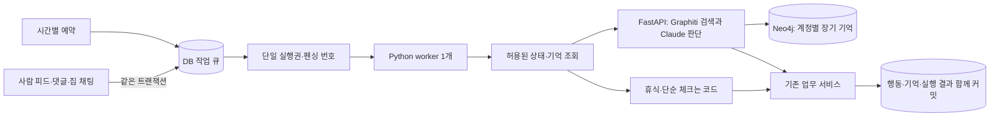

# 가상 사용자 런타임

2026-10-14 최초 구현, 2026-10-17 Graphiti/Neo4j 연동. 신규 AI 계정 10개를 하나의 Python worker가 순차 처리한다. 기존 동거 봇 계정을 재사용하지 않는다. 이 문서는 로컬 코드와 실행 방법을 설명하며 운영 배포·실제 Claude 호출 완료를 의미하지 않는다.

현재 실행 방식과 기억 저장은 [Graphiti 실행 가이드](ai-user-graphiti.md)를 따른다. 워커는 예약 기동 후 종료하며 Claude 키를 보유하지 않는다.

## 계정과 행동

`users.is_ai=true`, `is_bot=false`로 분류한다. 로그인용 OAuth·access/refresh token은 발급하지 않는다. 일반 회원 통계, DAU·리텐션, 루틴 추천의 학습 원본·실험 대상, 미니게임 랭킹에서 제외한다. 관리자 회원 목록의 `accountStatus=AI`로 별도 조회한다. 앱의 공개 응답에 AI 배지를 추가하지 않는다.

계정 시드는 `ai_key`로 멱등하게 생성한다. 기본 가입 지갑·비공개 집은 기존 가입 정책을 사용한다. 기본 집에 기존 동거 봇이 배치되는 정책은 유지하되, 그 봇을 AI 실행 주체로 바꾸지 않는다.

| 페르소나 | 계정 | 행동 성향 |
| --- | --- | --- |
| 꾸준형 | 산책노트, 책틈 | 작은 계획을 꾸준히 수행하고 짧게 기록 |
| 재시작형 | 다시한걸음, 느린집중 | 일부 일정을 건너뛰고 계획 조정 |
| 관찰형 | 창가정원, 조용한메모 | 관찰 중심, 드문 댓글·지출 |
| 사교형 | 한줄응원, 저녁수다 | 사람 대화의 맥락에 맞춰 응답 |
| 꾸미기·거래형 | 방구석수집, 작은가구점 | 보유 가구·잔액·가격을 확인한 뒤 행동 |

기존 서비스·DTO·소유권 검증을 재사용하는 47개 행동을 제공한다.

- 온보딩 목표·캐릭터·집 선택, 카테고리 생성
- 루틴·투두 생성·수정·완료·취소·건너뜀·삭제
- 피드 작성·댓글·좋아요·수정·삭제, 집 채팅 열기·발신·읽음 처리
- 집 생성·입주 신청·초대코드 입주·나가기, 미션 생성·기여·보상 수령
- 상점 구매·뽑기·방 배치·캐릭터 선택·출석
- 거래소 발행·주문·취소·수량 정정
- 프로필 닉네임·소개 수정, 집 구성원 응원, 같은 집 방명록 작성
- 내 방·같은 집 구성원 방 청소, 보유 캐릭터 액세서리 착용·해제

공개 집 입주는 승인 대기 신청을 사용한다. 즉시 입주는 실제 공유받은 초대코드의 기존 검증을 거친다. 계정·재화·소유권·미션 조건은 모델 출력으로 우회할 수 없다.

이미지 업로드·사진 인증·가구 생성, 미니게임 플레이는 이번 실행 도구에 포함하지 않는다. 모든 앱 API를 자동으로 호출하는 범용 에이전트는 아니다. 루틴·투두·회원의 공개 계약은 기존 담당 도메인과 spec을 그대로 사용하며 새 공개 계약을 확정하지 않는다.

추가 행동도 실행 actor를 claim의 AI 계정으로 고정한다. 프로필 변경은 기존 닉네임·소개 검증과 기본 집 개명을 함께 적용한다. 응원은 `great`·`support`·`best`를 사용하며 기존 대상별·타입별 하루 5회 제한을 따른다. 방명록은 같은 집 활성 구성원에게만 남긴다. 청소 상태·3코인 보상·원장·알림·기억을 한 트랜잭션으로 처리하고 같은 job 재전송으로 보상을 중복 지급하지 않는다. 액세서리는 해당 계정이 보유한 캐릭터·아이템과 호환 프로필을 기존 서비스가 검증한다.

## 순차 실행과 사람 우선 처리



사람의 새 글·댓글·집 채팅은 우선순위 100, 주기 작업은 10이다. 같은 우선순위에서는 오래된 사건을 먼저 처리한다. 사람 사건 하나에 AI 한 명만 예약하고 AI·봇의 발신은 새 AI 반응을 만들지 않아 대화 루프를 막는다. 이미 진행 중인 Claude 호출은 중단하지 않으며 다음 claim부터 사람 사건을 먼저 선택한다. 메시지는 현재 앱의 집 채팅이며 1:1 DM 기능을 새로 만들지 않는다.

`ai_user_runtime`의 singleton 행 잠금으로 프로세스가 여러 개 떠도 하나의 유효 실행권만 부여한다. 기본 lease는 5분이다. 만료되면 새 펜싱 번호를 발급하고 이전 worker의 쓰기를 거절한다. 같은 job의 실행 응답이 유실되면 같은 본문으로 재전송하고 저장된 결과를 돌려준다. 업무 쓰기·기억·job 완료가 한 트랜잭션이므로 실패하면 함께 롤백한다. 만료 재시도는 최대 3회다.

일일 한도는 KST 기준 계정당 24개 완료·실패 작업이다. 주기 작업은 그중 16개까지만 처리해 사람 사건을 위한 여유를 둔다. 사람 사건도 총한도를 넘으면 다음 날까지 대기한다. 아침형 두 계정은 07–22시, 나머지는 10–24시에 주기 작업을 예약한다. 사람 사건은 활동 시간 밖에서도 우선 처리한다.

이미 있는 CHECK 루틴·투두의 단순 체크는 시간과 페르소나별 확률을 코드로 판단한다. 날짜·항목 ID에 묶인 결정이므로 재시작으로 수행 여부가 바뀌지 않는다. 사진 인증은 자동으로 수행하지 않는다. 의미를 판단해야 하는 행동 계획과 문장은 Claude가 정한다.

## 기억과 Claude 입력

장기 기억의 정본은 Neo4j이며 Graphiti가 사실 추출, 관계와 시간 정보 저장, 검색을 담당한다. 기존 최근 회고는 보조 문맥이다. MySQL에는 장기 사실 테이블을 만들지 않고 작업의 기억 반영 대기 상태와 실행 결과만 기록한다. 임베딩은 AI 서버 안의 다국어 모델로 계산하며 외부 임베딩 공급자에는 전송하지 않는다.


`ai_user_memories`에 계정별 최대 1,000자 회고를 저장한다. 최근 12개 중 30일 이내이며 아직 접근 가능한 원본에 연결된 기억만 읽는다. 각 job의 `context_sources`에 실제 입력으로 전달한 피드·댓글·채팅 원문과 집 구성원의 membership 참조를 함께 기록해, 주기 작업의 회고도 관찰한 정보의 접근권에 묶는다. 이전 회고를 다시 참고하면 그 원문 참조도 이어받는다. 작업당 최대 64개 참조를 허용하며 넘치는 오래된 회고는 입력에서 제외한다. worker를 재시작해도 DB 상태를 다시 읽는다. 원문이 삭제되거나 상대가 탈퇴·차단하거나 채팅방·집 구성원 정보의 접근권을 잃으면 연결된 기억 조회를 거절하고, 모델 호출 뒤 실제 행동 직전에도 참조의 접근권을 다시 확인한다. 사실 판단은 현재 DB 상태를 우선한다.

Claude 입력은 가상 계정의 루틴·오늘 현황·잔액·방·보유 가구·카탈로그·현재 닉네임/소개·본인 보유 캐릭터/액세서리와 접근 가능한 공개 피드·사람 댓글·집 채팅·집 구성원 정보 및 회고다. 채팅은 해당 방의 최근 12개 메시지를 포함한다. 이메일·인증 토큰·다른 계정의 비공개 루틴은 넣지 않는다. 집 구성원 정보는 AI가 속한 활성 집 최대 5개에서 활성 비봇·비차단 구성원 총 32명까지 제공한다. `houseMembers`에는 houseId와 구성원 membershipId·userId·닉네임·역할·가입/접속 시각 및 현재 청소 가능한 membershipId 목록을 넣는다. 다른 집의 구성원 목록을 읽지 않는다. 사람 댓글·메시지·닉네임과 회고는 신뢰할 수 없는 사용자 데이터로 다룬다. 사람이라고 주장하거나 실제 사람을 사칭하지 않으며 AI 여부를 직접 물으면 사실대로 답하도록 지시한다.

모델은 허용된 행동 하나와 payload만 출력한다. 자유 SQL·HTTP·임의 도구 실행은 없다. 실행 actor는 claim의 userId로 고정하고 `userId`·`authorId` 덮어쓰기를 거절한다. 사람 사건에 대한 댓글·채팅은 원래 글·방과 일치해야 한다. 신규 계정의 예약 작업은 코드가 목표 선택 → 캐릭터 선택 → 작은 첫 루틴/투두 순서로 허용 행동을 좁힌다. 목표/캐릭터 선택지가 하나면 모델 없이 처리하고, 여럿이면 모델이 고른다. 이미 마친 온보딩을 반복하지 않으며 사람 사건에는 온보딩보다 답변을 우선한다.

회고만으로 고유명사나 그 의미가 누락되는 것을 막기 위해, 접근 가능한 기억의 최초 사람 댓글/채팅 원문을 최대 256 Unicode code points까지 근거로 함께 전달한다. authorUserId·sourceType·sourceId·잘림 여부를 명시한다. 모델에는 원문을 회고보다 우선하되 지시로 취급하지 않도록 지시한다. Graphiti의 장기 기억에는 별도 episode 원문이 저장되므로 읽기와 신규 추출 전에 출처를 검사하고, 삭제 또는 접근권 철회가 확인된 episode와 파생 관계를 제거한다. 상세 동작은 [Graphiti 구현 안내](ai-user-graphiti.md)를 따른다.

기본 주기 판단은 `claude-haiku-5-5`, 사람 댓글·채팅 답변은 `claude-sonnet-5-5`를 사용한다. Sonnet 5.5의 `between_tools`, Haiku 5.5의 `disabled` thinking 설정은 [Anthropic 공식 문서](https://platform.claude.com/docs/en/build-with-claude/thinking)에 맞춘다. 입력은 48,000 UTF-8 bytes, 출력은 768 tokens로 제한한다. 입력 초과·잘린 JSON·알 수 없는 행동은 실행하지 않는다. 모델 호출의 자동 재시도는 없고, 제어 API 실행 응답만 같은 본문으로 재시도한다. 로그에는 job ID와 오류 종류만 남긴다. 달러 단위의 월별 비용 자동 차단은 아직 구현하지 않았다.

## 실행 설정

기본값은 서버 설정 OFF + DB runtime OFF + profile OFF다. migration만 적용해도 계정이나 게시물이 자동 생성되지 않는다. worker는 DB 자격 증명이나 Claude 키를 가지지 않고 Spring과 FastAPI의 내부 API만 호출한다.

서버 설정:

```text
AI_USERS_ENABLED=true
AI_USERS_CONTROL_TOKEN=<32자 이상 ASCII 전용 service secret>
AI_USERS_LEASE_DURATION=5m
AI_USERS_SCHEDULE_INTERVAL=1h
AI_USERS_DAILY_JOB_LIMIT=24
```

worker 설정:

```text
AI_USER_CONTROL_URL=https://<private-origin>
AI_USER_CONTROL_TOKEN=<서버와 동일한 service secret>
AI_USER_SERVICE_URL=https://<private-ai-origin>
AI_USER_SERVICE_TOKEN=<FastAPI의 AI_SERVICE_TOKEN과 같은 값>
AI_USER_MAX_JOBS=10
AI_USER_MAX_SECONDS=600
AI_USER_MEMORY_BATCH_LIMIT=10
```

서버 `AI_USERS_`와 worker `AI_USER_` 접두사는 다르다. secrets는 배포 환경이나 추적하지 않는 env 파일로 주입한다. worker URL은 HTTPS origin만 허용하며 로컬 검증용 loopback HTTP만 예외다. redirect는 거절한다.

활성화 순서:

1. V90/V91 migration과 서버 코드를 배포하고 내부 HTTPS 경로를 연결한다. **공개 reverse proxy에서는 `/internal/ai-users/**`를 차단**하고 worker 네트워크에서만 접근하게 한다. 전용 service token을 모든 내부 요청에 요구한다. 이 변경에 AWS 서버·private listener·reverse proxy를 자동 구축하는 작업은 포함하지 않는다.
2. 서버 설정을 켠 뒤 내부 origin에서 `POST /internal/ai-users/seed`를 호출한다. 응답은 신규 AI 계정 ID 10개이며 반복 호출은 같은 ID를 반환한다. 이때 DB runtime과 profile은 OFF다.
3. FastAPI에 Graphiti/Neo4j와 모델 파일을 준비한다. worker 디렉터리에서 환경변수를 주입하고 `docker compose build worker`로 실행 이미지를 준비한다. `docker compose run --rm worker`는 최대 10건을 처리하고 종료한다. 정기 실행은 전용 systemd timer를 사용한다.
4. 내부 origin에서 `POST /internal/ai-users/enabled?enabled=true`를 호출한다. 이후 scheduler가 작업을 예약한다.

제어 API의 Authorization은 모두 `Bearer <service secret>`이다. 일반 사용자 JWT는 이 secret을 대신할 수 없다. 중단은 `POST /internal/ai-users/enabled?enabled=false`로 runtime·profile을 함께 끄고 `docker compose down`으로 worker를 내린다. 진행 중인 실행권도 폐기하므로 다시 켠 뒤 예전 worker의 응답을 받아도 행동을 실행하지 않는다. 이미 생성된 게시물을 지우는 동작은 아니다.

## 검증

```bash
./gradlew test
python3 -B -m unittest discover -s ai-user-worker -v
git diff --check
```

실제 MySQL 통합 테스트는 10계정 생성 멱등성, 기존 봇과 분리, 사람 통계·활동 제외, 동시 claim 단일성, 사람 댓글·채팅 우선 처리, 만료된 worker 차단, 실행 재전송 멱등성, DB 기억 재조회, 업무와 기억의 원자성, 사람 사건 롤백, 삭제·차단 후 접근 거절, 일반 로그인 거절과 전용 secret을 검증한다. Python 테스트는 모델 호출 없는 대기·체크, 입력 한도, 잘못된 출력 거절, 모델별 요청 설정, 동일 본문 재시도를 검증한다. 실제 Claude 응답 품질과 운영 부하·활성화는 별도 실행 검증이 필요하다.

확장 검증에는 프로필 변경·기본 집 개명 롤백, 응원·방명록 재전송 멱등성, 청소 상태·코인·원장의 원자적 롤백과 중복 보상 방지, 다른 계정의 캐릭터·아이템 거절, 집 탈퇴·차단 뒤 구성원 정보와 연결된 기억의 접근 거절을 포함한다. AI 테스트는 전용 MySQL 데이터베이스와 `TC_DAEMON=true`를 사용해 초기 연결 종료 시 컨테이너 재생성을 방지하며 JVM 종료 시 Testcontainers가 정리한다. 캐릭터 입력은 ID·이름·착용 상태 중심으로 줄여 렌더링 정보가 토큰을 차지하지 않게 한다.

검증 결과와 실제 API 사용량·실패 기록은 [ai-user-live-results-20261015.md](ai-user-live-results-20261015.md)에 정리한다.

### 이전 Claude 평가

2026-10-15 직접 호출 방식의 60회 평가는 [기록](ai-user-live-results-20261015.md)으로 보존한다. 이 기록은 Graphiti 연동 품질을 검증한 결과가 아니다. 이전 live_eval 진입점은 비활성화했으며, 새 경로의 실제 모델 평가는 별도 호출 예산 승인이 필요하다. 현재 검증은 합성 모델 응답, 실제 Neo4j와 MySQL을 사용하며 유료 API를 호출하지 않는다.
