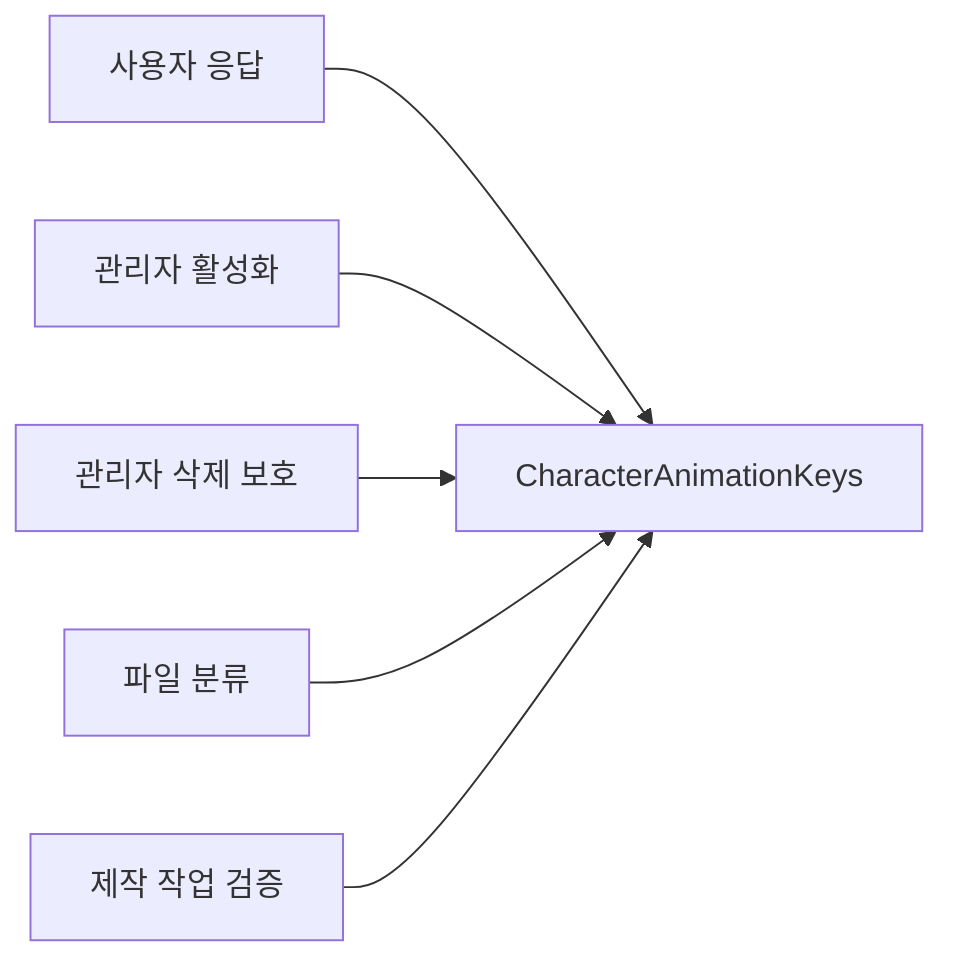

# 캐릭터 애니메이션 경로 규칙 공통화

2026-10-20 | 기준 main `119f8215ce7286218831b7f416634a84d9bf60d4`

백엔드 Java 코드에 있던 캐릭터 표준 애니메이션의 **경로 생성과 판정 규칙을 5곳에서 `CharacterAnimationKeys` 한 곳으로 모았다.** 사용자에게 내려주는 경로와 관리자가 검사하는 경로가 같은 정의를 사용하도록 했다.

```text
characters/{code}/animations/idle.webp
characters/{code}/animations/pose-cycle.webp
characters/{code}/animations/wave.webp
```

## 무엇이 줄었나

| 사용처 | 변경 전 | 변경 후 |
| --- | --- | --- |
| 사용자 응답 | DTO에서 디렉터리와 파일명 조합 | 공통 생성 결과를 기존 DTO에 복사 |
| 관리자 캐릭터 활성화 | 별도 파일 목록과 디렉터리 조합 | 공통 생성 결과를 순서대로 존재 검사 |
| 관리자 삭제 보호 | 정규식으로 파일 종류와 캐릭터 코드 추출 | 공통 코드 추출 사용 |
| 관리자 파일 분류 | 별도 정규식으로 애니메이션 판별 | 공통 판별 사용 |
| 제작 작업 등록 | 별도 정규식으로 캐릭터 애니메이션 종류 검사 | 공통 판별 사용 |

예를 들어 같은 애니메이션의 파일명이나 저장 디렉터리를 바꾸려면, 이전에는 응답 생성 1곳과 관리자 구현 4곳을 함께 고쳐야 했다. 이제 경로 정의는 공통 부품에서 수정한다. 각 API가 올바르게 연결되는지 확인하는 회귀 테스트는 계속 필요하다. 별도 Python 제작 도구 `tools/asset-pipeline/assetctl.py`의 검증 규칙과 관리자 화면의 안내 문구는 이번 서버 Java 공통화 범위에 포함하지 않았다.

새 동작을 추가해 응답 필드까지 늘리는 경우에는 DTO와 클라이언트 계약도 별도로 변경해야 한다. 이번 작업의 효과는 기존 세 동작의 경로 규칙 중복 제거이며, DB 조회 수나 응답 속도 개선은 측정하지 않았다.

## 호출 구조



공통 부품은 `common.asset`의 순수 Java record 하나다. 경로 생성 `of(code)`, 순서가 있는 목록 `all()`, 종류 판별 `matches(key)`, 코드 추출 `characterCode(key)`만 제공한다. 파일명 상수를 생성과 정규식이 함께 사용한다. Spring, DB, S3 의존성이나 새 모듈은 추가하지 않았다.

## 유지한 동작

- **응답:** `CharacterAnimations` DTO와 `idle`, `poseCycle`, `wave` JSON 필드 및 OpenAPI 설명을 유지한다. 온보딩 목록, 내 캐릭터, 방과 집 미리보기가 같은 경로를 받는다.
- **활성화:** 기본 이미지 → idle → pose-cycle → wave 순서로 검사한다. 누락 목록과 400 `CATALOG_ACTIVATION_INVALID` 응답을 유지한다. 비활성화는 S3 확인 없이 진행한다.
- **삭제:** 안전한 경로 검사 → DB 직접 참조 검사 → 등록 캐릭터의 파생 경로 보호 → S3 존재 확인 → 보관 후 삭제 순서를 유지한다. 비활성 캐릭터의 표준 애니메이션도 409로 보호한다.
- **분류와 안전 검사:** 공통 판별은 기존 `[^/]+` 코드 범위를 유지한다. 분류할 수 있는 경로라도 삭제나 제작 요청에서 허용된다는 뜻은 아니다. 삭제 API의 `..`·`//` 차단과 제작 API의 소문자·길이·`..` 검사는 각 호출자에 남긴다.
- **입력 처리:** 공통 생성기는 기존처럼 code를 그대로 연결한다. 새로운 trim, 소문자화, 유효성 검사를 추가하지 않는다. 제작 API가 입력 앞뒤 공백을 제거하는 기존 동작도 유지한다.
- **나머지 계약:** 가구 애니메이션 분류, 추가 포즈, 관리자 인증과 CSRF, DB 스키마, 트랜잭션, S3 작업을 변경하지 않았다.

스펙 `origin/main`의 `a0d7545b2d83403ccbe770f8320a856c4611a1dc`에서 표준 세 경로, 활성화 존재 검사, 등록 캐릭터 삭제 보호를 확인했다. 구체적인 정규식 허용 범위와 검사 순서는 기존 구현의 보존 조건이다.

## 검증 결과

생산 코드 변경 전에 관리자 회귀 사례 26개를 추가하고, 기존 사용자 통합 테스트의 세 응답 값 검증을 보강했다. 원본에서 통과한 테스트를 공통화 후 다시 실행했다.

| 검증 | 결과 |
| --- | --- |
| 변경 전 관련 테스트 | 210개 통과, 실패·오류·생략 0개 |
| 변경 후 관련 테스트 | 기존 210개 + 공통 부품 5개, 총 215개 통과 |
| 별도 소스 리뷰 | 가독성·범위, 삭제 안전성과 처리 순서 리뷰 통과 |

전체 모듈 컴파일과 테스트는 최종 실행에서 `BUILD SUCCESSFUL`, 종료 코드 0으로 완료됐다. 총 3분 57초가 걸렸으며 현재 빌드 모듈의 XML 397개를 집계했다. 집중 검증의 215개도 같은 성공 상태로 전체 결과에 포함됐다. `git diff --check`도 통과했다.

| 최종 결과 범위 | 전체 | 통과 | 생략 |
| --- | ---: | ---: | ---: |
| `user-api` | 2,162 | 2,155 | 7 |
| `admin-api` | 268 | 268 | 0 |
| `common` | 15 | 15 | 0 |
| 나머지 모듈 | 389 | 386 | 3 |
| 합계 | **2,834** | **2,824** | **10** |

최종 실행에서는 user-api 전체 테스트를 재실행하고, 다른 모듈은 앞선 검증의 성공 결과를 `UP-TO-DATE`로 재사용했다. 변경한 생산 코드는 집중 검증에서 컴파일했다. 조건부 생략 10개는 기존 실제 AI 모델, 개발 Lambda, FastAPI, 네이티브 libvips 환경 검증이며 이번 작업에서 생략 조건을 추가하지 않았다.

첫 전체 실행에서는 채팅 WebSocket 연결 테스트 5개가 HTTP 핸드셰이크의 EOF로 실패했다. 원인까지 확정하지는 못했으며, 코드·설정 변경 없이 해당 클래스만 재실행했을 때 17개 모두 통과했다. 실패한 로그와 결과를 보존한 뒤 전체 검증을 다시 실행해 위의 최종 통과 결과를 확인했다. 에셋 규칙 관련 집중 검증에는 실패가 없었다.

- 관리자 회귀 사례 26개: 비활성 캐릭터를 포함한 삭제 보호, 미등록 세 파일 삭제, 잘못된 삭제 경로, 활성화 누락 순서, 분류와 제작 요청의 입력 허용 차이.
- 사용자 검증: 기존 온보딩 HTTP 응답의 세 필드 검증을 유지하고, 내 캐릭터와 방 응답의 poseCycle·wave 기대값을 보강했다.
- 공통 부품 5개: 세 경로와 순서, 코드 추출, 입력 보정 없음, 안전 검사와의 구분, 잘못된 동작·확장자·계층 거부. 기대값은 고정 문자열로 검증한다.

기준선과 변경 후의 XML에서 테스트 이름과 성공 상태를 중복 횟수까지 비교했다. 기존 210개가 모두 유지되고 공통 부품 5개만 추가됐다. 테스트 건수는 커버리지 비율을 뜻하지 않는다.

```bash
# 변경 전: common·사용자 범위와 관리자 범위를 각각 실행
./gradlew :common:test :user-api:test \
  --tests '*Character*' --tests '*RoomResponseConsistencyIntegrationTest' \
  --tests '*HouseControllerTest' --console=plain
./gradlew :admin-api:test --tests '*Asset*' \
  --tests '*CatalogActivationTest' --tests '*ItemSlotTest' --console=plain

# 변경 후: 같은 범위를 함께 실행
./gradlew :common:test :user-api:test \
  --tests '*Character*' --tests '*RoomResponseConsistencyIntegrationTest' \
  --tests '*HouseControllerTest' \
  :admin-api:test --tests '*Asset*' \
  --tests '*CatalogActivationTest' --tests '*ItemSlotTest' --console=plain

# 전체 검증
./gradlew compileJava test --console=plain
git diff --check
```

Java 25 환경에서 DB 통합 테스트와 MockMvc로 응답·상태·오류 계약을 확인했다. S3는 mock/stub을 사용했으며 실제 파일을 업로드하거나 삭제하지 않았다. 운영 배포나 단말 표시를 확인한 결과는 아니다.

## 코드 위치

- [공통 경로 규칙](../../common/src/main/java/com/triples/rougether/common/asset/CharacterAnimationKeys.java)
- [사용자 응답 DTO](../../user-api/src/main/java/com/triples/rougether/userapi/character/dto/CharacterAnimations.java)
- [활성화 검사](../../admin-api/src/main/java/com/triples/rougether/adminapi/catalog/service/CatalogActivationService.java)
- [삭제 보호](../../admin-api/src/main/java/com/triples/rougether/adminapi/asset/web/AssetDeleteController.java)
- [파일 분류](../../admin-api/src/main/java/com/triples/rougether/adminapi/asset/AssetKeyClassifier.java)
- [제작 작업 검증](../../admin-api/src/main/java/com/triples/rougether/adminapi/assetfoundry/service/AssetFoundryService.java)
