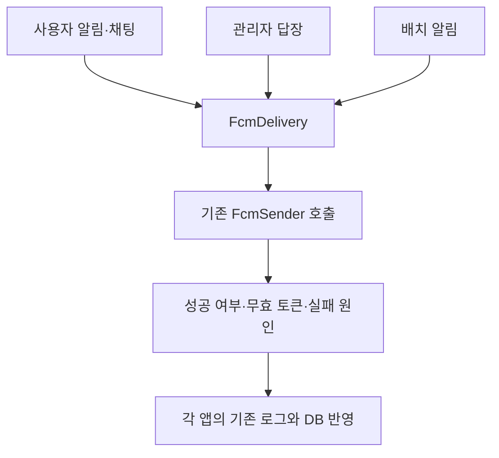

# 푸시 발송 결과 판정 공통화

2026-10-20 | 기준 main `2e54ec97206a3c2c0eb6e9ce1525b06d3ffcd579`

사용자 알림, 관리자 답장 알림, 배치 알림에 반복되던 **빈 토큰 처리, 발송 예외 처리, 성공·실패 판정을 `FcmDelivery` 한 곳으로 모았다.** 이제 “기기 한 대라도 발송에 성공하면 성공으로 처리한다” 같은 공통 규칙을 바꿀 때 세 구현을 각각 수정할 필요가 줄어든다.

## 전후 차이

| 항목 | 변경 전 | 변경 후 |
| --- | --- | --- |
| 토큰 없음, 발송 예외, 일부 성공의 판정 | 사용자·관리자·배치에서 각각 구현 | `FcmDelivery`와 결과 정의 한 곳에서 판정 |
| `successCount > 0` 성공 기준 | 3곳 | `FcmDeliveryResult.from()` 1곳 |
| 실패 원인과 무효 토큰 | 각 경로에서 처리 | 공통 결과로 전달하고 각 경로에서 로그·DB 반영 |
| 실행 방식과 DB 반영 | 각 앱에서 수행 | 기존 위치와 트랜잭션 유지 |
| 모듈 의존성 | 세 앱이 `infra:fcm` 사용 | 동일, 새 모듈·DB 의존성 없음 |

발송 실행기 세 개를 없애는 변경은 아니다. 메시지 작성, 비동기 실행, 설정 확인, 토큰 조회·삭제와 상태 저장은 앱마다 다른 책임이어서 유지한다. 전체 코드 줄 수, DB 조회 수, 전송 성능의 감소를 주장하지 않는다.

500개 토큰 분할과 Firebase 오류별 무효 토큰 분류는 이미 `FirebaseFcmSender`에서 공통 처리하고 있었다. 해당 알고리즘과 `FcmSender` 계약은 변경하지 않았다.

## 호출 흐름



공통 부품은 다음 네 결과를 반환한다. `SENT`는 FCM 발송 성공이며 사용자가 읽었다는 뜻은 아니다.

- `SENT`: 한 기기 이상 성공. 반환된 무효 토큰은 별도로 정리한다.
- `NO_TOKENS`: 등록된 토큰이 없어 발송하지 않는다.
- `SEND_FAILED`: 이동 정보 생성이나 sender 호출에서 예외가 발생했다. 원래 예외를 로그에 전달하며 토큰을 삭제 대상으로 추정하지 않는다.
- `NO_SUCCESS`: sender가 반환했지만 성공한 기기가 없다. 무효 토큰이 없어도 실패다.

이동 정보는 `Supplier`로 전달해 **토큰이 있을 때만 생성**한다. 배치의 기존 “빈 토큰이면 payload 생성도 생략하고, 생성 중 예외는 발송 실패로 처리한다”는 순서를 보존하기 위한 것이다. 공통 부품의 `try/catch`에는 이동 정보 생성과 sender 호출만 포함한다.

## 보존한 경계

- **사용자 알림:** 기존 executor에서 비동기 발송한다. 채팅은 다시 큐에 넣지 않으며 알림 내역과 상태를 저장하지 않는다. 토큰 없는 채팅의 DEBUG, 일반 알림의 WARN과 실패 예외 로그를 유지한다.
- **관리자 답장:** 커밋 후 동기 발송한다. 무효 토큰 정리와 상태 기록은 기존 `AdminPushResultService`의 한 트랜잭션에서 수행한다.
- **배치:** 기존 chunk에서 상태를 저장한다. 설정 차단과 삭제된 알림은 계속 `BLOCKED`로 처리하며, digest의 상태와 발송 시각도 함께 갱신한다.
- **소유권:** 무효 토큰 삭제는 발송 대상 `userId` 조건을 유지한다. 발송 중 다른 사용자에게 이전된 토큰을 지우지 않는다.
- **DB 오류:** 토큰 조회·삭제나 상태 저장 예외는 공통 발송 실패 처리에 들어가지 않는다. 특히 배치의 DB 오류는 기존처럼 청크 실패로 전파된다.
- **계약:** API, DB 스키마, payload, 설정 정책, 재시도 정책을 변경하지 않는다.

스펙 `origin/main` 커밋 `a0d7545b2d83403ccbe770f8320a856c4611a1dc`의 알림·채팅 계약을 확인했다. digest의 상세 상태·시각 동기화와 토큰 삭제 SQL 범위는 기존 구현의 보존 조건으로 확인했다.

## 검증 결과

앱별 회귀 테스트 18건을 먼저 추가해 기존 구현에서 실행했다. 공통화 뒤에는 같은 테스트를 다시 실행하고, 공통 부품 테스트 7건을 추가했다. XML의 테스트 이름과 성공 상태를 비교해 기준선 249건이 모두 보존됐음을 확인했다.

| 검증 | 결과 |
| --- | --- |
| 변경 전 관련 테스트 | 249개 통과, 실패·오류·생략 0개 |
| 변경 후 동일 테스트와 공통 부품 테스트 | 기존 249개 + 공통 부품 7개, 총 256개 통과 |
| 전체 모듈 컴파일 및 테스트 | 통과 2,793개, 기존 조건부 생략 10개, 실패·오류 0개 |
| 공백 검사 | `git diff --check` 통과 |
| 별도 소스 리뷰 | 가독성·범위, 정합성 리뷰 통과 |

추가한 앱별 회귀 검증은 다음을 다룬다.

- 사용자 7건: 무기록 채팅의 성공·실패·빈 토큰·발송 예외, 토큰 삭제와 SENT/FAILED 저장 예외의 전파.
- 관리자 2건: 무효 토큰 없는 전체 실패 시 토큰 유지, 모든 토큰이 무효일 때 실패 기록과 삭제. 기존 실제 커밋 통합 테스트를 확장했다.
- 배치 9건: 두 알림 타입의 이동 정보, 토큰 없을 때 생성 생략, 생성 오류의 실패 처리, 부분 성공 시 digest 발송 시각, 사용자 범위 토큰 삭제, DB 오류 전파.

공통 부품 테스트 7건은 빈 토큰에서 이동 정보·sender 호출 생략, 부분 성공, 무효 토큰 없는 실패, payload 전달, 발송·payload 예외 원인 보존, 잘못된 결과 해석 오류의 전파를 확인한다.

전체 검증은 `BUILD SUCCESSFUL`, 종료 코드 0으로 4분 55초에 완료됐다. 현재 빌드 모듈의 XML 395개를 집계했으며, 앞선 집중 검증을 중복 합산하지 않았다. 집중 검증의 256건도 전체 결과에 같은 성공 상태로 포함됨을 확인했다.

| 최종 결과 범위 | 전체 | 통과 | 생략 |
| --- | ---: | ---: | ---: |
| `user-api` — 전체 재실행 | 2,162 | 2,155 | 7 |
| `admin-api` — 전체 재실행 | 242 | 242 | 0 |
| `batch` — 전체 재실행 | 199 | 199 | 0 |
| `infra:fcm` — 집중 검증 결과 재사용 | 12 | 12 | 0 |
| 나머지 모듈 — 기존 결과 재사용 | 188 | 185 | 3 |
| 합계 | **2,803** | **2,793** | **10** |

변경한 생산 코드는 집중 검증에서 컴파일했고, 전체 컴파일 단계에서는 같은 입력의 결과를 재사용했다. 테스트 재사용은 Gradle의 `UP-TO-DATE` 판정에 따른 것이다. 기존 생략 10개는 실제 AI 모델, 개발 Lambda, FastAPI, 네이티브 libvips 환경 검증이다. 이번 변경으로 생략 조건을 추가하지 않았다. 테스트 건수는 커버리지 비율을 뜻하지 않는다.

```bash
# 변경 전후 같은 집중 검증
./gradlew :infra:fcm:test \
  :user-api:test --tests 'com.triples.rougether.userapi.notification.*' \
    --tests 'com.triples.rougether.userapi.chat.*' \
  :admin-api:test --tests '*BugReport*' \
  :batch:test --tests '*Reminder*' --tests '*EveningDigest*' \
    --tests '*WeeklyReportPush*' --tests '*Cobweb*' --tests '*AppIcon*' \
  --console=plain

# 변경 후 전체 검증
./gradlew compileJava test --console=plain
git diff --check
```

Java 25와 로컬 테스트 DB 환경에서 검증했다. 실제 FCM 서버와 단말 수신은 테스트 대상이 아니며, sender를 mock/stub으로 대체한다. 커밋·운영 배포나 실제 푸시 수신 성공을 의미하지 않는다.

## 코드 위치

- [공통 발송 판정](../../infra/fcm/src/main/java/com/triples/rougether/infra/fcm/FcmDelivery.java)
- [공통 결과 정의](../../infra/fcm/src/main/java/com/triples/rougether/infra/fcm/FcmDeliveryResult.java)
- [사용자 알림](../../user-api/src/main/java/com/triples/rougether/userapi/notification/fcm/FcmPushExecutor.java)
- [관리자 알림](../../admin-api/src/main/java/com/triples/rougether/adminapi/notification/AdminFcmPushExecutor.java)
- [배치 알림](../../batch/src/main/java/com/triples/rougether/batch/reminder/ReminderPushWriter.java)
