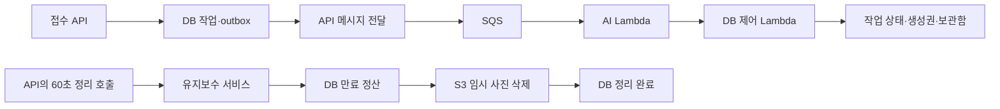

# 가구 생성 Lambda 전용 정리

가구 AI 실행을 Lambda 한 경로로 정리했다. API에서 계속 필요한 만료 정산과 임시 사진 삭제는 `FurnitureGenerationMaintenanceService`로 분리했다. 접수·조회 API, 생성권 정산, 보관함 지급 정책은 유지했다.

- 기준 커밋: `5af8238757e0ae33d415900b4f7456ca9e80c73e` — 이전 가구 결과 지급 분리까지 병합된 상태
- 작업일: 2026-10-19
- 범위: 백엔드 코드, 테스트, 빌드·배포 템플릿, 운영 안내. 실제 AWS 배포와 DB 설정 변경은 수행하지 않았다.

## 무엇이 달라졌나

| 책임 | 변경 전 | 변경 후 |
| --- | --- | --- |
| AI 추출·생성·검수 | 상주 Worker와 Lambda에 실행 구현이 각각 존재 | 기존 `FurnitureLambdaStage`만 사용 |
| 만료 정산·임시 사진 삭제 | API가 AI 실행도 담당하는 Worker의 `maintain()`을 호출 | API가 유지보수 서비스의 `maintain()`을 호출 |
| 작업 선점 | 상주용 `due/claim`과 Lambda용 선점이 공존 | Lambda Control의 소유권·용량 검사를 통과한 선점만 유지 |
| 실행·배포 구성 | 별도 `furniture-worker` 앱과 compose 템플릿이 존재 | 해당 모듈, 설정, 배포 템플릿 제거 |



정리 서비스의 의존성은 `FurnitureGenerationTransactions`와 `AssetStorageService` 두 개다. AI 클라이언트, 이미지 검수, AI 설정을 알 필요가 없다. 기존 `maintain()` 메서드 본문은 그대로 이동했다.

이전 미커밋 초안의 `FurnitureAiStageExecutor`는 남기지 않았다. 실행 경로가 하나이므로 AI 단계 구현을 기존 `FurnitureLambdaStage`에 유지한다. Stage, Runner, Control, Outbox와 `AiRuntime`은 기준 커밋과 동일하다.

## 유지한 동작

- 추출 → 생성 → 검수 순서, EDIT/REGENERATE, 시도 횟수와 시간 예산을 유지한다. 생성에는 원본 사진을 전달하지 않고 추출·검수에만 사용한다.
- 같은 메시지의 중복 실행 차단, 전역 실행 상한, 일시 중지, 순번·해시 기반 DB 명령 재전송을 유지한다. 유료 AI 호출을 자동 재시도하지 않는다.
- 가구 지급·이미지 교체·생성권 정산은 기존 트랜잭션 안에서 처리한다. 실패 시 원장·보관함·아이템이 부분 반영되지 않는다.
- 정리 작업의 DB 정산과 완료 기록은 각각 기존 트랜잭션을 사용하며, S3 삭제는 트랜잭션 밖에서 수행한다.
- 삭제 순서는 원본 → 직접 업로드 원본 → private 후보 이미지다. 공개 가구 이미지는 유지한다. 삭제에 실패하면 정리 완료로 표시하지 않고 다음 작업을 처리하며, 다음 정리 주기에 다시 시도한다.
- 24시간 사진 보존, 탈퇴·업로드 중단·대기 만료·실행 lease 만료 처리, 중복 반환 방지를 유지한다.
- API 응답, DB 스키마, 이미 적용된 Flyway, Lambda 프로토콜과 S3 경로는 변경하지 않았다.

`referencesAsset()`는 접수 API의 업로드 결과가 불확실할 때도 필요하므로 유지했다. `extracted/generated/reviewed/failed` 역시 Lambda Control이 사용하는 정산 경로다.

## 테스트를 어떻게 옮겼나

기존 생성 통합 테스트 25개와 결제 통합 테스트 21개는 실제 `FurnitureLambdaControl`과 `FurnitureLambdaStage`를 호출하도록 이전했다. 중간 상태를 검사하는 테스트에는 단계별 테스트 드라이버를 사용하고, 실제 Runner의 재전송·시간 예산 검증은 기존 Lambda 통합 테스트로 유지했다. opt-in 실제 AI 테스트 3개도 Runner를 사용하도록 바꿨으며 실행 조건은 그대로다.

상주 경로와 Lambda의 원래 차이는 Lambda 기준으로 검증한다. 실행 기한은 660초이며, AI 미설정 시 `AI_UNAVAILABLE`로 실패한다. DB 저장 응답이 실패하면 같은 DB 명령을 최초 시도를 포함해 최대 3회 전송하고 AI를 다시 실행하지 않는다. 저장 실패가 계속되면 중간 상태와 업로드를 보존한 뒤 lease 만료 정산에서 생성권을 반환한다. 이번에 새로 바꾼 운영 정책이 아니다.

| 검증 | 변경 전 | 변경 후 |
| --- | --- | --- |
| 가구 관련 집중 테스트 | 총 150: 통과 145, 조건부 생략 5, 실패 0 | 총 132: 통과 127, 조건부 생략 5, 실패 0 |
| 정리 서비스 계약 | 기존 Worker 대상 7개 통과 | 새 서비스 대상 동일 7개 통과 |
| Lambda AI 단계 계약 | Lambda 사례 14개 통과 | 동일 14개 통과 |
| 전체 검증 | 변경 전 기준은 위 집중 검증으로 확보 | 총 2,771: 통과 2,761, 조건부 생략 10, 실패·오류 0 |

집중 테스트가 18개 줄어든 이유는 상주 경로에만 해당하는 19개를 제거하고 실행 중지 검증 1개를 추가했기 때문이다. 제거한 19개는 AI 단계의 상주 반복 사례 14개, 상주 Worker 전용 업로드 정리 3개, 삭제된 실행 루프 테스트 2개다. Lambda의 단언이나 유료 테스트 실행 조건을 완화하지 않았다. 테스트 수를 커버리지 수치로 해석하지 않는다.

전체 명령은 5분 12초에 성공했다. XML 392개를 집계했으며, 집중 검증 132개의 이름·통과·생략 결과는 전체 실행에서도 동일했다. 전체 명령에서 사용자 API·관리자 API·배치·domain의 2,678개를 다시 실행했고, 나머지 93개는 Gradle의 기존 결과를 재사용했다. 이 중 AI/control Lambda 7개는 직전 집중 검증에서 다시 실행한 결과다. 생략 10개는 기존 실제 AI/AWS 7개, 실제 FastAPI 1개, native libvips 2개이며 새 생략 조건은 없다.

사용자 API bootJar와 AI/control Lambda ZIP 생성도 성공했다. 세 패키지의 내부 애플리케이션 JAR에 새 유지보수 클래스가 들어 있고, 제거한 `FurnitureGenerationWorker`와 미커밋 초안의 `FurnitureAiStageExecutor`가 남지 않았음을 확인했다. 정합성·트랜잭션·인가 코드 리뷰와 `git diff --check`도 통과했다.

재현 명령:

```bash
./gradlew :user-api:test \
  --tests 'com.triples.rougether.userapi.furniture.*' \
  --tests '*FurnitureBillingIntegrationTest' \
  :furniture-lambda-ai:test :furniture-lambda-control:test

./gradlew compileJava test :user-api:bootJar \
  :furniture-lambda-ai:buildZip :furniture-lambda-control:buildZip
git diff --check
```

변경 전 집중 검증에는 제거 전 `:furniture-worker:test`도 포함했다. Java 25를 사용했다. 기준 소스와 XML, 실행 로그는 로컬 `/tmp/rougether-lambda-only-before*`, 집중 결과는 `/tmp/rougether-lambda-only-focused*`, 전체 로그는 `/tmp/rougether-lambda-only-full.log`에 저장했다. 제거한 모듈의 과거 `build/test-results`는 최종 집계에서 제외한다.

## 운영 경계

`furniture_worker_capacity`는 Lambda의 전역 잠금·상한·중지에도 사용하므로 유지한다. `execution_mode` 열과 LAMBDA guard도 기존 배포와 호환되도록 남겼다. 기존 환경의 모드와 실행 허용 값은 자동으로 바꾸지 않는다. 새 DB는 기존 migration 기본값이 `RESIDENT`이므로 작업을 비운 상태에서 명시적으로 `LAMBDA`를 설정해야 한다.

정리 호출은 기존처럼 `furniture.lambda.dispatch-enabled=true`일 때 활성화된다. dispatcher를 끄면 정리 스케줄도 중단된다. 구 워커 플래그는 실행 경로를 만들지 않으며, 실제 API 설정과 부하 검증 compose에서 제거했다.

현재 버전은 상주 실행으로 복귀하는 코드를 제공하지 않는다. 복구에는 검증된 이전 Lambda 버전의 API 이미지와 AI/control 패키지를 사용한다. 세부 절차는 [Lambda 운영 안내](furniture-lambda.md)를 따른다.

로컬 검증은 실제 OpenAI 호출, AWS IAM·SQS, Lambda cold start와 배포 후 상태를 대신하지 않는다. 이번 작업에서 유료 opt-in 테스트와 실서비스 배포는 실행하지 않았다.
