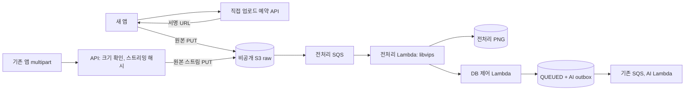

# 가구 전처리 Lambda 전환 준비

2026-10-30 `main=f00c654f`에서 분기해 준비했다. 운영 AWS, DB, 버킷 알림, 기능 플래그를 변경하거나 조회하지 않았다. 아래는 코드와 로컬 테스트로 확인하는 전환안이며 현재 운영 상태를 증명하지 않는다. 기본 플래그는 모두 false다.

## 두 업로드 경로



기존 앱의 `POST /api/v1/me/furniture-generations` 계약은 유지한다. `FURNITURE_UPLOAD_MULTIPART_LAMBDA_ENABLED=true`를 선택하면 JPEG/PNG magic, 실제 바이트 길이, SHA-256만 확인하고 S3 원본 키에 조건부 PUT한다. API에서 ImageIO/BufferedImage 디코딩을 호출하지 않는다. 원본 전체를 `byte[]`로 만들지 않고 해시 계산에는 8KiB 버퍼를 사용한다. SDK 재시도는 multipart 임시 파일의 새 스트림을 사용한다. PUT은 전체 30초, 시도당 15초로 제한한다.

이 경로에도 업로드 네트워크, servlet multipart 임시 파일, 해시 계산과 SDK 버퍼 비용은 남는다. 요청 접수 필터의 프로세스별 동시 업로드 제한을 유지한다. 네트워크 전송까지 API에서 빼려면 새 앱의 직접 업로드 적용이 필요하다. 성능 향상 수치는 배포 전후 같은 조건의 별도 측정으로 확인한다.

## 앱 계약과 호환

- 기존 앱: multipart path, `requestId`, `photo`, `targetHint`, 202 작업 응답, 기존 GET polling을 유지한다. 전처리 완료 전 상태는 `UPLOADING`이다. 형식 헤더는 맞지만 손상됐거나 픽셀 한도를 넘은 사진은 Lambda에서 검증해 `FAILED`로 전환하고 생성권을 돌려준다. 기존 동기 검사의 400과 이 비동기 실패 차이를 앱이 처리해야 한다.
- 새 앱: 기존 구현의 `POST /api/v1/me/furniture-generations/uploads`로 원본 SHA-256, 길이, MIME, 힌트와 requestId를 예약한다. 응답의 URL에 원본을 그대로 PUT하고 기존 작업 GET으로 완료를 확인한다. 구체적 필드는 [직접 업로드 계약](furniture-preprocessing.md#api-계약)을 따른다.
- `FURNITURE_UPLOAD_ENABLED`는 직접 업로드 예약 API, `FURNITURE_UPLOAD_MULTIPART_LAMBDA_ENABLED`는 기존 multipart의 처리 방식이다. 서로 독립이며 전처리 인프라가 검증된 후 설정한다. 새 앱은 해당 환경에서 직접 업로드가 제공되는 것을 확인한 뒤 사용해야 한다.
- PUT 응답 유실 후 412는 이미 같은 키가 업로드된 상태일 수 있다. 같은 requestId와 원본으로 조회/재시도하며 새 작업을 만들지 않는다. 409, 403, 5xx를 412처럼 성공 처리하지 않는다. 예약 요청 또는 PUT의 결과를 모를 때 다른 업로드 경로로 바꾸지 않는다.
- multipart 요청 해시는 기존 `SHA256(원본 + NUL + UTF-8 힌트)`를 유지한다. 전환 전에 예약한 작업을 새 원본 키로 덮어쓰지 않으며, 같은 입력의 재접수는 기존 작업을 반환한다. 새 경로에서 접수한 작업도 구버전 처리 코드의 동일 해시로 식별된다. 같은 requestId의 다른 사진/힌트는 409다.
- 직접 예약 API는 별도의 기존 digest 계약을 사용한다. multipart와 직접 예약 사이에서 같은 requestId를 재사용하며 자동 fallback하는 기능은 지원하지 않는다.
- `rougether-spec`의 확인 기준은 `origin/main=9d284d4`, `domains/attendance/api.md`다. multipart 계약은 존재하지만 직접 예약 계약은 없다. 직접 업로드용 앱 변경과 spec 반영은 별도 담당자 검토가 필요하다. 이 PR에는 앱 코드나 spec 저장소 변경이 없다.

## 실패와 중복 처리

생성권 예약과 UPLOADING 저장은 DB 트랜잭션에서 먼저 확정하며 S3 전송 중 DB 연결을 보유하지 않는다. 원본은 체크섬, 실제 길이, MIME을 고정하고 `If-None-Match: *`로 덮어쓰기를 막는다. PUT 결과가 불확실하면 즉시 환불하거나 원본을 삭제하지 않고 503 `FURNITURE_UPLOAD_BUSY`를 반환한다. 같은 requestId로 재시도할 수 있으며 30분 안에 전처리가 완료되지 않으면 유지보수 작업이 단일 환불한다.

기존 전처리 START/COMPLETE/FAIL 프로토콜을 재사용한다. S3 원본 versionId 고정, 출력의 조건부 PUT, 출력 체크섬 확인, `UPLOADING → QUEUED`와 AI outbox 저장의 원자성으로 중복 이벤트가 AI 실행과 정산을 늘리지 않게 한다. 탈퇴, 만료, 다른 원본 버전, 완료 후 늦은 실패는 기존 상태 검증으로 차단한다. 동일 이벤트의 이미지 변환 자체는 겹칠 수 있다.

전처리 허용 범위는 JPEG/PNG, 10MiB 이하, 각 변 32~8192, 최대 32M 픽셀이다. 방향 보정 후 긴 변 1536 이하 PNG를 만든다. 네이티브 출력과 Arena 수명 관리 구현은 변경하지 않았다.

## 배포 담당자가 확인할 순서

1. **별도 운영 승인 후에만** 현재 API 이미지/환경, DB 실행 모드와 미완료 작업, 두 Lambda의 실제 코드/설정, SQS 매핑, S3 versioning, IAM, lifecycle, CORS, 전체 notification과 이를 관리하는 IaC 위치를 확인한다. 과거 9월 기록을 현재 값으로 대입하지 않는다. 기존 runtime/ZIP/알림을 복구 가능한 형태로 보관한다.
2. API, control, preprocess ZIP을 동일 소스에서 빌드하고 검증한다. 최신 main의 migration과 비교한다. 이 변경은 새 migration이나 기존 SQL 수정을 추가하지 않는다.
3. Terraform에서 `enable_preprocessing=true`, `enable_preprocess_trigger=false`로 리소스만 준비하는 plan을 검토한다. 기존 `enable_trigger`는 **AI 트리거**이므로 현재 값을 유지한다. `preprocess_concurrency`는 전처리 reserved/max 동시성에 함께 사용하며 기본 2, 허용 2~100이다. AI/DB 상한과 별도로 실측 후 결정한다. 기존 전처리를 운영 중인 환경은 새 `enable_preprocess_trigger`에도 기존 활성 값을 명시해야 의도치 않은 중지가 없다.
4. 버킷 notification 소유 IaC에 원본 prefix의 `s3:ObjectCreated:Put` 항목만 통합한다. 이 모듈은 `aws_s3_bucket_notification`을 만들어 기존 설정 전체를 덮어쓰지 않는다. 기존 Topic, Queue, Lambda, EventBridge 설정을 보존한다. `merge-preprocess-notification.py`는 저장된 JSON과 Terraform output의 단일 항목으로 **후보 파일만 생성**하며 AWS를 호출하지 않는다. 동일 ID 충돌과 겹치는 Put prefix는 거절한다. 실제 적용 직전 최신 설정과 검토한 스냅샷이 일치하는지 다시 확인하고, 원래 IaC 소유자와 함께 반영한다.
5. 원본 버킷 versioning과 private current/noncurrent version 만료를 확인한다. SSE-KMS를 쓰면 서명 주체와 Lambda의 해당 KMS 권한도 검토한다. 웹 앱은 PUT 서명 헤더의 CORS를 확인한다. 전체 버킷 lifecycle/CORS를 임의로 교체하지 않는다.
6. 전처리 트리거만 활성화하고 격리된 테스트 계정/입력으로 이벤트 도착, 오류, 중복 전달, 만료/환불, DLQ, 큐 대기, DB 연결, Lambda 메모리를 검증한다. AI는 fake 또는 별도 승인된 소량 호출만 사용한다. S3 이벤트가 오는 것을 확인하기 전에 API의 두 업로드 플래그를 켜지 않는다.
7. 유지보수와 기존 AI dispatcher가 실행되는지 확인한 뒤 제한된 환경에서 multipart 플래그를 전환한다. 새 앱과 spec 검토가 완료되면 직접 업로드 플래그와 앱을 별도로 순차 적용한다. 일반 API p95, 오류율, 최대 메모리, 생성 완료/실패/환불 수를 동일 부하에서 비교한다.

알림 후보 파일 생성 예:

```bash
python3 deploy/furniture-lambda/merge-preprocess-notification.py \
  /private/snapshot.json /private/preprocess-entry.json /private/proposed-notification.json
```

원본 snapshot은 AWS API의 notification 설정 본문이며 SDK `ResponseMetadata`를 포함하지 않는다. entry는 Terraform `preprocess_notification`의 값이다. 후보 파일이 이미 존재하면 덮어쓰지 않는다. 이 명령은 적용 명령이 아니다.

## 롤백

새 접수를 기존 경로로 돌릴 때 multipart 플래그와 직접 예약 플래그를 끈다. 이미 발급된 최대 5분 유효 URL과 30분 전처리 기한이 있으므로 즉시 큐/전처리 함수/DB 유지보수를 끄거나 삭제하지 않는다. UPLOADING과 큐가 비고 완료 또는 단일 환불까지 확인한 뒤 전처리 트리거를 끈다. `enable_preprocessing=false`는 리소스 삭제 계획이므로 접수 롤백 수단으로 사용하지 않는다. AI dispatcher와 트리거는 기존 AI 작업을 위해 유지한다.

구버전 앱은 기존 multipart 계약을 계속 사용할 수 있다. 이미 예약된 raw 작업은 이전 바이너리로 롤백하더라도 전처리 Lambda가 완료할 수 있도록 control 프로토콜 호환성을 유지한다. DB 상태나 requestId를 초기화해 유료 AI를 재실행하지 않는다.

## 검증

```bash
./gradlew test :furniture-lambda-ai:buildZip :furniture-lambda-control:buildZip :furniture-lambda-preprocess:buildZip \
  -PvipsNativeDir=/absolute/path/to/sharp-libvips-linux-arm64/lib
python3 -m unittest discover -s deploy/furniture-lambda/tests -v
python3 qa/furniture-preprocess/run_native.py \
  --output output/preprocess-native --java-home /absolute/path/to/jdk25
terraform -chdir=deploy/furniture-lambda init -backend=false
terraform -chdir=deploy/furniture-lambda validate
terraform -chdir=deploy/furniture-lambda fmt -check
git diff --check
```

`FurnitureRawPhotoTest`는 기존 digest 호환, MIME 오기재, 제한 버퍼, 거짓 크기와 초과 입력을 검증한다. `FurnitureDirectUploadIntegrationTest`는 실제 MySQL에서 raw 중계와 기존 outbox 연결, 응답 유실과 412 재시도, 단일 예약/환불, 기존 요청 재접수를 검증한다. 기존 Lambda 테스트가 중복 COMPLETE, 탈퇴, 만료, 출력 소유권을 다룬다. S3와 AI는 fake다.

Linux ARM64 native probe는 배포 ZIP을 네트워크 없는 컨테이너에서 실행하며 합성 이미지로 방향 8종, 축소, alpha 및 close 40회, 잘못된 입력 7종을 검증한다. 512MiB/2 CPU 컨테이너와 256MiB JVM heap을 사용한다. 이는 기능 검증이며 동시 부하나 운영 메모리 상한 측정이 아니다.
