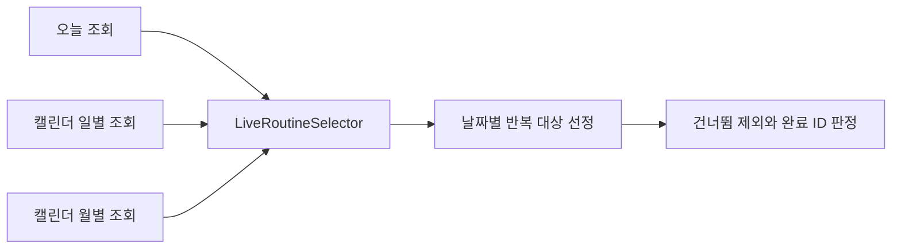

# 오늘·캘린더 루틴 선정 중복 제거

2026-10-20 | 기준 main `d7cc4d38fc57c42d8e675f9f574627322a5e86de`

오늘, 캘린더 일별, 캘린더 월별 조회에 따로 있던 **현재 루틴의 대상 선정과 로그 해석을 `LiveRoutineSelector` 한 곳으로 모았다.** 앞으로 건너뜀이나 완료 표시 규칙을 바꿀 때 세 구현을 각각 수정할 필요가 줄어든다. 세 조회 경로의 테스트는 계속 함께 검증해야 한다.

## 전후 차이

| 항목 | 변경 전 | 변경 후 |
| --- | --- | --- |
| 현재 루틴 선정 규칙 | Today 1곳 + Calendar 일별 1곳 + 월별 1곳 | `LiveRoutineSelector` 1곳을 세 경로가 호출 |
| 건너뜀과 완료 로그 해석 | 세 경로에서 각각 상태를 나누고 키를 선택 | 공통 `applyDayLogs()`에서 판정 |
| 조회할 로그 상태 목록 | 두 서비스에 각각 선언 | 공통 선정기의 `LOG_STATUSES`에 선언 |
| 반복 규칙 알고리즘 | 이미 `RoutineRecurrence`를 공유 | 동일한 알고리즘 사용 |
| DB 조회 책임 | 각 서비스 | 각 서비스에 유지 |
| API 응답과 조회 예산 | 기존 계약 | 유지 |

실제 중복은 SKIPPED를 도입한 커밋 `057c5dd23cf0a6df81cd53ec6ee6a3d1ab64a674`에서도 확인된다. 당시 Today의 일별 선정, Calendar의 일별 선정, 월별 선정에 같은 계보 제외 규칙을 각각 추가했다. 이번 변경은 그 수정 지점을 하나로 모은 것이다.

파일 수나 전체 코드 줄 수 감소가 목적은 아니다. 공통 클래스와 두 서비스의 의존성은 추가되며, 동일한 정책을 세 곳에서 따로 유지하던 부담을 줄인다. 응답 시간 개선이나 DB 쿼리 감소를 주장하는 변경은 아니다.

## 변경한 호출 흐름



공통 선정기는 Repository나 화면 DTO를 참조하지 않는다. 서비스가 조회한 데이터만 받아 아래 두 단계를 수행한다.

1. `targetsOn(candidates, date)`: 기존 `RoutineRecurrence`로 해당 날짜의 반복 대상을 고른다. 사용자 소유, ACTIVE, 미삭제 조건은 기존 Repository 조회에서 적용한다.
2. `applyDayLogs(targets, dayLogs)`: 해당 날짜의 건너뜀 계보를 제외하고, 완료된 루틴 ID 집합을 함께 반환한다.

두 단계로 나눈 이유는 오늘 조회에서 반복 대상이 없을 때 로그 조회를 생략하기 위해서다. 월별 조회는 ACTIVE 루틴과 구간 로그를 각각 한 번 조회하고, 로그를 날짜별로 묶은 뒤 해당 날짜의 목록만 공통 선정기에 넘긴다.

## 보존한 핵심 동작

- **건너뜀은 계보 기준:** `originRoutineId`가 있으면 그 값, 없으면 자기 ID로 제외한다. 건너뛴 뒤 새 버전이 생겨도 같은 날짜에 다시 나타나지 않는다.
- **완료는 정확한 버전 ID 기준:** 이전 버전의 완료 로그를 새 버전의 완료로 옮겨 해석하지 않는다.
- **로그는 날짜별 적용:** 다른 날짜의 완료나 건너뜀 상태가 섞이지 않는다.
- **어제와 과거 조회:** 어제는 완료 로그와 당시 유효 버전을 병합하고, 그제 이전은 로그만 조회한다. 해당 메서드 본문은 기준 커밋과 동일하다.
- **응답:** 기존 DTO, JSON, OpenAPI 모델, 카테고리와 항목 정렬, 요약 계산, 오늘 전용 streak를 유지한다.
- **조회:** 사용자 필터, 읽기 트랜잭션, Repository 메서드와 호출 순서를 유지한다. 오늘의 빈 대상 조회 3회, 캘린더 월 조회 최대 6회 테스트도 유지한다.

완료의 정확한 ID 매칭과 조회 예산은 기존 구현의 보존 조건이다. 스펙에 새 정책으로 추가한 것은 아니다. 스펙 `origin/main`의 `a0d7545b2d83403ccbe770f8320a856c4611a1dc`에서 현재/미래의 건너뜀 계보 제외와 어제/과거의 별도 소싱 계약을 확인했다.

## 검증 결과

먼저 신규 회귀 테스트 2개를 기존 구현에서 실행해 기준을 확보하고, 공통화 후 동일한 테스트를 다시 실행했다. 테스트 이름까지 비교해 전후 검증 범위가 같음을 확인했다.

| 검증 | 결과 |
| --- | --- |
| 변경 전 관련 테스트 | 86개 통과, 실패·오류·생략 0개 |
| 변경 후 동일 테스트 | 86개 통과, 실패·오류·생략 0개 |
| 전체 모듈 컴파일 및 테스트 | 통과 2,763개, 기존 조건부 생략 10개, 실패·오류 0개 |
| 공백 검사 | `git diff --check` 통과 |
| 별도 소스 리뷰 | 수정 필요 사항 없음 |

신규 `LiveRoutineSelectionIntegrationTest`는 같은 DB 데이터로 오늘과 캘린더 일별의 목록·완료 상태·요약, 월별의 전체·완료 개수를 비교한다. 기대 루틴 ID와 완료 여부를 별도로 고정하므로 세 경로가 모두 같은 잘못된 결과를 내도 테스트가 실패한다.

- 첫 테스트: 수정 전후 버전의 건너뜀/완료 차이, origin 없는 기존 데이터, 삭제·기간 밖 루틴의 완료 제외, FAILED 로그와 다음 날 상태를 확인한다.
- 둘째 테스트: DAILY, WEEKLY, BIWEEKLY, MONTHLY, YEARLY와 시작·종료일, 빈 대상, 날짜별 로그 분리를 확인한다.

기존 Today/Calendar 서비스 테스트는 소유권, 정렬, 어제/과거 기록, KST 자정 경계, 쿼리 수를 검증한다. 컨트롤러 테스트와 OpenAPI 계약 테스트는 고정 JSON과 스키마 모델을 검증하고, `RoutineSkipIntegrationTest`는 건너뜀 기능의 기존 동작을 확인한다.

전체 검증은 `BUILD SUCCESSFUL`, 종료 코드 0으로 4분 12초에 완료됐다. 현재 빌드에 포함된 모듈의 XML 393개를 집계했다. 앞선 집중 실행 결과를 전체 합계에 중복 합산하지 않았다.

| 최종 결과 범위 | 전체 | 통과 | 생략 |
| --- | ---: | ---: | ---: |
| `user-api` — 전체 재실행 | 2,150 | 2,143 | 7 |
| 다른 모듈 — `UP-TO-DATE` 결과 재사용 | 623 | 620 | 3 |
| 합계 | **2,773** | **2,763** | **10** |

변경한 Java 코드는 집중 검증에서 다시 컴파일했다. 이후 전체 컴파일 단계에서는 입력이 동일한 결과를 재사용했다. 조건부 생략 10개는 기존 실제 AI 모델, 개발 Lambda, FastAPI, 네이티브 libvips 환경 검증이다. 이번 변경으로 새 생략 조건을 추가하지 않았다. 테스트 건수는 커버리지 비율을 뜻하지 않는다.

```bash
# 변경 전후 같은 집중 검증
./gradlew :user-api:test \
  --tests '*Today*' \
  --tests '*Calendar*' \
  --tests '*LiveRoutineSelectionIntegrationTest' \
  --tests '*AgendaOpenApiContractTest' \
  --tests '*RoutineSkipIntegrationTest' --console=plain

# 변경 후 전체 검증
./gradlew compileJava test --console=plain
git diff --check
```

Java 25와 MySQL 8.4 Testcontainers 환경에서 검증했다. API 동작 검증은 DB 통합 테스트와 MockMvc 기준이며, 운영 배포나 실제 앱 E2E를 실행한 결과는 아니다.

## 코드 위치

- [공통 선정기](../../user-api/src/main/java/com/triples/rougether/userapi/agenda/LiveRoutineSelector.java)
- [오늘 조회](../../user-api/src/main/java/com/triples/rougether/userapi/today/service/TodayService.java)
- [캘린더 조회](../../user-api/src/main/java/com/triples/rougether/userapi/calendar/service/CalendarService.java)
- [전후 공통 회귀 테스트](../../user-api/src/test/java/com/triples/rougether/userapi/today/service/LiveRoutineSelectionIntegrationTest.java)
