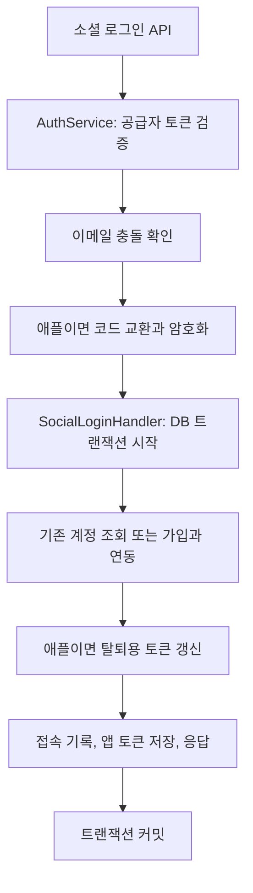

# 소셜 로그인 공통 DB 처리

2026-10-20 | 기준 main `08b6c9e843ac0d0de8cdee9e14388659057b2f3d`

카카오, 구글, 애플 로그인에 각각 있던 **계정 조회부터 가입, 연동, 접속 기록, 토큰 저장까지의 DB 처리를 `SocialLoginHandler` 한 곳으로 모았다.** 이제 소셜 로그인 공통 저장 규칙을 바꿀 때 세 핸들러의 같은 코드를 각각 수정할 필요가 줄어든다.

## 무엇이 줄었나

| 항목 | 변경 전 | 변경 후 |
| --- | --- | --- |
| 소셜 로그인 DB 핸들러 | 카카오, 구글, 애플 각각 1개 | `SocialLoginHandler` 1개 |
| 기존 계정 조회와 신규 가입 분기 | 같은 흐름 3곳 | 공통 구현 1곳 |
| 접속 시각 기록, 앱 토큰 저장, 응답 조립 | 같은 흐름 3곳 | 공통 구현 1곳 |
| `AuthService`의 DB 핸들러 의존성 | 3개 | 1개 |
| 공급자별 검증과 애플 코드 교환 | `AuthService`에서 수행 | 기존 위치와 순서 유지 |

공통 핸들러에는 공급자가 정해진 짧은 진입점 세 개와 실제 DB 처리 한 개를 두었다. 새로운 공통 DTO나 전략 인터페이스 없이 기존 `KakaoUser`, `GoogleUser`, `AppleUser`를 그대로 받는다.

`SignupService`의 가입 지급과 기본 집 생성, `TokenService`의 토큰 생성·해시 알고리즘은 이미 공통이었다. 이번에 줄인 것은 이들을 호출하고 결과를 저장하는 흐름의 중복이다. 개발용 로그인과 refresh, logout은 변경하지 않았다. DB 쿼리나 응답 시간이 줄어드는 변경은 아니다.

## 호출 흐름



외부 검증과 애플 코드 교환은 DB 트랜잭션 밖에 둔다. DB 처리의 unique 충돌은 `AuthService`에서 받아 공통 핸들러를 한 번 더 호출한다. 첫 시도가 롤백된 뒤 새 트랜잭션으로 재시도하며, 애플의 1회용 코드는 다시 교환하지 않는다.

## 보존한 동작

- **계정 식별:** `provider + providerUserId`로 조회한다. 이메일로 다른 공급자의 계정을 자동 병합하지 않는다.
- **가입과 재로그인:** 새 계정만 가입하고 `isNewUser=true`를 반환한다. 이메일은 가입할 때만 저장하며 재로그인 시 바꾸지 않는다.
- **애플 연동:** 암호화된 탈퇴용 토큰을 신규 연동 INSERT 전에 넣고, 기존 계정의 재로그인에도 갱신한다. 이메일 충돌 409는 코드 교환보다 먼저 처리한다.
- **원자성:** 회원, 지갑과 지급 원장, 기본 집, 소셜 연동, 접속 기록, 앱 refresh token 저장은 같은 트랜잭션에서 처리한다.
- **응답과 인증:** API path, 요청·응답 DTO, 에러 정책, 권한, 토큰 생성·해시·만료 정책을 유지한다.

기준 스펙은 `rougether-spec`의 `origin/main` 커밋 `a0d7545b2d83403ccbe770f8320a856c4611a1dc`에서 확인했다. 외부 호출의 트랜잭션 위치와 DB 충돌 재시도 횟수는 기존 구현의 보존 조건이다. 이번 변경에서 새 계약을 정하지 않았다.

## 어떻게 확인했나

새 통합 테스트를 **기존 구현에서 먼저 실행**한 뒤 공통화 후 같은 테스트를 다시 실행했다. 두 실행의 XML에서 테스트 이름과 성공 상태가 같음을 확인했다.

| 검증 | 결과 |
| --- | --- |
| 변경 전 인증·탈퇴 관련 테스트 | 179개 통과, 실패·오류·생략 0개 |
| 변경 후 동일 테스트 | 179개 통과, 실패·오류·생략 0개 |
| 전체 모듈 컴파일 및 테스트 | 통과 2,768개, 기존 조건부 생략 10개, 실패·오류 0개 |
| 공백 검사 | `git diff --check` 통과 |
| 별도 인증·정합성 리뷰와 가독성 리뷰 | 수정 필요 사항 없음 |

신규 `SocialLoginTransactionIntegrationTest`의 5개 실행 사례는 실제 Spring 프록시와 MySQL을 사용한다. 테스트 자체에 트랜잭션을 걸지 않아 로그인 메서드가 실제로 커밋하거나 롤백한 결과를 확인한다.

1. **신규 가입 실패 3개:** 카카오, 구글, 애플 각각에서 가입 후 앱 토큰 생성이 실패하면 회원·연동·지갑·원장·집·토큰의 DB 행이 남지 않는지 확인한다.
2. **애플 재로그인 성공 1개:** 같은 회원과 이메일을 유지하면서 탈퇴용 암호문을 최신값으로 갱신하고 앱 refresh token을 새로 저장하는지 확인한다.
3. **애플 재로그인 실패 1개:** 토큰 생성 실패 시 접속 시각과 탈퇴용 암호문까지 이전 값으로 복원되는지 확인한다.

외부 클라이언트 호출 때 트랜잭션이 없고, 앱 토큰 생성 때는 트랜잭션이 열려 있는지도 검증한다. 기존 테스트는 로그인 응답, 이메일 충돌, 재시도, 동시 가입, 토큰과 탈퇴 동작을 계속 검증한다. 애플 재시도 단위 테스트에는 외부 코드 교환과 암호화가 각각 한 번만 실행된다는 검증도 추가했다.

전체 검증은 `BUILD SUCCESSFUL`, 종료 코드 0으로 3분 43초에 완료됐다. 현재 빌드에 포함된 모듈의 XML 394개를 집계했으며, 앞선 집중 실행 결과를 중복 합산하지 않았다.

| 최종 결과 범위 | 전체 | 통과 | 생략 |
| --- | ---: | ---: | ---: |
| `user-api` — 전체 재실행 | 2,155 | 2,148 | 7 |
| 다른 모듈 — `UP-TO-DATE` 결과 재사용 | 623 | 620 | 3 |
| 합계 | **2,778** | **2,768** | **10** |

변경한 Java 생산 코드는 집중 검증에서 다시 컴파일했다. 전체 검증에서는 생산 코드 컴파일 결과를 재사용하고, 보강한 애플 단위 테스트를 재컴파일한 뒤 `user-api` 전체 테스트를 실행했다. 기존 조건부 생략 10개는 실제 AI 모델, 개발 Lambda, FastAPI, 네이티브 libvips 환경 검증이다. 이번 변경으로 생략 조건을 추가하지 않았다. 테스트 건수는 커버리지 비율을 뜻하지 않는다.

```bash
# 변경 전후 같은 집중 검증
./gradlew :user-api:test \
  --tests 'com.triples.rougether.userapi.auth.*' \
  --tests '*MemberWithdrawal*' --console=plain

# 변경 후 전체 검증
./gradlew compileJava test --console=plain
git diff --check
```

Java 25와 MySQL 8.4 Testcontainers에서 검증했다. 외부 소셜 공급자는 mock을 사용하므로 실제 카카오·구글·애플 서버와의 로그인이나 운영 배포를 검증한 결과는 아니다.

## 코드 위치

- [공통 DB 처리](../../user-api/src/main/java/com/triples/rougether/userapi/auth/service/SocialLoginHandler.java)
- [공급자별 검증과 DB 재시도](../../user-api/src/main/java/com/triples/rougether/userapi/auth/service/AuthService.java)
- [전후 공통 회귀 테스트](../../user-api/src/test/java/com/triples/rougether/userapi/auth/service/SocialLoginTransactionIntegrationTest.java)
- [애플 코드 교환 횟수 검증](../../user-api/src/test/java/com/triples/rougether/userapi/auth/service/AuthServiceAppleLoginTest.java)
