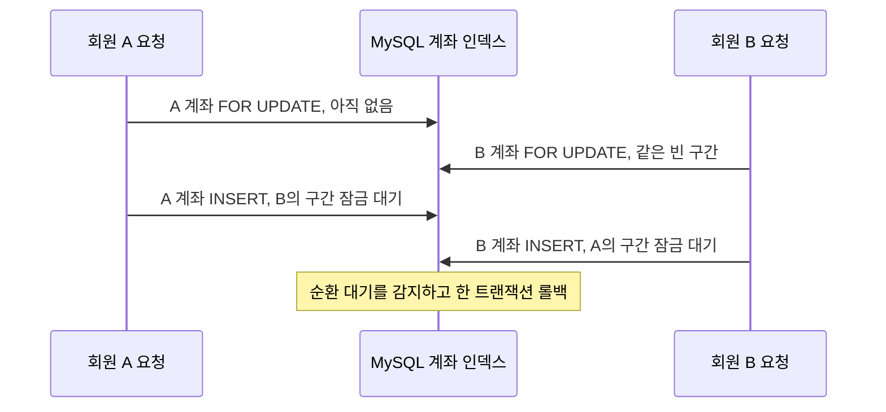

# 서로 다른 회원의 첫 요청이 동시에 500을 반환한 이유

모바일 부하테스트에서 초대코드 사용, 집 선택, 생성권 조회가 동시에 실패했다. 수정 전 사용자 API(`11085a40`)를 로컬 MySQL 8.4.11에 연결해 같은 오류를 재현했다. [QA 이슈 #500](https://github.com/TripleS-soma/rougether-server/issues/500)

## 어떤 요청이 충돌했나

생성권 조회는 첫 호출에서 잔액 0인 계좌를 만든다. 예를 들어 A와 B가 각각 자기 계좌를 처음 조회하면, 두 요청 모두 `SELECT ... FOR UPDATE`로 계좌가 있는지 먼저 확인했다. MySQL의 기본 격리 수준에서는 찾는 행이 없을 때 그 행이 들어갈 인덱스 구간을 잠글 수 있다. A와 B는 같은 빈 구간을 잠글 수 있었지만, 이어서 각자 행을 넣으려면 상대방이 먼저 잠금을 풀어야 했다. MySQL은 한 트랜잭션을 취소했고 그 요청이 HTTP 500으로 끝났다. [MySQL 8.4 인덱스 구간 잠금](https://dev.mysql.com/doc/refman/8.4/en/innodb-locking.html#innodb-gap-locks)

아래는 생성권 계좌에서 확보한 교착 기록을 두 회원의 요청으로 풀어 쓴 것이다.



수정 후에는 각 요청이 자기 회원 행을 잠그고 계좌를 먼저 생성한 다음, 존재하는 계좌 행을 잠근다. 같은 회원이 다시 요청하면 기존 계좌를 사용한다.

생성권의 마지막 교착 기록에는 두 트랜잭션이 모두 `furniture_credit_accounts.PRIMARY`에서 `locks gap before rec`를 보유하고 `insert intention waiting` 상태인 것이 남았다. API 예외에서도 아래 세 테이블의 INSERT가 MySQL 오류 1213으로 실패했다. InnoDB가 보관한 마지막 상세 잠금 기록은 생성권 사례에 해당한다.

| API | 서로 간섭한 첫 쓰기 | 수정 |
| --- | --- | --- |
| `POST /api/v1/invites/redeem` | 초대자·피초대자의 기존 보상 이력을 확인한 뒤 새 이력 저장 | 지급 트랜잭션에만 `READ COMMITTED`를 적용했다. 같은 회원이 포함된 요청은 기존처럼 회원 ID 순서로 행을 잠그고, 지급 한도와 중복 여부를 다시 확인한다. |
| `PUT /api/v1/onboarding/house` | 회원의 첫 집 선택 이력을 확인한 뒤 결과 저장 | 집 선택 쓰기 트랜잭션에 `READ COMMITTED`를 적용했다. 같은 집의 정원은 집 행 잠금으로, 같은 회원의 재요청은 회원 행 잠금으로 보호한다. |
| `GET /api/v1/me/furniture-credits` | 계좌가 없으면 조회 중 새 계좌 생성 | 회원 행을 잠근 뒤 INSERT를 먼저 시도한다. 기존 계좌일 때는 토큰, 잔액, 예약 수량을 보존한다. 결제와 가구 생성 작업이 같은 저장소 메서드를 사용한다. |

## 같은 조건으로 다시 보낸 결과

실험마다 새 DB에 같은 회원, 지갑, 개인집, 초대코드를 만들었다. API마다 독립적인 24명의 요청을 동시에 시작했고, 매번 새 회원으로 세 차례 반복했다. HTTP 재시도는 없었다. 이 실험의 분모는 각 API의 첫 요청 72건이다.

| 독립 사용자 첫 요청 | 수정 전 HTTP 500 | 수정 후 HTTP 500 |
| --- | ---: | ---: |
| 초대 보상 | 51 / 72 | 0 / 72 |
| 집 온보딩 | 37 / 72 | 0 / 72 |
| 생성권 조회 | 51 / 72 | 0 / 72 |
| **합계** | **139 / 216** | **0 / 216** |

수정 전 예외 로그에서 세 INSERT의 교착 수는 각각 51, 37, 51이었다. DB의 `information_schema.innodb_metrics.lock_deadlocks`도 139였다. 수정 후 216건 모두 HTTP 200을 받았고 DB 교착은 0건이었다.

별도로 한 회원의 요청을 API마다 24개씩 동시에 보냈다. 초대는 보상 1회와 `409 INVITE_ALREADY_REDEEMED` 23회, 집 선택은 같은 집과 멤버십 24회, 생성권 조회는 같은 계좌 토큰 24회였다. 독립 사용자까지 합쳐 DB에 양쪽 50코인 지급 73쌍, 지급 원장 146행, 잔액이 100에서 150이 된 지갑 146개, 올바른 집 선택 73건, 서로 다른 계좌 토큰 73개가 남았다.

새 DB에서 같은 검증을 한 번 더 수행하고 한 초대자의 코드를 신규 회원 12명이 동시에 사용하는 경우를 추가했다. 12명 모두 50코인을 받았고, 초대자는 한도인 10건에 대해서만 총 500코인을 받았다. 이 회차도 MySQL 교착은 0건이었다.

전체 Gradle 테스트에서는 2,899개가 통과했고 10개가 건너뛰었다. 실패와 오류는 0건이었다. 초대 보상 경합 2개, 집 선택 통합 18개, 출석 생성권 4개가 통과했으며 `git diff --check`도 통과했다.

## 업무 성공 TPS

11월 8일에 수정 전후 JAR를 같은 Docker VM(6 vCPU, 메모리 7.65 GiB)에서 순차 실행했다. API와 MySQL, 발생기가 이 자원을 공유한다. 각 업무에 24명씩 세 묶음을 보내고, 첫 묶음 발행 준비부터 마지막 응답까지의 경과 시간으로 나눴다. 응답에 성공한 회원 전체와 커밋된 결과의 회원 전체를 대조했다. 동일 회원의 재호출과 초대자 지급 한도 검사는 분모와 분자 모두에서 제외했다.

| 업무 | 수정 전 커밋 / 경과 시간 | 수정 후 커밋 / 경과 시간 | 성공 TPS 전 → 후 |
| --- | ---: | ---: | ---: |
| 초대 보상 지급 | 25건 / 4.482초 | 72건 / 4.470초 | 5.58 → 16.11 |
| 개인집 선택 저장 | 31건 / 3.158초 | 72건 / 3.957초 | 9.82 → 18.20 |
| 생성권 계좌 최초 생성 | 10건 / 1.408초 | 72건 / 1.628초 | 7.10 → 44.23 |

이번 회차의 독립 요청 216건에서 수정 전 150건이 실패했고, 수정 후에는 모두 성공했다. 이전 재현에서는 139건이 실패했다. 초대 보상의 경우 경과 시간은 두 회차 모두 약 4.5초였고, 같은 시간 동안 성공한 지급 건수가 늘었다. 이 수치는 최초 요청이 겹친 짧은 표본에서의 처리율이다. [회차별 측정값](measurement.json)

서비스 수준의 지속 처리율은 별도 AWS 실험에서 측정했다. 1,500 RPS 혼합 부하에 투두 완료를 20% 넣었고, 300.140초 동안 서로 다른 투두 90,000건이 실제로 완료돼 **299.86 TPS**였다. 사용자 API 한 대는 4 vCPU와 8 GiB, DB 한 대는 2 vCPU와 8 GiB였다. DB 감사에서 누락, 소유자 불일치, 보상 원장의 중복은 모두 0건이었다. [AWS 부하 조건과 결과](../../docs/performance/mentor-review.md)

## 재현

저장소 루트에서 아래 명령을 실행한다. Docker 안의 사용자 API와 MySQL만 사용한다. 재현 스크립트가 종료되면 해당 Compose 프로젝트를 정리한다. 수정 전 JAR를 비교할 때는 `QA500_JAR`에 절대 경로를 지정한다. 실패한 버전은 HTTP 상태 분포와 DB 결과를 출력하고 종료 코드 1을 반환한다.

```sh
./gradlew :user-api:bootJar
bash qa/first-write/run.sh
```
