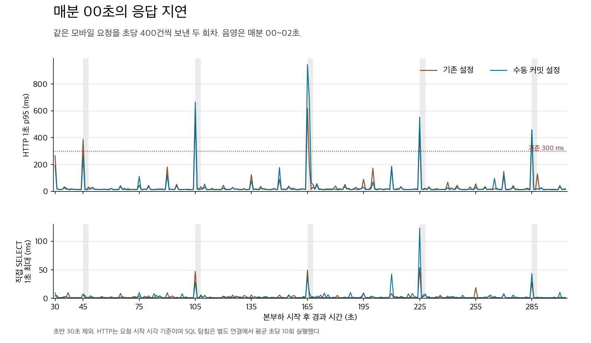
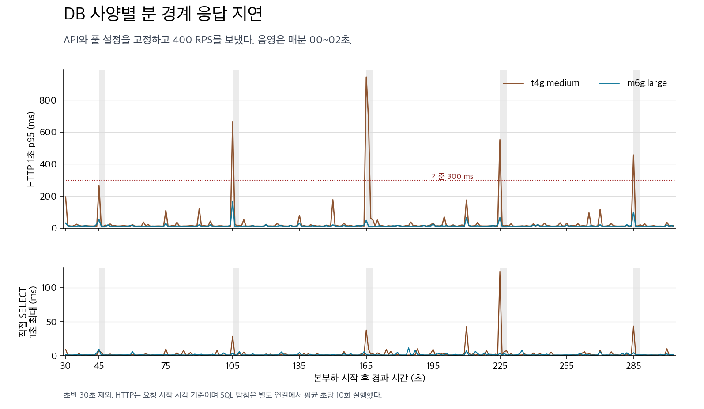

# 사용자 API의 분 경계 지연

사용자 API가 커넥션을 빌릴 때마다 보내던 자동 커밋 상태 전환과 복원을 줄였다. 풀의 기본값을 수동 커밋으로 바꾸고 Hibernate에도 같은 사실을 알려서, 실제 업무의 COMMIT과 ROLLBACK만 유지한다. 개발 배포의 mysql 프로필과 prod 프로필 양쪽에 적용한다.

## RDS에서 어떤 부분이 줄었나

11월 3일 격리 RDS MySQL db.t4g.medium, API 1대(2 vCPU, 4 GiB), 풀 10개에서 동일 API 이미지로 설정만 바꿨다. 내 정보 40%, 오늘 할 일 40%, 투두 완료 20%로 각 180초 동안 400 RPS를 시도했다. 기존 설정과 변경 설정은 순서대로 한 회씩 실행했다.

| 측정 | 기존 설정 | 변경 설정 |
| --- | ---: | ---: |
| 자동 커밋 복구 SET | 72,525건 | 0건 |
| 전체 HTTP p99 | 462.8ms | 66.7ms |
| 미발행 / DB 감사 | 85건 / 기대 완료 수 미달 | 0건 / 통과 |
| 분 경계에서 API별 1초 p95 중 최대 | 248.2ms | 258.8ms |
| 분 경계에서 API별 1초 p99 중 최대 | 296.8ms | 320.5ms |

자동 커밋 복구 호출은 없어졌다. 분 경계에서의 HTTP 최고 지연은 이 비교에서 개선되지 않았다. 변경 설정에서도 별도 탐침의 COMMIT이 87.4ms 걸린 표본이 있었다. 11월 8일에는 현재 코드와 실제 모바일 요청 분포로 이 변경을 다시 검증했다.

## 다른 부하에서는 목표를 충족했나

API가 30초 동안 기동 부하를 처리한 뒤, **온전히 관측된 매분 [00초, 03초)**를 사용했다. 표는 세 API와 세 1초 표본의 p95 및 p99 중 가장 큰 값이다. 각 요청을 합쳐 구한 3초 분위수와 다르다.

| 격리 RDS m6g.large | 분 경계 | 각 경계 내 p95 최댓값 중 가장 큰 값 | p99 기준 같은 값 |
| --- | ---: | ---: | ---: |
| 11월 5일, 1,000 RPS, 풀 20 | 5회 | 191.1ms | 235.1ms |
| 11월 7일, 1,500 RPS, 풀 40, 내 정보 조회 변경 이미지 | 4회 | 231.1ms | 275.6ms |

이 아홉 경계에서 p95는 모두 300ms 안에 들어왔다. API 이미지와 풀 크기, 부하 조건이 달라 DB 사양 단독의 개선량을 계산할 수 없다. 매시 정각 집 목록 1,000 RPS 실험은 이 두 회차에 포함되지 않는다. [집 목록 QA #501](https://github.com/TripleS-soma/rougether-server/issues/501)

[회차별 분 경계와 원본 해시](results.json). 동일한 세 API 부하의 원본 diagnostics.json과 summary.json을 보관한 디렉터리를 지정하면 다시 집계할 수 있다.

```sh
python3 qa/minute-boundary/summarize.py RUN_DIRECTORY
```

## 11월 8일 모바일 400 RPS에서 분 경계 지연이 해결됐나

**수정 후에도 다섯 분 경계 중 네 번에서 1초 p95가 300ms를 넘었다.** 같은 분의 30~32초 대조 구간에서는 두 회차 모두 이 기준을 넘지 않았다.

격리된 같은 RDS 인스턴스(db.t4g.medium)와 같은 사용자 API JAR를 사용했다. Fargate API는 1대, 4 vCPU, 8 GiB, Hikari 풀 40개였고, 발생기는 별도 Fargate 태스크였다. 기준 회차는 기존 auto-commit 설정을 주입했고 수정 회차는 JAR의 mysql 프로필을 사용했다. 회차별로 별도의 빈 스키마에 같은 합성 데이터를 준비했다. 각 회차를 200 RPS로 35,838건 예열하고, 매분 경계와 요청 순서를 맞추기 위해 각각 03:22:15와 03:42:15 KST부터 같은 시드로 76종의 요청을 재생했다.

| 지표 | 기존 설정 | 수동 커밋 설정 |
| --- | ---: | ---: |
| 발행 / 미발행 / HTTP 5xx | 121,632 / 0 / 0 | 121,632 / 0 / 0 |
| 실제 RPS | 399.99 | 399.99 |
| 전체 HTTP p95 / p99 | 25.9 / 245.6ms | 21.9 / 298.8ms |
| 분 경계 p95 > 300ms | 5/5회 | 4/5회 |
| 분 경계 1초 p95 중 최댓값 | 619.5ms | 944.3ms |
| 분 경계 1초 p99 중 최댓값 | 842.0ms | 1,455.3ms |
| 분 경계에서 500ms 이상 걸린 요청 / 총 요청 | 126 / 6,000 | 518 / 6,000 |
| MySQL 전역 `Com_set_option` 증가량 | 469,282 | 221,610 |
| MySQL 전역 `Com_commit` 증가량 | 118,573 | 118,568 |

76종의 경로별 HTTP 상태 건수가 두 회차에서 모두 일치했다. 75ms 넘게 늦게 발행한 요청과 발행 마감 뒤 보낸 요청은 모두 0건이었다. 첫 30초 이후 1초 p95가 300ms를 넘긴 초는 기준 회차에서 모두 00초였다. 수정 회차에서는 00초 네 번과 01초 한 번이었다. `Com_set_option`은 이 DB 전체의 SET 계열 명령을 세며 복구 SET만의 수치는 아니다.



별도 연결에서 약 100ms 간격으로 `SELECT 1, UNIX_TIMESTAMP(NOW(6))`를 실행했다. 수정 회차에서 이 요청의 클라이언트 왕복 p99는 분 경계에서 88.4ms(150표본), 나머지 초에서 4.0ms(2,577표본)였다. SQL 탐침에는 앱의 커넥션 풀이나 인증 필터가 없다. API가 가장 느렸던 03:45 경계에서 탐침 최대는 37.9ms였고, 탐침이 가장 느렸던 03:46 경계에서는 123.3ms였다. 두 지연의 최대 발생 분도 달라서 탐침 시간을 API 응답 시간의 원인으로 그대로 대입할 수 없다.

수동 커밋은 SET 계열 명령을 52.8% 줄였다. 이 모바일 부하에서 분 경계 지연 개선은 확인되지 않았다. 두 회차를 서로 다른 시각에 한 번씩 측정했고 RDS의 1초 OS 지표는 비활성 상태였다. 이 결과만으로 호스트의 CPU 배정 대기나 MySQL 내부 대기를 구분할 수 없다. 매시 정각은 두 측정에서 제외했다.

[분별 표본과 회차별 집계](mobile-400-rps.json) · [전체 1초 수치](mobile-400-rps-seconds.csv)

## 같은 수동 커밋 설정에서 DB 사양을 바꾸면

**m6g.large에서는 다섯 분 경계 모두 1초 p95가 300ms 이내였다.** 직전 t4g.medium 수동 커밋 회차의 요청 순서를 재사용해 m6g.large에서 한 번 측정했다. 두 회차 모두 본부하의 미발행, 75ms 초과 발행 지연, HTTP 5xx가 0건이었고, 76개 경로의 HTTP 상태별 건수가 같았다.

| 수동 커밋 설정, 모바일 400 RPS | t4g.medium | m6g.large |
| --- | ---: | ---: |
| 실제 RPS / 발행 건수 | 399.99 / 121,632 | 399.99 / 121,632 |
| 전체 HTTP p95 / p99 | 21.9 / 298.8ms | 13.4 / 36.1ms |
| p95 300ms를 초과한 분 경계 | 4/5 | 0/5 |
| 분 경계에서 가장 높은 1초 p95 / p99 | 944.3 / 1,455.3ms | 165.3 / 214.9ms |
| 분 경계에서 500ms 이상 걸린 요청 (6,000건 중) | 518건 | 0건 |
| 분 경계 직접 SELECT 왕복 p99 / 최대 (각 150표본) | 88.4 / 123.3ms | 8.5 / 9.8ms |
| DB 전역 SET 계열 명령 증가량 | 221,610 | 221,610 |

m6g.large에서 04:17부터 04:21 KST까지 각 분의 00~02초에 기록한 1초 p95 중 최댓값은 차례로 **53.6, 165.3, 48.6, 66.1, 100.5ms**였다. 별도로 본 30~32초 대조 구간 네 곳의 최댓값은 30.8ms였다. 분 경계의 작은 상승은 남았지만 기준을 초과하지 않았다.



JAR와 런타임 이미지, MySQL 8.4.11, gp3 3,000 IOPS / 125 MiB/s, 풀 40개, 예열 35,838건을 유지했다. 실제 부하를 받은 API와 요청을 발행한 태스크는 두 회차 모두 서울 2a, DB는 2b에 배치했다. 새 회차에서 처음 생성된 2b 태스크는 본부하를 발행하지 않았다. 두 회차는 약 34분 간격으로 시작했다. DB 클래스 전환에는 메모리 용량, 호스트, 재기동에 따른 캐시 상태 변화가 포함되므로 지연 차이를 CPU 배정 하나에 귀속할 수 없다. 이번 판정은 400 RPS에서 관측한 다섯 분 경계에 해당한다. 매시 정각이나 다른 부하의 통과 여부는 별도로 판단해야 한다.

**원복**은 05:15 KST까지 완료됐다. 테스트 RDS는 원래 t4g.medium, available, 변경 대기 0건이었다. 원래 ECS 태스크 정의와 서브넷, API 1대, ALB healthy를 확인했고, 실험 태스크와 임시 스키마, S3 객체, ECR 태그를 정리했다. 개발 환경의 DB 사양은 변경하지 않았다.

[분별 수치와 실행 원본 해시](db-class-400-rps.json) · [두 회차의 1초 집계](db-class-400-rps-seconds.csv)
